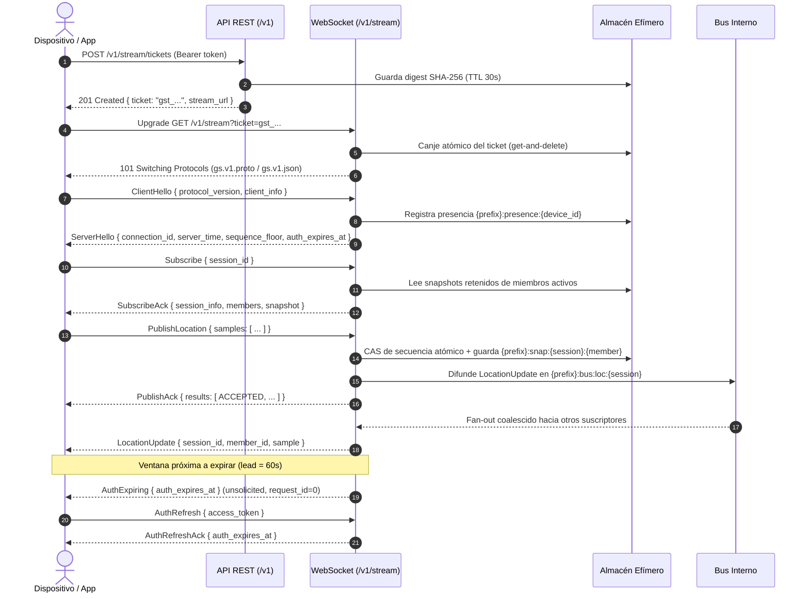

# GeoStream

**Infraestructura de ubicación en tiempo real, privada por defecto, multi-inquilino y de alto rendimiento para integrar en aplicaciones móviles y sistemas backend.**

> **Estado actual:** **Fase F4 — Stream en nodo único (Hito M1)** en desarrollo activo.
> Fases F0, F1, F2 y F3 completadas; Fase F4 con 10 tareas completadas (tickets, conexión WS, AuthzCache, suscripción gap-free, publicación CAS, fan-out coalescido, control y revocación en vivo, presencia con gracia de desconexión, renovación AuthExpiring/AuthRefresh, y snapshot REST).
> Suite integral de 421 pruebas automatizadas verdes sin advertencias.
> Repositorio gobernado por documentación ([`AGENTS.md`](AGENTS.md), [`docs/00_INDEX.md`](docs/00_INDEX.md)).

---

## 🧭 ¿Qué es GeoStream?

GeoStream es una plataforma especializada en streaming bidireccional y gestión de ubicación en tiempo real entre múltiples participantes organizados en sesiones dinámicas (1-a-1, 1-a-N y N-a-N). Diseñada para integrarse como infraestructura subyacente en productos existentes, ofrece APIs REST de control, protocolos de streaming de ultra baja latencia sobre WebSockets, y un SDK Flutter multiplataforma (previsto para Fase F5).

### Características Clave

- 🛡️ **Privacidad por defecto (`INV-SHR-1`):** La compartición de ubicación está siempre desactivada al unirse a una sesión; solo el propio usuario/dispositivo puede encenderla.
- 🔒 **Redacción estricta (`NFR-SEC-003`):** Coordenadas, tokens, tickets y secretos jamás se escriben en logs, métricas, trazas o mensajes de error (`docs/10_SECURITY_PRIVACY.md` §8.2).
- 🏢 **Multi-inquilino estricto (`INV-TEN-1`):** Aislamiento de datos garantizado por diseño; cada consulta, mutación y clave efímera filtra forzosamente por `tenant_id`.
- ⚡ **Stream en tiempo real:** WebSockets de alto rendimiento con negociación de subprotocolos binario (`gs.v1.proto`, Protobuf) y texto (`gs.v1.json`, JSON canónico proto3).
- 🔄 **Orden y deduplicación atómica:** Validación espacial y temporal estricta (16 reglas sin estado), comparación y reemplazo atómico (CAS) de secuencias, y cálculo dinámico de `sequence_floor`.
- 📡 **Distribución eficiente (Fan-out):** Tarea lectora/escritora desacoplada, bus interno con coalescencia de muestras por miembro y cola de control acotada con contrapresión.
- 🚫 **Revocación en vivo (`FR-STR-008`):** Despacho instantáneo de eventos `SubscriptionEnded` ante expulsión o degradación de permisos, y desconexión inmediata (códigos de cierre 4401 / 4403) ante revocación de credenciales o inhabilitación de cuentas.
- 🎟️ **Tickets de un solo uso (`gst_...`):** Autenticación de WebSocket desacoplada de tokens de larga duración, con canje atómico y TTL acotado.
- 📊 **Observabilidad integrada:** Métricas Prometheus tipadas sin etiquetas de alta cardinalidad, logs JSON estructurados y sondas de salud (`/health/live`, `/health/ready`).
- 🦀 **Rust puro y seguro:** 100% Rust moderno (edición 2024, toolchain 1.99.0) con `#![forbid(unsafe_code)]` en todos los componentes del servidor.

### Qué NO es GeoStream
GeoStream no es un proveedor de teselas ni mapas base, no es un navegador GPS paso a paso (turn-by-turn), ni es una plataforma de despacho logístico. Es la capa de transporte, autorización y sincronización espacial en tiempo real sobre la cual se construyen dichas aplicaciones.

---

## 🏗️ Arquitectura del Espacio de Trabajo

El proyecto está organizado como un espacio de trabajo Cargo modular, cohesionado y desacoplado, siguiendo la arquitectura de capas de [`docs/04_ARCHITECTURE.md`](docs/04_ARCHITECTURE.md):

| Crate / Aplicación | Ruta | Responsabilidad |
|---|---|---|
| **`geostream`** | [`apps/geostream`](apps/geostream) | Binario unificado del servidor (`serve`, `migrate`, `admin`, `version`). |
| **`gs-domain`** | [`crates/gs-domain`](crates/gs-domain) | Entidades puras de dominio sin I/O, máquinas de estados, tipos tipados, validación pura de 16 reglas espaciotemporales, y catálogo unificado de errores (`ErrorCode`). |
| **`gs-protocol`** | [`crates/gs-protocol`](crates/gs-protocol) | Generación de código y tipos Rust a partir de los contratos Protobuf v1 (`contracts/proto/v1/`). |
| **`gs-config`** | [`crates/gs-config`](crates/gs-config) | Carga y validación estricta de variables de entorno (`GS_*`) y archivos TOML, con tipos secretos redactados y políticas de inquilino. |
| **`gs-observability`** | [`crates/gs-observability`](crates/gs-observability) | Formateador de logs estructurados JSON con redacción de datos sensibles, catálogo tipado de métricas Prometheus y verificador de captura de logs. |
| **`gs-store`** | [`crates/gs-store`](crates/gs-store) | Persistencia relacional en PostgreSQL (sqlx), migraciones embebidas, repositorios aislados por `tenant_id` y restricciones de integridad. |
| **`gs-ephemeral`** | [`crates/gs-ephemeral`](crates/gs-ephemeral) | Almacén de estado efímero (memoria local para F4, Redis/Valkey para F6): snapshots de ubicación, presencia, tickets de stream y contadores de tasa. |
| **`gs-bus`** | [`crates/gs-bus`](crates/gs-bus) | Bus de eventos y mensajes en memoria con canales de difusión (`broadcast`) y recuento de referencias por tema. |
| **`gs-auth`** | [`crates/gs-auth`](crates/gs-auth) | Verificación criptográfica de API keys (SHA-256 en tiempo constante), JWT Ed25519 (EdDSA), cifrado en reposo AES-256-GCM y emisión de tickets de un solo uso. |
| **`gs-service`** | [`crates/gs-service`](crates/gs-service) | Casos de uso de negocio: administración, autenticación, sesiones, membresías, invitaciones, publicación, suscripción y eventos de control. |
| **`gs-api`** | [`crates/gs-api`](crates/gs-api) | Servidor HTTP REST (Axum) conforme a OpenAPI 3.1, middleware de correlación, rate limiting, Problem Details (RFC 7807/9457) y upgrade a WebSocket. |
| **`gs-stream`** | [`crates/gs-stream`](crates/gs-stream) | Servidor WebSocket de tiempo real: máquina de estados, negociación de subprotocolos, codecs, colas acotadas, token bucket y distribución fan-out. |
| **`gs-worker`** | [`crates/gs-worker`](crates/gs-worker) | Tareas en segundo plano (limpieza de expiraciones, webhooks en F8, retención de datos en F10). |
| **`gs-testkit`** | [`crates/gs-testkit`](crates/gs-testkit) | Utilidades de pruebas de integración con contenedores (`testcontainers` para PostgreSQL y Valkey). |
| **`geostream-tools`** | [`tools`](tools) | Herramienta CLI de verificación interna: consistencia de contratos, dependencias, catálogo de errores, trazabilidad de requisitos y enlaces. |

---

## 🚦 Estado de las Fases del Roadmap

El plan de trabajo avanza conforme a [`docs/21_ROADMAP.md`](docs/21_ROADMAP.md):

| Fase | Hito | Estado | Logros Principales |
|---|---|---|---|
| **F0** | Fundaciones | **Completada** | Repositorio, contratos Proto/OpenAPI, herramientas, integración continua (CI) y entorno dev. |
| **F1** | Núcleo de dominio | **Completada** | Modelos puros, invariantes de negocio, CAS, property testing (>90% cobertura en `gs-domain`). |
| **F2** | Base de plataforma | **Completada** | PostgreSQL con migraciones, tokens JWT Ed25519, API keys, observabilidad JSON, CLI admin. |
| **F3** | Plano de control REST | **Completada** | CRUD completo de sesiones, miembros, invitaciones Base32, compartición, conformidad OpenAPI. |
| **F4** | Stream en nodo único | **En curso (M1)** | Handshake WS, tickets de un solo uso, caché authz con bus, suscripción sin huecos con snapshot, publicación CAS deduplicada, fan-out coalescido, control y revocación en vivo, presencia con gracia de desconexión, conexión única (`Supersede`), renovación de auth (`AuthExpiring`/`AuthRefresh`) y snapshot REST. |
| **F5** | SDK Flutter (M2) | Pendiente | Cliente Flutter en Dart, gestión de ubicación en segundo plano, reconexión y cola offline. |
| **F6–F12** | Escalamiento y Ecosistema | Pendiente | Redis/Valkey multinodo, geocercas, webhooks, adaptadores de mapas (MapLibre/Google Maps) y auditoría. |

---

## 🔄 Ciclo de Vida del Protocolo de Streaming (WebSockets)

GeoStream implementa un protocolo de streaming bidireccional sobre WebSockets (`docs/08_STREAM_PROTOCOL.md`) diseñado para garantizar entrega oportuna, baja latencia, privacidad por diseño y contrapresión eficiente:



---

## 📍 API REST de Snapshots de Ubicación (`GET /v1/sessions/{id}/snapshot`)

Permite a aplicaciones backend autorizadas (scope `locations:read`) y a dispositivos participantes activos (capacidad `read`) consultar el último estado espacial retenido de todos los miembros de una sesión sin mantener abierta una conexión WebSocket permanente:

- **Privacidad estricta (`INV-SHR-1`):** Miembros con compartición desactivada (`sharing=false`) nunca aparecen en la respuesta.
- **Retención configurable:** Si la sesión se configuró con `snapshot_ttl_seconds = 0`, la respuesta devuelve inmediatamente una lista vacía de items (`[]`).
- **Frescura garantizada:** Cada elemento incluye `age_ms = generated_at - captured_at` en milisegundos para evaluar la actualidad de la muestra.
- **Redacción total (`NFR-SEC-003`):** Coordenadas y muestras son omitidas de todos los logs, métricas y mensajes de error.

Ejemplo de respuesta (`200 OK`, cabecera `Cache-Control: no-store`):

```json
{
  "session_id": "ses_0192b6c0a1e47c3f9d2a7b5e8f1c0d3a",
  "generated_at": "2026-10-15T00:00:05.123Z",
  "items": [
    {
      "member_id": "mem_0192b6c0a1e47c3f9d2a7b5e8f1c0d3b",
      "external_subject_id": "courier-123",
      "received_at": "2026-10-15T00:00:01.456Z",
      "age_ms": 4123,
      "sample": {
        "sequence": 105,
        "captured_at": "2026-10-15T00:00:01.000Z",
        "position": {
          "latitude": -12.0464,
          "longitude": -77.0428,
          "horizontal_accuracy_m": 5.0,
          "altitude_m": 120.5,
          "speed_mps": 3.2,
          "heading_deg": 180.0
        },
        "quality": {
          "source": "GNSS",
          "kind": "MEASURED",
          "motion": "AUTOMOTIVE"
        }
      }
    }
  ]
}
```

---

## 🚀 Inicio Rápido y Desarrollo Local

### Requisitos Previos

- **Rust:** Versión 1.99.0 fijada en [`rust-toolchain.toml`](rust-toolchain.toml) (edición 2024).
- **Docker & Docker Compose:** Para ejecutar PostgreSQL y Valkey en desarrollo.
- **Node.js (opcional):** Para validación de OpenAPI con `@redocly/cli`.

### 1. Configurar Entorno

Clona el repositorio y copia la configuración de ejemplo:

```bash
cp deploy/.env.example .env
```

### 2. Levantar Servicios Auxiliares

Inicia las instancias locales de PostgreSQL 16 y Valkey 7.2:

```bash
docker compose -f deploy/docker-compose.dev.yml up -d
```

### 3. Ejecutar Migraciones de Base de Datos

Aplica las migraciones idempotentes de PostgreSQL embebidas en el binario:

```bash
cargo run -p geostream -- migrate
```

Para verificar sin aplicar cambios:
```bash
cargo run -p geostream -- migrate --dry-run
```

### 4. Iniciar el Servidor GeoStream

Arranca el servidor en modo desarrollo (expone el API REST y el listener de administración):

```bash
cargo run -p geostream -- serve
```

Endpoints disponibles por defecto:
- **API REST y WebSocket Stream:** `http://127.0.0.1:8080/v1`
- **Sondas de salud:** `http://127.0.0.1:8080/health/live`, `http://127.0.0.1:8080/health/ready`
- **Métricas Prometheus:** `http://127.0.0.1:9090/metrics` (listener administrativo)

### 5. Uso de la CLI de Administración

El binario incluye comandos administrativos para gestionar entidades maestras:

```bash
# Crear un nuevo inquilino (tenant)
cargo run -p geostream -- admin tenant create --name "Acme Corp"

# Crear una aplicación
cargo run -p geostream -- admin app create --tenant <TENANT_ID> --name "Logistics App"

# Generar una API Key
cargo run -p geostream -- admin key create --tenant <TENANT_ID> --app <APP_ID> --name "Backend Key" --scopes "sessions:write,members:write,stream:connect"

# Generar pares de claves Ed25519 para tokens
cargo run -p geostream -- admin signing-key generate --dir ./keys --kid "key-2026-10"
```

---

## 🧪 Pruebas y Control de Calidad

El proyecto exige el cumplimiento estricto de la **Definition of Done** ([`docs/19_ENGINEERING_STANDARDS.md`](docs/19_ENGINEERING_STANDARDS.md) §1) antes de considerar terminada cualquier tarea:

```bash
# 1. Comprobar formato de código
cargo fmt --all -- --check

# 2. Análisis estático y linter sin advertencias
cargo clippy --workspace --all-targets --all-features -- -D warnings

# 3. Ejecutar toda la suite de pruebas del workspace (421 pruebas)
cargo test --workspace

# 4. Auditoría de dependencias, licencias y avisos de seguridad
cargo deny check

# 5. Comprobación exhaustiva de consistencia de contratos, documentación y enlaces
cargo run -p geostream-tools -- all
```

### Validación de Contratos

```bash
# Linting de esquemas Protobuf
(cd contracts/proto && buf lint)

# Linting de contrato OpenAPI 3.1
npx @redocly/cli lint contracts/openapi/geostream.v1.yaml --config contracts/openapi/redocly.yaml
```

---

## 📚 Mapa de Documentación Normativa

El repositorio está **gobernado por la documentación**: las especificaciones mandan, el código cumple.

```text
AGENTS.md                         Reglas obligatorias para desarrolladores y agentes de código
docs/
  ├── 00_INDEX.md                 Gobierno, precedencia y convenciones generales
  ├── 01_VISION_SCOPE.md          Visión del producto, principios y límites del sistema
  ├── 02_GLOSSARY.md              Glosario canónico de términos del dominio
  ├── 03_REQUIREMENTS.md          Catálogo de requisitos funcionales (FR) y no funcionales (NFR)
  ├── 04_ARCHITECTURE.md          Arquitectura de componentes, capas y flujos de concurrencia
  ├── 05_DOMAIN_MODEL.md          Modelo de dominio: sesiones, miembros, invitaciones, presencia
  ├── 06_IDENTITY_AUTH.md         Modelo de identidad, JWTs, API keys, tickets y autorización
  ├── 07_REST_API.md              Diseño del API REST, paginación, rate limit e idempotencia
  ├── 08_STREAM_PROTOCOL.md       Protocolo de streaming WebSocket, subprotocolos y mensajes
  ├── 09_VALIDATION_ERRORS.md     Reglas de validación espaciotemporal y catálogo de errores
  ├── 10_SECURITY_PRIVACY.md      Modelo de amenazas, redacción de secretos y cifrado
  ├── 11_DATA_STORAGE.md          Esquema PostgreSQL, almacén efímero y retención
  ├── 12_FLUTTER_SDK.md           Especificación del SDK para Flutter / Dart
  ├── 13_MAP_ADAPTERS.md          Adaptadores de mapas (MapLibre, Google Maps)
  ├── 14_GEOFENCING.md            Motor y evaluación de geocercas
  ├── 15_INTEGRATION_GUIDE.md     Guía práctica para desarrolladores e integradores backend
  ├── 16_OPERATIONS.md            Operación, métricas Prometheus, logs estructurados y CLI
  ├── 17_CONFIGURATION.md        Variables de entorno, configuración del servidor y políticas
  ├── 18_TESTING_QA.md            Estrategia de pruebas, vectores de prueba y QA
  ├── 19_ENGINEERING_STANDARDS.md Estándares de ingeniería y Definition of Done
  ├── 20_AGENT_PROTOCOL.md        Protocolo de trabajo estructurado para agentes de código
  ├── 21_ROADMAP.md               Hoja de ruta por fases y tareas
  ├── TRACEABILITY.md             Matriz de trazabilidad (Requisitos → Pruebas → Estado)
  └── PROGRESS.md                 Bitácora cronológica de avance y decisiones
contracts/                        Contratos formales (Protobuf, OpenAPI, vectores JSON)
```

---

## 📄 Licencia

Pendiente de decisión formal ([`docs/adr/ADR-0019-license.md`](docs/adr/ADR-0019-license.md)). Hasta su resolución, todos los derechos están reservados por el propietario.
