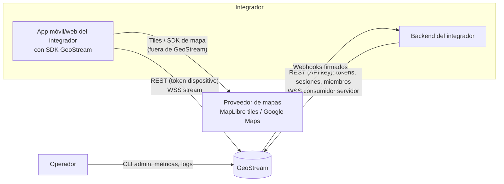
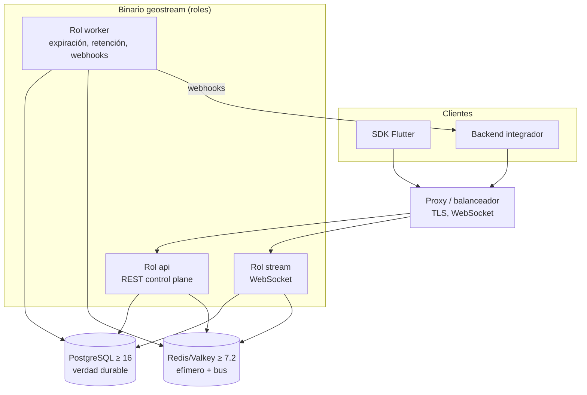
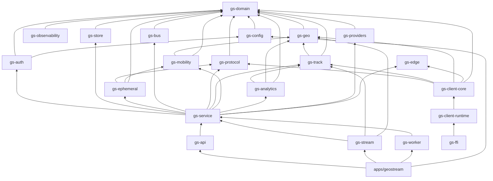
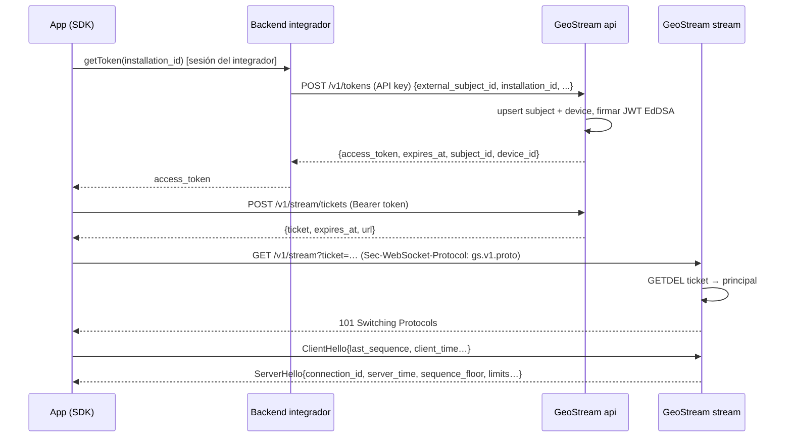
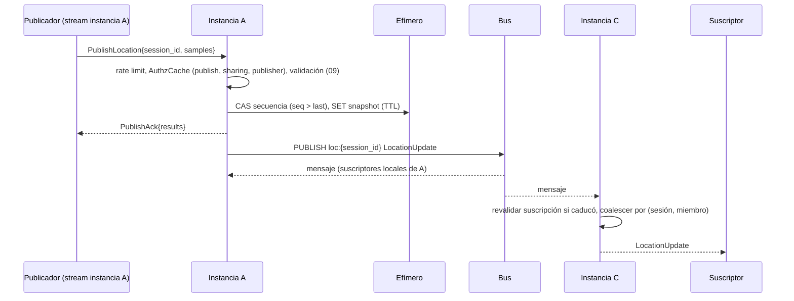
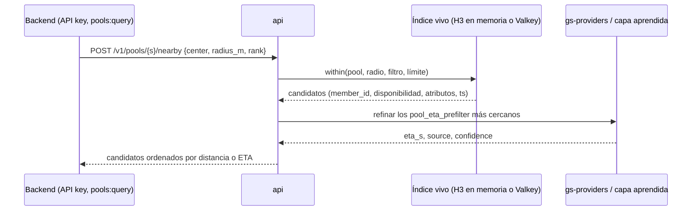
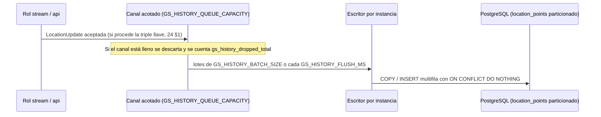
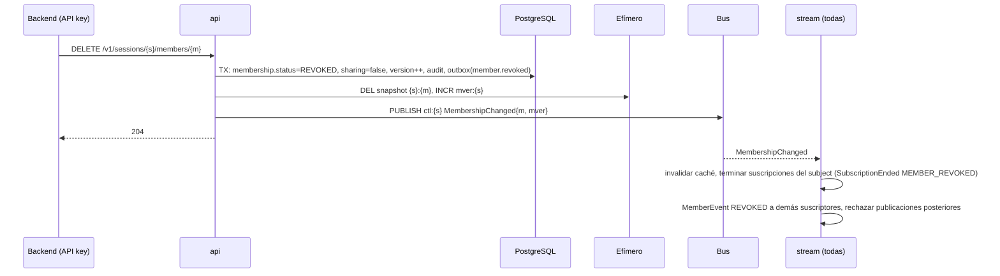

# 04 — Documento de diseño de arquitectura (SAD)

**ID:** GS-ARC-001 · **Versión:** 0.2.0

## 1. Contexto del sistema (C4 nivel 1)



Reglas del contexto:

- El SDK **nunca** recibe una API key. El backend del integrador obtiene tokens de dispositivo y los entrega a su app (`06_IDENTITY_AUTH.md`).
- Los proveedores de mapas están fuera de GeoStream; el servidor no los llama en v1.

## 2. Contenedores (C4 nivel 2)



| Contenedor | Responsabilidad | Estado |
|---|---|---|
| Rol `api` | Autenticación de peticiones REST, casos de uso del plano de control, emisión de tokens y tickets, consultas de movilidad e historial, auditoría, outbox | Sin estado propio |
| Rol `stream` | Conexiones WebSocket, handshake, suscripciones, validación y aceptación de ubicaciones, estimación de trayectoria, geocercas, fan-out, presencia, backpressure | Estado de conexión y de trayectoria en memoria; verdad en PG/efímero |
| Rol `worker` | Expiración de sesiones, jobs de retención, entrega de webhooks, mantenimiento de particiones de historial | Sin estado propio |
| Rol `analytics` (opcional) | Trabajos pesados por lotes: cierre de viajes, agregados H3, capa aprendida, map-matching, matrices OD | Sin estado propio |
| PostgreSQL | Tenants, aplicaciones, keys, subjects, dispositivos, sesiones, membresías, invitaciones, auditoría, idempotencia, webhooks, outbox, geocercas, historial de puntos y viajes, tags, reportes Beacon opacos | Durable |
| Redis/Valkey | Snapshots, secuencias, presencia, tickets, versiones de membresía, épocas de subject, rate limits, bus Pub/Sub, estado del filtro de trayectoria, odómetro y paradas, índice espacial vivo de pools | Efímero, **sin persistencia en disco** |

Con `GS_STATE_BACKEND=memory` no hay Redis/Valkey: el almacén efímero y el bus viven en memoria y **solo puede ejecutarse una instancia** (desarrollo, pruebas, instalaciones pequeñas).

## 3. Planos

### 3.1 Plano de control (REST)
Todo lo que cambia autorización o configuración pasa por REST: sesiones, membresías, invitaciones, compartición, tokens, revocaciones, webhooks, geocercas. Cada mutación: transacción PostgreSQL → (si afecta a sesiones) incremento de versión de membresía y evento de control al bus → outbox de webhook en la misma transacción.

### 3.2 Plano de datos (stream)
WebSocket con Protobuf (binario) o su mapeo JSON. Transporta ubicaciones (best-effort, latest-state) y eventos de control (confiables dentro de la conexión). Ver `08_STREAM_PROTOCOL.md`.

### 3.3 Plano de distribución
Bus con temas por sesión. Una sola ruta de entrega: **toda** `LocationUpdate` aceptada se publica al bus y cada instancia la entrega a sus suscriptores locales, incluida la propia instancia que la aceptó. Esto elimina rutas duplicadas y comportamientos distintos entre uno y varios nodos.

### 3.4 Plano efímero
Snapshots, secuencias, presencia, tickets y versiones con TTL. Pérdida total tolerada: se recupera sola (los clientes reconectan; las secuencias del SDK siguen creciendo; los snapshots se repueblan).

### 3.5 Plano del motor

El kernel geoespacial (`gs-geo`) es la base determinista de todo lo demás, sin I/O ni estado global. Sobre él:

- **Camino caliente (rol `stream`):** puerta de plausibilidad, filtro de Kalman CV, anti-deriva en reposo, odómetro y paradas (`gs-track`), y evaluación de geocercas con índice R-tree en memoria cargado desde PostgreSQL. Su fallo nunca bloquea la distribución.
- **Consulta (roles `api`):** índice espacial vivo de pools (`gs-mobility`), ETA, asignación por lotes y Provider Gateway.
- **Lotes (rol `analytics` o `worker`):** historial, cierre de viajes, agregados H3, capa aprendida y map-matching (`gs-analytics`). Nunca en el camino de aceptación.
- **Dispositivo:** `gs-client-core` ejecuta muestreo adaptativo, publicación por cambio significativo, predicción visual y cola sin conexión; comparte `gs-geo`, `gs-track` y `gs-edge` con el servidor (`26` §1).

### 3.6 Plano de mapas y proveedores

`geostream_maps` (interfaces) y `geostream_maps_*` (adaptadores) siguen siendo **cliente**. El servidor añade un plano opcional y desactivado por defecto: el **Provider Gateway** (`gs-providers`, ADR-0028), que solo llama a proveedores para tenants que configuraron sus propias credenciales (BYOK), con manifiestos declarativos, `ContentPolicy` y aislamiento total respecto al stream y a la aceptación.

### 3.7 Plano de privacidad
Transversal: compartir apagado por defecto, consentimiento del subject con propósito (`HISTORY`, `ANALYTICS`), capacidades por acción, snapshot efímero, borrado inmediato, k-anonimato en agregados, redacción en logs, auditoría sin coordenadas y E2E para tags Beacon. Ver `10_SECURITY_PRIVACY.md`.

## 4. Estructura del repositorio objetivo

```text
geostream/
├── AGENTS.md  README.md  CHANGELOG.md  CONTRIBUTING.md  SECURITY.md
├── Cargo.toml                 # workspace
├── rust-toolchain.toml        # toolchain fijada (F0)
├── deny.toml                  # cargo-deny (F0)
├── apps/
│   ├── geostream/             # binario: serve | migrate | admin | version
│   ├── gs-devclient/          # CLI de desarrollo: conectar, suscribir, publicar trayectos sintéticos
│   └── gs-loadgen/            # generador de carga (perfiles P-S, P-M, P-L)
├── crates/
│   ├── gs-domain/             # tipos, IDs, validación, máquinas de estado, reglas puras. Sin I/O, sin tokio
│   ├── gs-protocol/           # código generado (prost + pbjson), codec de tramas, conversión dominio↔wire
│   ├── gs-config/             # carga y validación de configuración y políticas
│   ├── gs-auth/               # API keys, JWT EdDSA, tickets, scopes, extracción de principal
│   ├── gs-store/              # PostgreSQL (sqlx): repositorios, transacciones, outbox, auditoría, idempotencia
│   ├── gs-ephemeral/          # trait EphemeralStore + impl memoria + impl Redis/Valkey + ValkeyGeoIndex
│   ├── gs-bus/                # trait Bus + impl memoria + impl Redis/Valkey Pub/Sub
│   ├── gs-service/            # casos de uso: sesiones, membresías, pools, compartición, tokens, AuthzCache
│   ├── gs-api/                # router Axum REST, middlewares, Problem Details
│   ├── gs-stream/             # WebSocket: conexión, handshake, suscripciones, publicación, fan-out local
│   ├── gs-worker/             # jobs: expiración, retención, entrega de webhooks, particiones
│   ├── gs-geo/                # kernel geoespacial: geodesia, ENU, polilíneas, R-tree, H3 (E1)
│   ├── gs-track/              # motor de trayectoria: plausibilidad, Kalman, odómetro, paradas (E2)
│   ├── gs-mobility/           # LiveIndex, ranking, anillos, ETA, asignación, grafo vial (E4–E7)
│   ├── gs-analytics/          # viajes, paradas offline, DBSCAN, agregados H3, map-matching (E6–E7)
│   ├── gs-providers/          # puertos y adaptadores del Provider Gateway BYOK (E5)
│   ├── gs-edge/               # EID rotatorio, tramas BLE, cifrado, códecs LPWAN (no_std, E8)
│   ├── gs-client-core/        # núcleo sans-IO del cliente: muestreo, publicación, cola, predicción (E3)
│   ├── gs-client-runtime/     # transporte nativo del cliente (tokio, WebSocket, HTTP)
│   ├── gs-ffi/                # superficie FFI única (única excepción a forbid(unsafe_code), ADR-0031)
│   ├── gs-observability/      # tracing, métricas, tipos redactados
│   └── gs-testkit/            # cliente de prueba, fixtures, runner de vectores y escenarios, trazas sintéticas
├── bindings/                  # salidas generadas de gs-ffi por lenguaje
├── migrations/                # SQL secuencial (sqlx)
├── firmware/                  # firmware de referencia del tag (COULD, fuera del workspace)
├── sdks/
│   ├── flutter/geostream/     # paquete Dart: fachada L2 sobre gs-client-core
│   ├── kotlin/                # Android: fachada L2 + anfitrión de plataforma
│   ├── swift/                 # iOS: fachada L2 + anfitrión de plataforma
│   ├── ts/                    # web (WASM) y Node
│   ├── go/                    # backend
│   └── ruby/                  # backend
├── contracts/                 # proto, openapi, test-vectors, scenarios
├── deploy/                    # Dockerfile, docker-compose.yml, ejemplos de proxy
├── examples/                  # backend de tokens de ejemplo, receptor de webhooks, demos por vertical
├── tools/                     # verificadores de CI (consistencia de catálogos, enlaces, reglas de crates)
└── docs/
```

### 4.1 Reglas de dependencia entre crates



Reglas obligatorias:

- `gs-domain` NO DEBE depender de `tokio`, `sqlx`, `axum`, `redis`, `reqwest` ni de ningún crate interno.
- Los crates **puros** (`gs-domain`, `gs-track`, `gs-mobility`, `gs-analytics`, `gs-edge`, `gs-client-core`) NO DEBEN depender de `tokio`, `sqlx`, `axum`, `redis` ni `reqwest`, ni realizar ningún I/O.
- `gs-edge` NO DEBE depender de ningún crate interno: también lo usa el firmware.
- Solo `gs-store` habla con PostgreSQL. Solo `gs-ephemeral` y `gs-bus` hablan con Redis/Valkey.
- `gs-api` y `gs-stream` NO DEBEN acceder a `gs-store`, `gs-ephemeral` ni `gs-bus` directamente: usan `gs-service`.
- `gs-observability` puede ser usado por cualquier crate excepto `gs-domain` (que solo define los tipos redactados) y `gs-edge` (que debe ser `no_std` puro).
- Ningún crate del servidor depende de `gs-client-core`, `gs-client-runtime` ni `gs-ffi`. Servidor y cliente comparten `gs-domain`, `gs-protocol`, `gs-geo`, `gs-track` y `gs-edge`.
- `gs-ffi` es la **única** excepción a `#![forbid(unsafe_code)]`, documentada en ADR-0031.
- La implementación Valkey de `LiveIndex` (`ValkeyGeoIndex`) vive en `gs-ephemeral`, que depende de `gs-mobility` (crate puro) para implementar el trait; la consume `gs-service` a través del trait.
- Un check de CI (`tools/check_crate_deps`) verifica estas reglas con `cargo metadata`.

## 5. Binario y roles

```
geostream serve   [--roles api,stream,worker,analytics] [--config path.toml]
geostream migrate [--dry-run]
geostream admin   <tenant|app|key|policy|signing-key> <subcomando> ...
geostream version
```

- `serve` sin `--roles` ejecuta `api`, `stream` y `worker` en un proceso (el rol `analytics` es opcional y hay que pedirlo explícitamente).
- `api` y `stream` comparten el listener `GS_HTTP_ADDR` cuando corren juntos; el router monta `/v1/stream` solo si el rol `stream` está activo.
- El rol `worker` NO DEBE ejecutarse en más de una instancia salvo que sus jobs usen bloqueo (`FOR UPDATE SKIP LOCKED`); todos los jobs DEBEN usarlo, de modo que varias instancias sean seguras.
- **Rol `analytics`** (opcional, `24` §3): ejecuta los trabajos pesados por lotes (cierre de viajes, agregados horarios, lugares aprendidos, perfiles de velocidad, matrices OD, particiones de historial) con `FOR UPDATE SKIP LOCKED`, para no competir por CPU con el rol `stream`. Sin ese rol, `worker` los ejecuta con menor prioridad.
- El escritor de historial (`24` §2) corre dentro de los roles que aceptan muestras: `stream` y `api` (ingesta HTTP).
- `/metrics` y una copia de `/health/*` escuchan en `GS_ADMIN_ADDR`.

## 6. Distribución multi-instancia

### 6.1 Temas del bus

| Tema | Contenido | Publica | Consume |
|---|---|---|---|
| `{p}:bus:loc:{session_id}` | `LocationUpdate` (Protobuf) | instancia que aceptó la muestra | instancias con suscriptores locales de la sesión |
| `{p}:bus:ctl:{session_id}` | `ControlEvent` de sesión (membresía cambiada, compartición, estado de miembro, sesión actualizada/cerrada/expirada) | api, worker, stream | instancias con suscriptores o publicadores locales de la sesión |
| `{p}:bus:dev:{device_id}` | `Supersede`, `DeviceDeactivated` | stream, api | instancia que tiene la conexión del dispositivo |
| `{p}:bus:global` | `SubjectTokensRevoked`, `TenantDisabled`, `ApplicationDisabled`, `SigningKeysChanged` | api, admin | todas las instancias |

`{p}` = `GS_REDIS_KEY_PREFIX`. `ControlEvent` es un mensaje interno definido en `gs-protocol` (no forma parte del contrato público, pero se serializa con Protobuf en `contracts/proto/geostream/internal/v1/` cuando se cree, en F6).

Cada instancia mantiene un **conteo de referencias** por tema: se suscribe al tema de una sesión al primer suscriptor/publicador local y se desuscribe al último.

### 6.2 Caché de autorización (ADR-0009)

- Clave: `(session_id, subject_id)` → `MembershipView { member_id, role, capabilities, status, sharing, publisher_device_id, session_status, session_expires_at, mver, loaded_at }`. Para principales de aplicación: `(session_id, application_id)` → `{ tenant ok, session_status, scopes }`.
- `mver`: versión de membresías de la sesión, guardada en el almacén efímero (`{p}:mver:{session_id}`) e incrementada por **toda** mutación de membresía, compartición o estado de sesión, **después** del commit en PostgreSQL.
- Una entrada es válida si `now − loaded_at < GS_AUTHZ_CACHE_TTL_MS`. Al caducar: leer `mver`; si no cambió, renovar `loaded_at`; si cambió, recargar las membresías de la sesión desde PostgreSQL.
- Un `ControlEvent` de la sesión invalida la entrada de inmediato (acelerador).
- Al reconectar con el bus, la instancia **vacía toda la caché** y marca todas las suscripciones para revalidación antes de la siguiente entrega.
- Resultado: plazo de revocación ≤ latencia del bus (normal) y ≤ TTL + 1 s (si se pierden mensajes). Ver NFR-SEC-002.

### 6.3 Presencia y conexión única
- Al completar el handshake de un dispositivo: escribir `{p}:presence:{device_id}` con `connection_id` e `instance_id` (TTL `GS_PRESENCE_TTL_S`, renovado cada `GS_PRESENCE_TTL_S/3`), y publicar `Supersede{device_id, connection_id}` en `{p}:bus:dev:{device_id}`. La instancia que tenga otra conexión del mismo dispositivo la cierra con 4409.
- Al cerrar: borrar la clave de presencia si sigue siendo de esa conexión (script atómico compare-and-delete) y programar el evento `OFFLINE` tras `GS_STREAM_OFFLINE_GRACE_MS` si el dispositivo es publicador; al vencer, emitirlo solo si no hay presencia nueva.

## 7. Flujos clave

### 7.1 Obtención de token e inicio de stream



### 7.2 Publicación y distribución



Orden de operaciones en la aceptación (normativo en `09` §4; resumen):

1. Precondiciones del lote (`08` §6.4) y, por cada muestra en orden: validación pura (sin efectos).
2. Por cada muestra válida y no antigua: CAS atómico de secuencia (`{p}:seq:{session}:{device}`); si se acepta, publicar su `LocationUpdate` al bus.
3. Entre el CAS aceptado y la publicación al bus se inserta el **paso de estimación** (`22` §2.8), que calcula `LocationEstimate` por `(device_id, sequence)` y lo adjunta como campo aparte. La muestra `MEASURED` viaja intacta.
4. Tras el lote: si hubo alguna aceptada y `snapshot_ttl_seconds > 0`, escribir el snapshot con la última aceptada; actualizar `{p}:devseq:{device}` con el máximo.
5. Responder `PublishAck` (el orden entre el ack y la entrega a otros suscriptores no está garantizado).

### 7.2.1 Consulta de cercanos en un pool



La actualización del índice ocurre fuera de este camino, por canal acotado con coalescencia (§7.2.2). El borrado por desconexión es **síncrono** y previo a la respuesta.

### 7.2.2 Escritura de historial



El backfill del dispositivo sigue el mismo camino pero por `POST /v1/ingest/history`, sin tocar la secuencia viva ni el snapshot.

### 7.3 Revocación de un miembro



### 7.4 Detener compartición
Igual que 7.3 con: `sharing=false`, `publisher_device_id=NULL`, snapshot borrado **antes** de responder, `MemberStatus{sharing=false}` a suscriptores, outbox `sharing.stopped`. El miembro sigue en la sesión.

### 7.5 Expiración de sesión (worker)
Cada `GS_WORKER_EXPIRY_INTERVAL_S`: `SELECT … WHERE status='ACTIVE' AND expires_at <= now() FOR UPDATE SKIP LOCKED LIMIT 500` → `status=EXPIRED`, `sharing=false` en membresías → borrar snapshots → `INCR mver` → `ctl:{s}` `SessionExpired` → outbox `session.expired`. Toda lectura de sesión trata `expires_at <= now()` como expirada aunque el worker no haya corrido (verificación perezosa).

### 7.6 Caída del almacén efímero (NFR-RES-002)
Detección por error de conexión o latencia > `GS_REDIS_COMMAND_TIMEOUT_MS`:
1. `ready=false` (el balanceador deja de enviar conexiones nuevas).
2. `ServerNotice DEGRADED` a conexiones abiertas.
3. Publicaciones → `PublishAck.request_error = TEMPORARILY_UNAVAILABLE`.
4. Suscripciones nuevas → `StreamError TEMPORARILY_UNAVAILABLE`.
5. Al recuperarse: vaciar caché de autorización, resuscribir temas, `ServerNotice RECOVERED`, `ready=true`.

No se simula que el fan-out sigue sano.

La pérdida del almacén efímero implica además la pérdida del estado del filtro de trayectoria (`{p}:trk:*`), del odómetro y de las paradas. Cada uno se reinicia desde la siguiente muestra aceptada (`TrackState.INIT`), sin estimar a partir de un estado desconocido.

### 7.7 Reporte Beacon

```mermaid
sequenceDiagram
  participant TAG as Tag BLE (EID rotatorio)
  participant F as Buscador (SDK en un teléfono)
  participant API as api
  participant E as Almacén opaco (TTL)
  participant D as Dueño (SDK)
  TAG->>F: anuncio conectable: x(R) + UUID de servicio
  F->>F: reconstruir R; ECDH efímero; HKDF; AES-256-GCM sobre {lat_e7, lon_e7, acc, observed_at}
  F->>API: POST /v1/edge/reports {hashed_eid, time_bucket, E, nonce, ciphertext}
  API->>E: guardar blob opaco (sin identidad del buscador)
  D->>API: POST /v1/edge/reports:lookup {hashed_eid…} (derivados del EIK del dueño)
  API-->>D: blobs opacos
  D->>D: descifrar, fusionar por precisión → TagLocation
```

El servidor nunca puede leer las coordenadas ni vincular un reporte con el buscador que lo envió (`25` §2.6, `NFR-PRIV-004`).

## 8. Modelo de concurrencia del stream

Por conexión:

- **Tarea lectora**: lee tramas, decodifica, aplica límites de tamaño y rate, despacha a la lógica de servicio. Nunca bloquea en I/O de red de salida.
- **Tarea escritora**: único dueño del sink del WebSocket. Fuentes:
  - `control_tx`: `mpsc` acotado (`GS_STREAM_OUTBOUND_CONTROL_QUEUE`) para respuestas y eventos de control. Lleno → cerrar con 4005.
  - `latest`: mapa `(session_id, member_id) → LocationUpdate` protegido por mutex sin `.await` dentro + `Notify`. Insertar reemplaza (coalescencia). La escritora prioriza `control_tx` sobre `latest`.
- **Temporizadores**: hello timeout, idle timeout, auth expiring, heartbeats de presencia.
- Cancelación: un `CancellationToken` por conexión; al cerrarse se liberan suscripciones (refcount de temas) y presencia.

Por instancia:

- **Tarea del bus**: recibe mensajes, busca suscripciones locales por sesión (`DashMap<SessionId, Vec<ConnHandle>>` o equivalente) y deposita en `latest` o `control_tx`.
- Límites globales: `GS_STREAM_MAX_CONNECTIONS`; al alcanzarlo, los upgrades reciben HTTP 503.

Reglas: nada de locks mantenidos a través de `.await`; todo canal acotado; todo I/O con timeout (`19_ENGINEERING_STANDARDS.md` §3).

## 9. Persistencia y semántica

- Esquema, claves y TTL: `11_DATA_STORAGE.md`.
- Ubicación: best-effort, latest-state, duplicados tolerados, antiguas descartables.
- Control: transaccional en PostgreSQL; distribución en vivo vía bus con caché acotada como red de seguridad.
- Orden: por (dispositivo, sesión) mediante `sequence`; no existe orden global.

## 10. Topologías de despliegue

| Topología | Uso | Componentes | Notas |
|---|---|---|---|
| **T1 — Local** | Desarrollo | `geostream serve` + PostgreSQL (`GS_STATE_BACKEND=memory`) | `docker compose up` |
| **T2 — Nodo único** | Producción pequeña | 1 instancia + PostgreSQL (+ Redis/Valkey opcional) | Reinicio = reconexión de clientes y pérdida de snapshots |
| **T3 — Multi-nodo** | Producción | N instancias `api,stream` + 1..N `worker` + PostgreSQL + Redis/Valkey | Balanceador con WebSocket; sin afinidad requerida |
| **T4 — Roles separados** | Escala | Pools separados `api`, `stream`, `worker` | Solo con evidencia de cuello de botella |

Kubernetes es opcional. Detalle en `16_OPERATIONS.md`.

## 11. Atributos de calidad y tácticas

| Atributo | Tácticas |
|---|---|
| Privacidad | Defaults seguros, borrado inmediato, tipos redactados, minimización de presencia |
| Seguridad | Identidad desde credenciales, scopes + capacidades, tickets de un uso, caché acotada, aislamiento por tenant en cada consulta |
| Rendimiento | Una ruta de fan-out, coalescencia, Protobuf, CAS en efímero, sin PG en el camino caliente de publicación (salvo recarga de caché) |
| Disponibilidad | Instancias sin estado durable, reconexión con jitter, drenaje, degradación explícita |
| Escalabilidad | Temas por sesión con refcount, sin afinidad, límites por conexión |
| Mantenibilidad | Monolito modular, reglas de dependencia, contratos máquina, ADR |
| Observabilidad | Métricas sin alta cardinalidad, logs estructurados, trazas opcionales |

## 12. Índice de decisiones

Ver `docs/adr/README.md`. Las decisiones que estructuran esta arquitectura: ADR-0002 (monolito modular), ADR-0004 (transporte), ADR-0006/0007 (identidad y tickets), ADR-0008 (secuencias), ADR-0009 (revocación), ADR-0010 (backends efímero/bus), ADR-0011 (PostgreSQL e IDs).

Las decisiones que estructuran la **pista del motor**: ADR-0021 (alcance y no objetivos), ADR-0022 (núcleo Rust compartido, sustituye ADR-0012), ADR-0023 (motor de trayectoria), ADR-0024 (historial opt-in, sustituye ADR-0005), ADR-0025 (cola `buffered`, sustituye ADR-0014), ADR-0026 (H3 y R-tree, sustituye ADR-0016), ADR-0027 (pools e índice vivo), ADR-0028 (Provider Gateway BYOK, amplía ADR-0013), ADR-0029 (red Beacon), ADR-0030 (predicción visual), ADR-0031 (bindings y FFI), ADR-0032 (capa aprendida y grafo propio).

## 13. Puntos de extensión posteriores a GA

- MQTT (F14): adaptador de ingesta que reutiliza la lógica de aceptación de `gs-service`.
- E2EE de sesiones (F16): requiere que `LocationUpdate` admita una carga cifrada opaca; el servidor perdería snapshots en claro y geocercas. Se decidirá en ADR. Los tags Beacon ya tienen E2E en E8 (`FR-EDGE-002`).
- Particionado multi-región por tenant: solo con evidencia de cuello de botella (`03` G-17, brecha `docs/proposals/GeoStream_Brechas_y_Plan_de_Completitud.md`).
- Perfil de release y PGO del servidor: solo con evidencia de benchmark (`26` §5).
