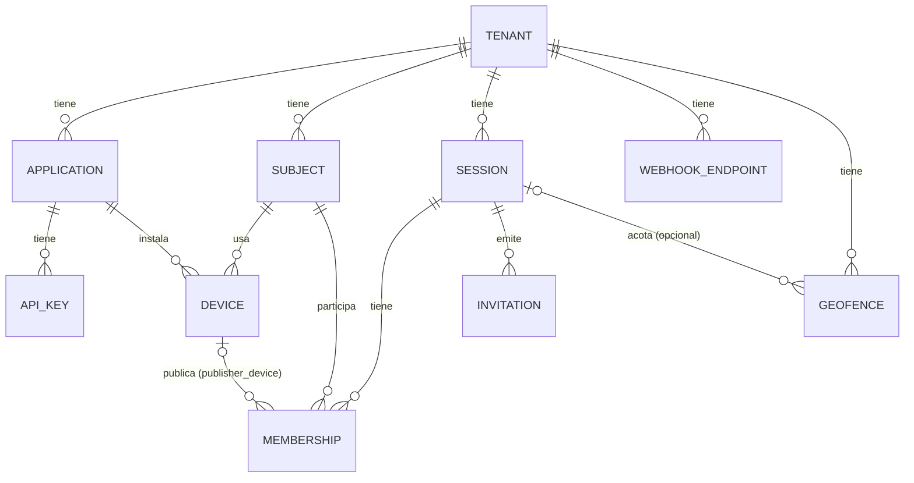
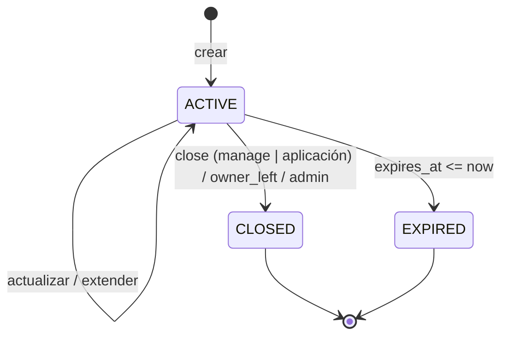
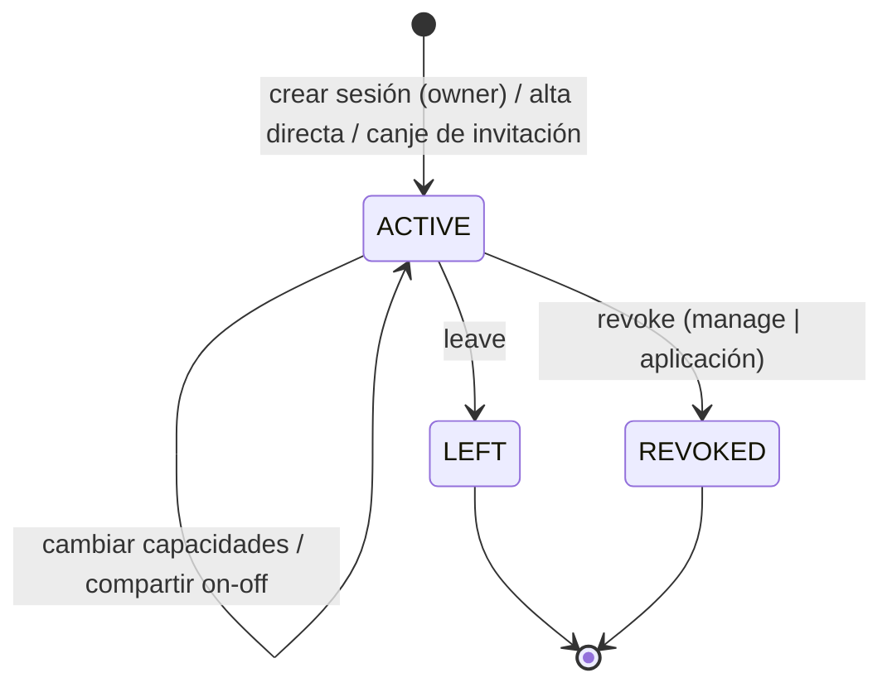
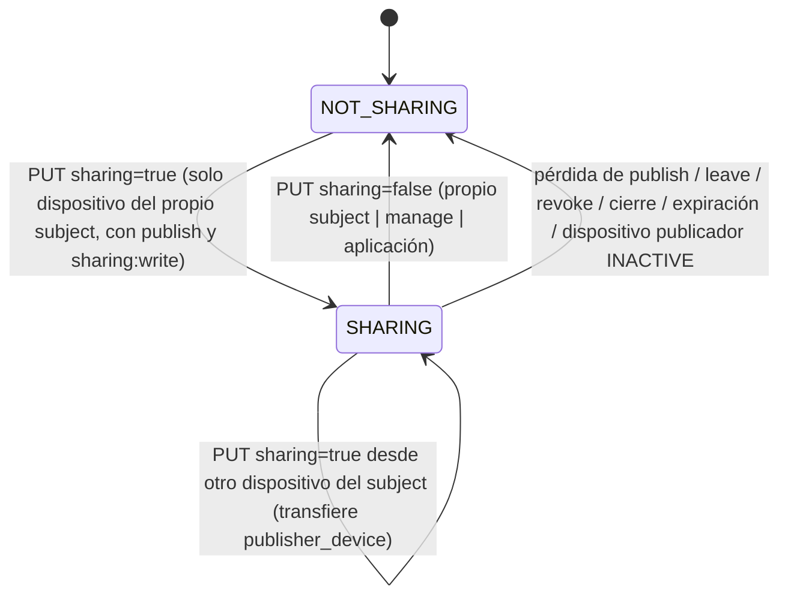

# 05 — Modelo de dominio, invariantes y máquinas de estado

**ID:** GS-DOM-001 · **Versión:** 0.2.0

Este documento define las entidades, sus reglas y sus transiciones. Se implementa en `crates/gs-domain` como lógica pura (sin I/O) y se prueba con pruebas unitarias y de propiedades.

## 1. Mapa de entidades

## 2. Identificadores

- Formato público: `<prefijo>_<32 hex minúscula>`, donde los 32 hex son un **UUIDv7** sin guiones (`Uuid::simple()`).
- Regex general: `^(ten|app|key|sub|dev|ses|mem|inv|whk|evt|geo|con|req|aud)_[0-9a-f]{32}$`.
- En PostgreSQL se almacena el UUID (`uuid`); el prefijo se añade/valida en la frontera (`gs-domain::ids`), con un tipo newtype por entidad (`SessionId`, `MemberId`, …). Un ID con prefijo incorrecto es un error de validación, nunca se reinterpreta.
- Los IDs no son secretos ni credenciales. UUIDv7 revela el instante de creación; se acepta (ADR-0011).
- `external_subject_id` (del integrador): `^[A-Za-z0-9._:\-]{1,128}$`. El integrador DEBERÍA usar identificadores opacos, nunca correos ni teléfonos (por eso `@` y `+` no se admiten).
- `installation_id`: UUID v4 en forma canónica con guiones, minúsculas.

| Prefijo | Entidad | Prefijo | Entidad |
|---|---|---|---|
| `ten_` | Tenant | `inv_` | Invitation |
| `app_` | Application | `whk_` | WebhookEndpoint |
| `key_` | ApiKey | `evt_` | Evento de webhook |
| `sub_` | Subject | `geo_` | Geofence |
| `dev_` | Device | `con_` | Conexión de stream |
| `ses_` | Session | `req_` | Petición (correlación) |
| `mem_` | Membership | `aud_` | Registro de auditoría |

## 3. Tenant, Application, Subject, Device

### 3.1 Tenant
Atributos: `id`, `name` (1..100), `status ∈ {ACTIVE, DISABLED}`, `policy` (`17_CONFIGURATION.md` §4), timestamps.
- INV-TEN-1: ningún recurso referencia recursos de otro tenant. Toda consulta filtra por `tenant_id` derivado del principal.
- `DISABLED` bloquea todo acceso de sus aplicaciones y dispositivos (FR-ADM-003).

### 3.2 Application
Atributos: `id`, `tenant_id`, `name`, `status ∈ {ACTIVE, DISABLED}`, `allowed_device_scopes` (subconjunto de scopes de dispositivo), `allowed_origins` (CORS, F8), timestamps.

### 3.3 Subject
Atributos: `id`, `tenant_id`, `external_subject_id` (único por tenant), `status ∈ {ACTIVE, ERASED}`, `token_epoch` (entero ≥ 0), timestamps.
- Se crea implícitamente al emitir un token o al agregarlo como miembro.
- INV-SUB-1: `(tenant_id, external_subject_id)` único.
- `ERASED`: resultado del borrado (F10); no puede volver a usarse; un nuevo token con el mismo `external_subject_id` crea un subject nuevo.

### 3.4 Device
Atributos: `id`, `tenant_id`, `subject_id`, `application_id`, `installation_id`, `platform ∈ {ANDROID, IOS, WEB, SERVER, OTHER}`, `app_version`, `sdk_version`, `status ∈ {ACTIVE, INACTIVE}`, `last_seen_at`, timestamps.
- INV-DEV-1: `(application_id, installation_id, subject_id)` único. El mismo teléfono con otro usuario del integrador es otro dispositivo.
- INV-DEV-2: un subject tiene como máximo `max_devices_per_subject` dispositivos `ACTIVE`; al superarse, el más antiguo por `last_seen_at` pasa a `INACTIVE` con los mismos efectos que una desactivación explícita (`06` §7).
- `INACTIVE` es terminal para ese ID (un nuevo token crea otro dispositivo).

## 4. Sesión

### 4.1 Atributos

| Campo | Tipo | Reglas |
|---|---|---|
| `id` | `SessionId` | |
| `tenant_id` | `TenantId` | |
| `mode` | `SessionMode` | `ONE_TO_ONE`, `ONE_TO_MANY`, `MANY_TO_MANY`; inmutable |
| `status` | `SessionStatus` | `ACTIVE`, `CLOSED`, `EXPIRED` |
| `owner_subject_id` | `SubjectId?` | presente si la creó un dispositivo; puede cambiar por transferencia |
| `created_by` | `Actor` | dispositivo o aplicación |
| `expires_at` | timestamp | obligatorio; ≤ `created_at + max_session_ttl_seconds` y tras extensiones ≤ `now + max_session_ttl_seconds` |
| `max_members` | u32 | 2 en `ONE_TO_ONE`; en otros modos 2..=`max_members_cap` |
| `snapshot_ttl_seconds` | u32 | 0..=`snapshot_ttl_max_seconds`; 0 = sin snapshot |
| `stale_after_seconds` | u32 | 5..=3600; pista para clientes |
| `metadata` | mapa string→string | ≤ 32 entradas; clave `^[a-z0-9_.-]{1,64}$`; valor ≤ 512 caracteres UTF-8; NO DEBE contener datos personales |
| `closed_reason` | enum? | `CLOSED_BY_MEMBER`, `CLOSED_BY_APPLICATION`, `OWNER_LEFT`, `ADMIN` |
| `version` | u64 | se incrementa en cada cambio; base de ETag |

### 4.2 Modos

| Modo | `max_members` | Capacidades del propietario | Capacidades por defecto de quien se une | Notas |
|---|---|---|---|---|
| `ONE_TO_ONE` | 2 (fijo) | todas | `publish`, `read` | |
| `ONE_TO_MANY` | default `default_max_members_one_to_many`, tope `max_members_cap` | todas | `read` | Varios publicadores son posibles si se conceden explícitamente |
| `MANY_TO_MANY` | default `default_max_members_many_to_many`, tope `max_members_cap` | todas | `publish`, `read` | |

"Por defecto" aplica cuando una invitación o alta directa no especifica capacidades. Las capacidades explícitas siempre prevalecen dentro de las reglas de §5.3.

### 4.3 Máquina de estados de sesión

Efectos obligatorios al entrar en `CLOSED` o `EXPIRED` (misma transacción + efectos efímeros antes de responder):

1. `sharing=false` y `publisher_device_id=NULL` en todas las membresías.
2. Borrar todos los snapshots de la sesión.
3. Incrementar `mver`; publicar `SessionClosed`/`SessionExpired` en `ctl:{session}`.
4. Las suscripciones terminan con `SubscriptionEnded{SESSION_CLOSED | SESSION_EXPIRED}`.
5. Invitaciones pendientes quedan inutilizables (no hace falta modificarlas: el canje exige sesión `ACTIVE`).
6. Outbox: `session.closed` / `session.expired`.

- INV-SES-1: una sesión no `ACTIVE` no acepta publicaciones, suscripciones, altas, invitaciones ni cambios (salvo lecturas).
- INV-SES-2: `status = ACTIVE ∧ expires_at <= now` se trata como `EXPIRED` en toda lectura (verificación perezosa).
- INV-SES-3: cerrar es idempotente; cerrar una sesión `EXPIRED` devuelve su estado sin error.

## 5. Membresía

### 5.1 Atributos

| Campo | Reglas |
|---|---|
| `id` (`MemberId`) | nuevo en cada alta; nunca se reutiliza |
| `session_id`, `tenant_id`, `subject_id` | |
| `role` | `OWNER` o `MEMBER`; a lo sumo un `OWNER` activo por sesión |
| `capabilities` | `{publish, read, invite, manage}` booleanos |
| `status` | `ACTIVE`, `LEFT`, `REVOKED` |
| `sharing` | bool, default `false` |
| `publisher_device_id` | `DeviceId?`; presente si y solo si `sharing=true` |
| `sharing_changed_at` | timestamp? |
| `joined_at`, `ended_at` | |
| `joined_via` | `CREATOR`, `DIRECT_ADD`, `INVITATION` (+ `invitation_id`) |
| `version` | u64 |

### 5.2 Máquina de estados

Efectos de `LEFT` / `REVOKED`: `sharing=false`, `publisher_device_id=NULL`, borrar snapshot, `mver++`, `ctl` `MembershipChanged`, `SubscriptionEnded{MEMBER_LEFT | MEMBER_REVOKED}` a las conexiones del subject, `MemberEvent{LEFT | REVOKED}` al resto, outbox `member.left` / `member.revoked`. Si era `OWNER`, aplicar §5.4.

### 5.3 Reglas de capacidades

- INV-MEM-1: `role=OWNER` ⇒ las cuatro capacidades en `true`; no se pueden reducir.
- INV-MEM-2: un miembro con `manage` puede cambiar capacidades de otros miembros **no propietarios** solo dentro de su propio conjunto (`nuevo ⊆ propias`). La aplicación puede asignar cualquier conjunto.
- INV-MEM-3: un miembro no puede cambiar sus propias capacidades (excepto la aplicación).
- INV-MEM-4: retirar `publish` a un miembro con `sharing=true` detiene la compartición (efectos de §7.3).
- INV-MEM-5: retirar `read` termina sus suscripciones con `SubscriptionEnded{PERMISSION_CHANGED}`.
- INV-MEM-6: a lo sumo una membresía `ACTIVE` por `(session_id, subject_id)`.
- INV-MEM-7: el número de membresías `ACTIVE` ≤ `max_members` (garantizado con bloqueo de la fila de sesión en la transacción de alta).

### 5.4 Salida del propietario (FR-SES-007)
Cuando el `OWNER` pasa a `LEFT` o `REVOKED`:
1. Buscar el miembro `ACTIVE` más antiguo (`joined_at`, desempate por `id`) con `manage=true`.
2. Si existe: pasa a `role=OWNER` (y recibe las cuatro capacidades); `owner_subject_id` se actualiza; `MemberEvent{UPDATED}`.
3. Si no existe y `created_by` es un dispositivo: la sesión pasa a `CLOSED` con `OWNER_LEFT`.
4. Si `created_by` es una aplicación (sesión sin propietario original), nunca se cierra por esta regla.

### 5.5 Readmisión (FR-MEM-007)
- Subject con última membresía `LEFT`: puede volver por invitación o alta directa → nueva membresía.
- Subject con última membresía `REVOKED`: solo alta directa (aplicación o miembro con `manage`); el canje de invitación falla con `INVITATION_INVALID`.

## 6. Invitación

| Campo | Reglas |
|---|---|
| `id` | `InvitationId` |
| `session_id`, `tenant_id` | |
| `code_hash` | SHA-256 del código normalizado; el código nunca se almacena |
| `grants` | `Capabilities`; ⊆ capacidades del emisor (si es miembro); `manage` solo si el emisor es `OWNER` o la aplicación |
| `max_uses` | 1..=`invitation_max_uses`; default 1 |
| `uses` | contador atómico |
| `expires_at` | default `now + 86400 s`; ≤ `now + invitation_max_ttl_seconds`; ≤ `session.expires_at` |
| `created_by` | actor |
| `revoked_at` | opcional |

Código: 16 caracteres Crockford Base32 (80 bits) generados con CSPRNG, presentados como `XXXX-XXXX-XXXX-XXXX`. Normalización antes del hash: mayúsculas, eliminar `-` y espacios, `I`/`L`→`1`, `O`→`0`, rechazar `U` y cualquier carácter fuera del alfabeto.

Canje válido si y solo si: código normalizado existe ∧ no revocada ∧ `uses < max_uses` ∧ `expires_at > now` ∧ sesión `ACTIVE` ∧ subject sin membresía `ACTIVE` en la sesión ∧ subject sin última membresía `REVOKED` ∧ hay cupo. Cualquier otro caso → `INVITATION_INVALID` (404), salvo subject ya miembro activo → 409 `CONFLICT` (revela solo lo que el subject ya sabe) y sesión llena → 409 `SESSION_FULL`.

## 7. Compartición y consentimiento

### 7.1 Máquina de estados por membresía

### 7.2 Reglas
- INV-SHR-1: `sharing=true` ⇒ `publisher_device_id` presente, `ACTIVE` y del mismo subject.
- INV-SHR-2: solo el propio subject activa la compartición. Ni la aplicación ni un manager pueden.
- INV-SHR-3: `PUT sharing=true` cuando ya es `true` desde el mismo dispositivo es idempotente (200, sin eventos).
- INV-SHR-4: cada transición genera auditoría (`sharing.started` / `sharing.stopped`), outbox y `MemberStatus` a suscriptores.

### 7.3 Efectos de detener
Antes de responder: `sharing=false`, `publisher_device_id=NULL`, borrar snapshot, `mver++`, `ctl` `SharingChanged`. Después: `MemberStatus` a suscriptores; las publicaciones en vuelo de ese dispositivo se rechazan con `NOT_SHARING`.

## 8. Presencia y estado de miembro

`MemberStatus` (contrato en `session.proto`):

| Campo | Regla |
|---|---|
| `sharing` | valor actual |
| `connectivity` | si `sharing=true`: `ONLINE` si existe presencia del `publisher_device_id`; `OFFLINE` si no existe y ya pasó la gracia; si `sharing=false`: siempre `UNSPECIFIED` |
| `last_location_at` | `captured_at` del snapshot vigente si `sharing=true` y existe snapshot; si no, ausente |

- El cliente calcula la frescura: `STALE` si `now_servidor − last_location_at > stale_after_seconds`.
- Se emite `MemberStatus` en: cambio de `sharing`, transición de conectividad (tras gracia) y cambio de capacidades/rol.
- INV-PRS-1: nunca se revela si un miembro que no comparte está conectado (FR-PRS-004).

## 9. Ubicación

Tipos de dominio (en `gs-domain::location`), equivalentes a `location.proto`:

- `Position { latitude, longitude, horizontal_accuracy_m, altitude_m?, vertical_accuracy_m?, speed_mps?, speed_accuracy_mps?, heading_deg?, heading_accuracy_deg? }` — constructor que valida (`09` §3) y devuelve `Result<Position, ValidationError>`.
- `LocationQuality { source, kind, is_mock?, motion }`.
- `LocationSample { sequence, captured_at, position, quality }`.
- `AcceptedLocation { session_id, member_id, device_id, sample, received_at }`.
- Los tipos que contienen coordenadas implementan `Debug` y `Display` **redactados** (`Position { <redacted> }`). Ver `10` §8.

Algoritmo de aceptación: `09_VALIDATION_ERRORS.md` §4.

## 10. Eventos de dominio y su proyección

| Evento de dominio | Stream (a suscriptores) | Webhook | Auditoría |
|---|---|---|---|
| SessionCreated | — | `session.created` | sí |
| SessionUpdated | `SessionEvent{UPDATED}` | `session.updated` | sí |
| SessionClosed | `SessionEvent{CLOSED}` + `SubscriptionEnded` | `session.closed` | sí |
| SessionExpired | `SessionEvent{EXPIRED}` + `SubscriptionEnded` | `session.expired` | sí |
| MemberJoined | `MemberEvent{JOINED}` | `member.joined` | sí |
| MemberUpdated (capacidades/rol) | `MemberEvent{UPDATED}` (+ `SubscriptionEnded` si pierde `read`) | `member.updated` | sí |
| MemberLeft | `MemberEvent{LEFT}` + `SubscriptionEnded` al propio | `member.left` | sí |
| MemberRevoked | `MemberEvent{REVOKED}` + `SubscriptionEnded` al propio | `member.revoked` | sí |
| SharingStarted | `MemberStatus` | `sharing.started` | sí |
| SharingStopped | `MemberStatus` | `sharing.stopped` | sí |
| ConnectivityChanged | `MemberStatus` | — | no |
| LocationAccepted | `LocationUpdate` | — | no (ni métricas con coordenadas) |
| GeofenceTransition (F11) | `GeofenceEvent` | `geofence.entered` / `geofence.exited` | no |
| InvitationCreated / Revoked / Redeemed | — | — | sí |
| TokensRevoked, DeviceDeactivated | cierre 4401 de conexiones afectadas | — | sí |

## 11. Lista de invariantes a probar

`INV-TEN-1`, `INV-SUB-1`, `INV-DEV-1`, `INV-DEV-2`, `INV-SES-1..3`, `INV-MEM-1..7`, `INV-SHR-1..4`, `INV-PRS-1`. Cada invariante DEBE tener al menos una prueba unitaria en `gs-domain` o una prueba de integración en `gs-service`, con su ID en el nombre de la prueba.
