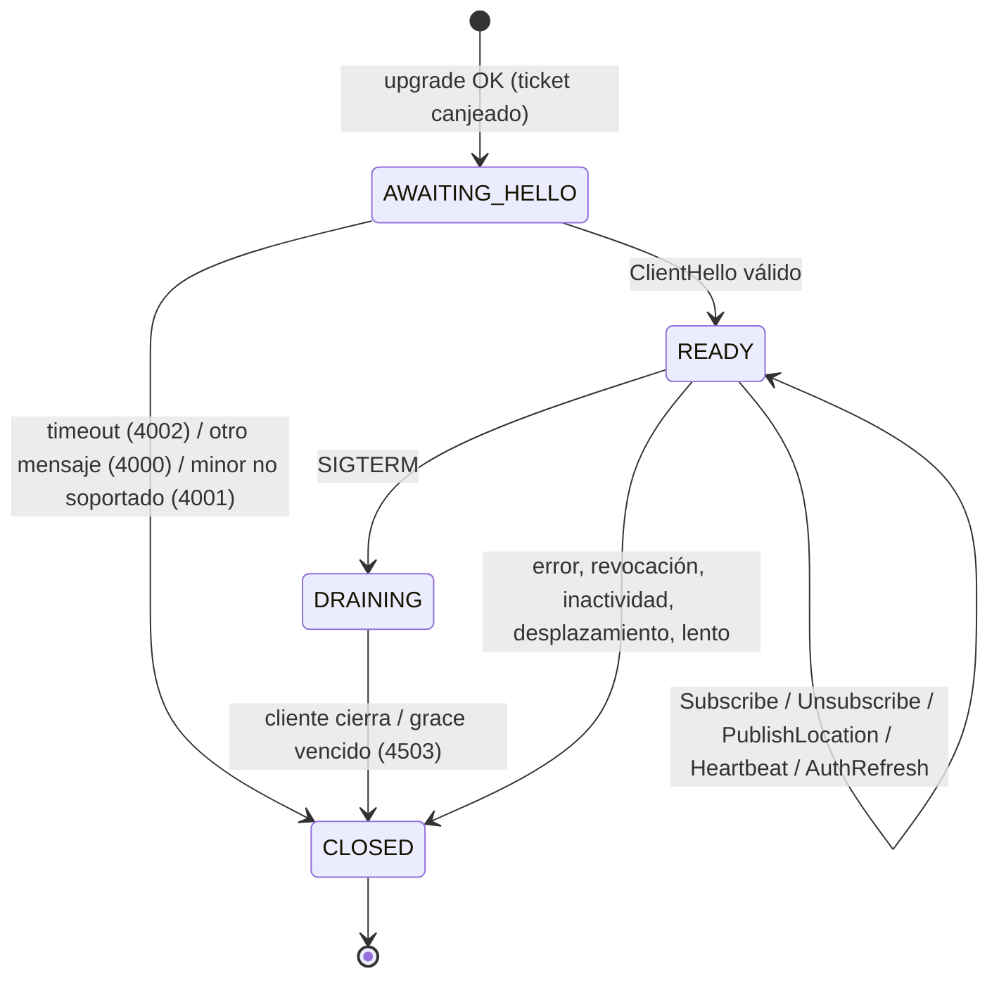

# 08 — Protocolo de stream (WebSocket) v1

**ID:** GS-PRO-001 · **Versión del documento:** 0.2.0 · **Versión del protocolo:** v1, minor 0
**Contrato máquina:** `contracts/proto/geostream/v1/*.proto` · **Decisiones:** ADR-0004, ADR-0007, ADR-0008, ADR-0009

## 1. Alcance y principios

- Canal bidireccional para: suscribirse a sesiones, recibir ubicaciones y eventos, y publicar ubicaciones.
- Las acciones administrativas (crear sesiones, invitar, revocar, activar/detener compartición) **no** van por el stream: usan REST.
- Ubicaciones: best-effort, latest-state. Eventos de control y respuestas: ordenados y confiables **mientras la conexión viva**; tras una reconexión el cliente reconstruye el estado con `SubscribeAck`.
- El protocolo es idéntico en uno o varios nodos.

## 2. Transporte

| Aspecto | Regla |
|---|---|
| URL | `wss://<host>/v1/stream?ticket=<gst_…>` (`ws://` solo con `GS_ENV=dev`) |
| Subprotocolos | `gs.v1.proto` (tramas **binarias**, Protobuf) y `gs.v1.json` (tramas de **texto**, JSON canónico proto3). El cliente los ofrece en `Sec-WebSocket-Protocol` por orden de preferencia; el servidor elige el primero soportado y habilitado (`gs.v1.json` solo si `GS_STREAM_JSON_ENABLED=true`). |
| Una trama = un mensaje | Cada trama contiene exactamente un `ClientMessage` o `ServerMessage`. Sin fragmentación a nivel de aplicación. |
| Tipo de trama | Binaria con `gs.v1.proto`, texto con `gs.v1.json`. Tipo equivocado → cierre 4000. |
| Tamaño | Trama entrante > `GS_STREAM_MAX_FRAME_BYTES` → cierre 1009. |
| Compresión | `permessage-deflate` **no** se negocia en v1. |
| Ping/Pong WebSocket | El servidor responde Pings de control con Pong (RFC 6455). La vitalidad de aplicación usa `Heartbeat` (§6.5). |

## 3. Apertura de la conexión

1. El cliente obtiene un ticket con `POST /v1/stream/tickets` (`06_IDENTITY_AUTH.md` §5).
2. Upgrade HTTP con `?ticket=` y `Sec-WebSocket-Protocol`.
3. El servidor, **antes** del upgrade: comprueba límites de conexión, subprotocolo y canjea el ticket (get-and-delete atómico).

Respuestas sin upgrade (cuerpo `application/problem+json`):

| HTTP | `code` | Causa |
|---|---|---|
| 400 | `PROTOCOL_VERSION_UNSUPPORTED` | Ningún subprotocolo ofrecido es soportado/habilitado |
| 401 | `UNAUTHENTICATED` | Ticket ausente, malformado, expirado o ya usado |
| 403 | `ACCOUNT_DISABLED` | Ticket válido pero tenant/aplicación deshabilitados desde su emisión |
| 429 | `RATE_LIMITED` | Demasiados intentos de upgrade desde la IP (`GS_STREAM_UPGRADE_RPM_PER_IP`) |
| 503 | `TEMPORARILY_UNAVAILABLE` | `GS_STREAM_MAX_CONNECTIONS` alcanzado, instancia drenando o degradada; incluye `Retry-After` |

## 4. Envoltorio y correlación

- Cliente → servidor: `ClientMessage { request_id, oneof body }`.
- Servidor → cliente: `ServerMessage { request_id, oneof body }`.
- `request_id`: elegido por el cliente, único y creciente por conexión, ≥ 1 para peticiones que esperan respuesta. El servidor responde con el mismo `request_id`. Los eventos no solicitados llevan `request_id = 0`.
- `Heartbeat` puede llevar `request_id = 0`; aun así recibe `HeartbeatAck` con `request_id = 0`.
- Un `body` ausente o desconocido para el servidor → `StreamError{PROTOCOL_ERROR}` con el `request_id` recibido (la conexión sigue). Más de `GS_STREAM_MAX_PROTOCOL_ERRORS` en una conexión → cierre 4000.
- El cliente DEBE ignorar `body` de servidor desconocidos (compatibilidad hacia delante).

## 5. Máquina de estados de la conexión (servidor)



## 6. Operaciones

### 6.1 Handshake

El cliente envía `ClientHello` como **primer** mensaje antes de `GS_STREAM_HELLO_TIMEOUT_MS`.

Validación del hello:
- `protocol_minor`: se negocia `min(cliente, servidor_max)`. Si el cliente declara una versión menor que la mínima que el servidor soporta → cierre 4001 (en v1 el mínimo es 0, por lo que no ocurre hasta que se retire una minor).
- `sdk_name` ≤ 64, `sdk_version` ≤ 32, `app_version` ≤ 32 caracteres imprimibles; en otro caso cierre 4000.
- `last_sequence` ≤ 2^53 − 1.
- Para principales de aplicación, `last_sequence` y `platform` se ignoran.

El servidor responde `ServerHello` con: `connection_id`, `protocol_minor` negociado, `server_time`, `auth_expires_at`, `sequence_floor` (§6.2), `limits` (valores efectivos de `17_CONFIGURATION.md` y de la política del tenant), `principal_kind` e IDs del principal.

**Campo `sampling` (E3).** `ServerHello.sampling` lleva la `SamplingPolicy` del tenant (`version`, `rules[]`, `publish`, `wake_region_radius_m`, `downgrade_confirm_s`, `predict_horizon_ms`) que el cliente usa para su muestreo adaptativo y su publicación por cambio significativo (`22` §3.4). Solo llega por este canal autenticado sobre TLS, y **el cliente acota cada valor a los rangos de `17` §4.1 antes de aplicarlo** (T-30). Un cliente que no lo entienda (versión anterior) lo ignora y usa sus defaults locales.

**Campo `core_version` (E3).** `ClientHello.core_version` informa la versión del núcleo Rust del cliente (por ejemplo `0.1.0`), para diagnóstico y para decidir si el servidor puede activar capacidades que dependen del cliente. El servidor **no** rechaza la conexión por este campo.

Tras el hello del dispositivo: registrar presencia, publicar `Supersede` (§6.7) y, para cada membresía donde este dispositivo sea publicador, emitir conectividad `ONLINE` si estaba `OFFLINE`.

### 6.2 Sequence floor (ADR-0008)
- `sequence_floor` = valor de `{p}:devseq:{device_id}` (0 si no existe).
- El SDK DEBE fijar su siguiente secuencia en `max(local_next, sequence_floor + 1)` antes de publicar.
- Si `ClientHello.last_sequence < sequence_floor`, el servidor incrementa `gs_stream_sequence_floor_applied_total`.

### 6.3 Suscripción

`Subscribe{session_id, skip_snapshot, replay_trace}` → `SubscribeAck` o `StreamError`.

Autorización: `06` §8.3. Errores posibles: `NOT_FOUND`, `PERMISSION_DENIED`, `SESSION_CLOSED`, `SESSION_EXPIRED`, `TOO_MANY_SUBSCRIPTIONS` (más de `limits.max_subscriptions`), `VALIDATION_FAILED` (ID malformado), `TEMPORARILY_UNAVAILABLE`.

Algoritmo sin huecos ni duplicados:
1. Validar ID y autorización.
2. Registrar la suscripción local en estado `PENDING` (los eventos que lleguen se retienen: ubicaciones en el mapa coalescido, eventos de control en una cola pendiente acotada a `GS_STREAM_PENDING_EVENTS_MAX`; si se desborda, reintentar desde el paso 2 una vez y luego responder `TEMPORARILY_UNAVAILABLE`).
3. Leer `SessionInfo`, `MemberStatus` de todos los miembros activos y, salvo `skip_snapshot`, los snapshots vigentes (`DeliveryKind.SNAPSHOT`) de miembros que comparten.
4. Encolar `SubscribeAck`.
5. Pasar a `ACTIVE`: liberar los eventos de control retenidos y las ubicaciones retenidas cuya `sequence` sea mayor que la del snapshot del mismo miembro.

Reglas:
- `SubscribeAck` precede a cualquier evento de esa sesión en esa conexión.
- Suscribirse dos veces a la misma sesión es idempotente: se responde un `SubscribeAck` nuevo.
- `Unsubscribe` siempre responde `UnsubscribeAck` (idempotente).
- Las suscripciones no sobreviven a la conexión.

**`replay_trace` (E6, COULD).** Con `replay_trace = true`, tras `SubscribeAck` el servidor envía la traza simplificada de la sesión activa como `LocationUpdate` con `delivery = REPLAY`, respetando `skip_snapshot`. Requiere autorización de historial (`history:read` para aplicaciones, `HISTORY ∈ consent_purposes` y sesión `ACTIVE` para dispositivos); sin ella responde `CONSENT_REQUIRED` o `PERMISSION_DENIED` **antes** del `SubscribeAck`. Si la política del tenant no habilita historial, el campo se ignora como si fuera `false` (nunca es un error por sí solo).

**Minimización de `MemberStatus` en sesiones `POOL`.** `availability` y `attributes` solo se incluyen en `SubscribeAck` y en `MemberStatus` posteriores cuando el suscriptor es un **principal de aplicación**. Para una conexión de dispositivo se omiten siempre (INV-PRS-2), incluso si el suscriptor tiene capacidad `read`.

### 6.4 Publicación y acks

`PublishLocation{session_id, samples[]}` → siempre `PublishAck`.

Precondiciones del lote, evaluadas **en el orden de la tabla** (coherente con `06` §8.1); la primera que falla determina `request_error`, `results` queda vacío y ninguna muestra se aplica:

| Condición | `request_error` |
|---|---|
| ID de sesión malformado, `samples` vacío, secuencias no estrictamente crecientes dentro del lote | `VALIDATION_FAILED` |
| `len(samples) > limits.max_samples_per_publish` | `PAYLOAD_TOO_LARGE` |
| Principal de aplicación | `PERMISSION_DENIED` |
| Rate limit (§7.4) | `RATE_LIMITED` (+ `retry_after_ms`) |
| Sin membresía activa; última membresía revocada | `NOT_FOUND`; `MEMBER_REVOKED` |
| Sin capacidad `publish` | `PERMISSION_DENIED` |
| Sesión cerrada / expirada | `SESSION_CLOSED` / `SESSION_EXPIRED` |
| `sharing=false` | `NOT_SHARING` |
| Este dispositivo no es `publisher_device_id` | `NOT_PUBLISHER` |
| Almacén efímero no disponible | `TEMPORARILY_UNAVAILABLE` (+ `retry_after_ms`) |

Si pasan las precondiciones: cada muestra se evalúa en orden con el algoritmo de `09` §4 y produce un `SampleResult` (`ACCEPTED`, `IGNORED_DUPLICATE`, `IGNORED_STALE` o `REJECTED` con `error_code` y `field`). `results` tiene la misma longitud y orden que `samples`.

El cliente:
- elimina de su cola local toda muestra con resultado distinto de `REJECTED` por error transitorio;
- trata `REJECTED` como error de programación del SDK (log + métrica), nunca reintenta la misma muestra;
- ante `NOT_SHARING`, `NOT_PUBLISHER`, `MEMBER_REVOKED`, `NOT_FOUND`, `SESSION_*`: deja de publicar en esa sesión y notifica a la app.

**Estimación adjunta (E2).** Cuando `policy.track_estimates_enabled` es verdadera, cada `LocationUpdate` aceptada lleva `estimate` (campo 6 de `LocationUpdate`), con la estimación canónica calculada por `gs-track` (`22` §2.7). Reglas invariables:

- El campo `estimate` **nunca** sustituye ni modifica la muestra `sample`, que viaja intacta (P-E3 / `FR-LOC-006`).
- `estimate.kind` es `FILTERED` o `MAP_MATCHED`; **nunca** `MEASURED` ni `PREDICTED` (la predicción visual es exclusivamente local, §6.9).
- `estimate.position.horizontal_accuracy_m` representa la desviación típica (1σ) de la posición estimada, no la precisión declarada del dispositivo.
- Si el motor de trayectoria no puede estimar (conflicto de versión del estado en la ingesta HTTP, almacén efímero degradado), el campo **va ausente** y la aceptación no se ve afectada; se incrementa `gs_track_state_conflict_total`.

**`TrackEvent` (E2).** El servidor emite `TrackEvent` como mensaje no solicitado (`request_id = 0`, campo 28 de `ServerMessage.body`) a los suscriptores autorizados de la sesión: `STOP_STARTED`, `STOP_ENDED`, `TRACKING_LOST` y `TRACKING_RESUMED` (`22` §2.7). Solo `STOP_*` llevan `position` (centroide de la parada) y solo `STOP_ENDED` lleva `duration_s`. **El mismo dato por webhook nunca incluye coordenadas** (`FR-WHK-005`).

### 6.5 Heartbeat e inactividad
- El cliente envía `Heartbeat{client_time}` cada `limits.heartbeat_interval_ms` (si no ha enviado otro mensaje en ese intervalo puede igualmente enviarlo; siempre es válido).
- El servidor responde `HeartbeatAck{client_time, server_time}` (base de la estimación de desfase, `12` §10).
- Si el servidor no recibe **ninguna** trama durante `limits.idle_timeout_ms`, cierra con 4408.
- Cada heartbeat de un dispositivo renueva su presencia si han pasado ≥ `GS_PRESENCE_TTL_S / 3` desde la última renovación.

### 6.6 Renovación de autenticación
- El servidor envía `AuthExpiring{auth_expires_at}` cuando faltan `GS_STREAM_AUTH_EXPIRING_LEAD_S` segundos (o inmediatamente tras el hello si ya falta menos).
- Dispositivo: responde `AuthRefresh{access_token}`. El servidor verifica el token completo (`06` §4.3) y exige el mismo `did`.
  - Válido → `AuthRefreshAck{auth_expires_at}`; se actualizan scopes y `sep` de la conexión.
  - Inválido o expirado → `StreamError{UNAUTHENTICATED | TOKEN_EXPIRED}`; la conexión sigue hasta la expiración anterior.
  - Otro `did` → `StreamError{PERMISSION_DENIED}` y cierre 4403.
- Aplicación: no hay `AuthRefresh` (→ `StreamError{PERMISSION_DENIED}`); reconecta con un ticket nuevo antes de `auth_expires_at`.
- Al llegar `auth_expires_at` sin renovación → cierre 4401.

**Orden de entrega (obligatorio).** En los casos con dos efectos, el `StreamError` se escribe **antes** del close frame: la cola de control se drena por completo antes de emitir el cierre (§4, §8). Un cliente que solo recibiera el 4403 no podría distinguir «rechacé tu token» de «la sesión expiró», que es justo la información que necesita para decidir si reintenta o si su sesión está muerta.

### 6.7 Conexión única por dispositivo
Tras el hello de un dispositivo se publica `Supersede{device_id, connection_id}` en `{p}:bus:dev:{device_id}`. Toda otra conexión del mismo dispositivo, en cualquier instancia, se cierra con 4409. Las conexiones de aplicación no tienen esta restricción.

### 6.8 Drenaje y avisos
- SIGTERM: `ready=false`; enviar `ServerNotice{DRAINING, reconnect_after_ms}` a cada conexión con `reconnect_after_ms` aleatorio uniforme en [0, `GS_STREAM_DRAIN_SPREAD_MS`]; esperar hasta `GS_SHUTDOWN_GRACE_S`; cerrar las restantes con 4503.
- Almacén efímero caído: `ServerNotice{DEGRADED}`; al recuperarse `ServerNotice{RECOVERED}` (ver `04` §7.6).

## 7. Procesamiento y entrega

### 7.1 Aceptación
Algoritmo normativo en `09_VALIDATION_ERRORS.md` §4.

### 7.2 Construcción de `LocationUpdate`
`{ session_id, member_id (de la membresía del publicador), sample (tal cual se recibió, ya validada), received_at (reloj del servidor al aceptar), delivery = LIVE, estimate (E2, opcional) }`. El servidor NO DEBE modificar posición, `kind`, `source`, `is_mock` ni `motion` de `sample`; lo derivado va en `estimate` (§6.4).

### 7.3 Entrega autorizada
Las actualizaciones se entregan a todas las suscripciones autorizadas de la sesión, **incluida la del propio publicador** si está suscrito (permite mostrar la posición propia tal como la ven los demás). Antes de depositar una actualización o evento en una conexión, la suscripción debe estar autorizada según la caché de `04` §6.2 con antigüedad ≤ `GS_AUTHZ_CACHE_TTL_MS`; si caducó, se revalida (consulta de `mver` coalescida por sesión). Una suscripción que deja de estar autorizada termina con `SubscriptionEnded` (§9).

### 7.4 Rate limit de publicación
Token bucket por (conexión, sesión): capacidad `publish_burst`, una ficha cada `min_publish_interval_ms` (política del tenant). Un `PublishLocation` consume una ficha independientemente del número de muestras. Sin ficha → `PublishAck{request_error=RATE_LIMITED, retry_after_ms}`. Además, límite global de mensajes entrantes por conexión `GS_STREAM_MAX_INBOUND_MSGS_PER_S`; excederlo de forma sostenida (`GS_STREAM_ABUSE_WINDOW_S`) → cierre 4429.

### 7.5 Eventos de sesión y miembros
A cada suscripción activa se envían: `MemberEvent`, `MemberStatus`, `SessionEvent`, `GeofenceEvent` (F11) y `TrackEvent` (E2), según la tabla de `05` §10. Un evento por suscriptor afectado y transición.

### 7.6 Predicción visual: qué NO viaja por el stream
La predicción visual (`MemberView.renderPosition`, ADR-0030) es **exclusivamente local del cliente**. El cliente puede dibujar una posición `PREDICTED` o interpolada entre muestras, pero esa posición:

- **nunca** se envía como `LocationSample` ni como `PublishLocation`;
- **nunca** se guarda en el historial ni en el snapshot;
- **nunca** se escribe en logs ni se reporta como medición.

Si un cliente publica una muestra con `kind = PREDICTED` o `INTERPOLATED`, el servidor la rechaza con `INVALID_LOCATION` en el campo `quality.kind` (`09` §3.3): el camino de medición solo admite `MEASURED` desde el dispositivo.

### 7.6 Garantías de orden
- Por conexión, los mensajes del servidor se entregan en el orden en que se encolan.
- Para un mismo (sesión, miembro), el servidor DEBERÍA entregar `LocationUpdate` en orden de `sequence`, pero puede omitir intermedias (coalescencia). El cliente DEBE descartar toda `LocationUpdate` con `sequence` ≤ la última aplicada para ese (sesión, miembro).
- No hay orden entre miembros distintos ni entre sesiones.
- `MemberStatus{sharing=false}` implica que el cliente DEBE retirar la ubicación de ese miembro; cualquier `LocationUpdate` de ese miembro que llegue después con `sequence` menor o igual a la última conocida se descarta, y una con `sequence` mayor solo puede llegar si volvió a compartir (precedida de `MemberStatus{sharing=true}`).

## 8. Códigos de cierre

| Código | Nombre | Causa | Acción del cliente |
|---|---|---|---|
| 1000 | NORMAL | Cierre normal | Reconectar solo si sigue habiendo suscripciones o compartición activas |
| 1001 | GOING_AWAY | Cliente navega / servidor cierra listener | Reconectar con backoff |
| 1009 | MESSAGE_TOO_BIG | Trama > máximo | Error del SDK: registrar; reconectar con backoff |
| 4000 | PROTOCOL_ERROR | Mensaje malformado, tipo de trama incorrecto, mensaje antes del hello, demasiados errores de protocolo | Reconectar con backoff; registrar |
| 4001 | UNSUPPORTED_PROTOCOL | Minor no soportada | No reconectar; `ProtocolException` (actualizar SDK) |
| 4002 | HELLO_TIMEOUT | Sin `ClientHello` a tiempo | Reconectar con backoff |
| 4005 | SLOW_CONSUMER | Cola de control llena | Reconectar con backoff |
| 4401 | AUTH_EXPIRED | Token expirado sin renovar; tokens del subject revocados; dispositivo desactivado; API key revocada | Forzar token nuevo (`forceRefresh`) y ticket nuevo; si el proveedor falla, detenerse con `AuthenticationException` |
| 4403 | FORBIDDEN | Tenant/aplicación deshabilitados; `AuthRefresh` de otro dispositivo | No reconectar; `AuthorizationException` |
| 4408 | IDLE_TIMEOUT | Sin tramas en `idle_timeout_ms` | Reconectar de inmediato (sin espera inicial) |
| 4409 | SUPERSEDED | Otra conexión del mismo dispositivo | No reconectar automáticamente; emitir estado `superseded` |
| 4429 | RATE_LIMITED | Abuso sostenido | Reconectar tras ≥ 60 s |
| 4500 | INTERNAL | Error interno | Reconectar con backoff |
| 4503 | TRY_AGAIN | Drenaje / sobrecarga | Reconectar tras `reconnect_after_ms` si se recibió `ServerNotice`; si no, backoff |

El servidor incluye en el *reason* del cierre solo el nombre (p. ej. `SUPERSEDED`), nunca detalles sensibles.

**El close frame va siempre después.** Cuando una operación produce además un mensaje (un `StreamError`, un `AuthExpiring`, un `ServerNotice`), ese mensaje se escribe **antes** del close frame: la cola de control se drena por completo y el cierre espera a que esté vacía. El orden es normativo porque el código de cierre solo dice *qué* pasó, no *por qué* en el caso concreto; el mensaje correlacionado es el que lleva la explicación accionable.

## 9. Revocación en vivo

| Causa | Mensaje al afectado | Efecto en publicaciones |
|---|---|---|
| Miembro revocado | `SubscriptionEnded{MEMBER_REVOKED}` | `MEMBER_REVOKED` |
| Miembro sale | `SubscriptionEnded{MEMBER_LEFT}` | `NOT_FOUND` |
| Pierde `read` | `SubscriptionEnded{PERMISSION_CHANGED}` | sin cambio |
| Pierde `publish` | `MemberStatus{sharing=false}` (si compartía) | `PERMISSION_DENIED` |
| Detiene compartición | `MemberStatus{sharing=false}` | `NOT_SHARING` |
| Sesión cerrada / expirada | `SessionEvent{CLOSED/EXPIRED}` + `SubscriptionEnded{SESSION_CLOSED/EXPIRED}` | `SESSION_CLOSED` / `SESSION_EXPIRED` |
| Tokens revocados / dispositivo desactivado / key revocada | cierre 4401 | — |
| Tenant / aplicación deshabilitados | cierre 4403 | — |

Plazo: NFR-SEC-002. La conexión no se cierra por revocaciones de membresía: solo terminan las suscripciones afectadas.

## 10. Backpressure

Semántica observable:
- Para cada (sesión, miembro), el cliente recibe **siempre la ubicación más reciente** disponible al momento de escribir; las intermedias pueden omitirse.
- Las respuestas y eventos de control nunca se descartan: si la cola de control (`GS_STREAM_OUTBOUND_CONTROL_QUEUE`) se llena, la conexión se cierra con 4005 y el cliente reconstruye el estado al reconectar.
- La memoria por conexión está acotada por: tamaño de la cola de control + número de (sesión, miembro) suscritos × tamaño de una `LocationUpdate`.

Implementación de referencia: `04_ARCHITECTURE.md` §8.

## 11. Versionado y evolución

- Versión mayor en el subprotocolo (`gs.v1.*`) y en el paquete Protobuf (`geostream.v1`). Un cambio incompatible exige `gs.v2.*` y `geostream.v2`, con convivencia de ambas versiones durante la deprecación (`19` §8).
- Versión menor en `protocol_minor`: se incrementa al añadir campos, mensajes o valores de enum. Nunca rompe a clientes anteriores.
- Reglas Protobuf: no reutilizar números ni nombres; campos eliminados → `reserved`; nuevos campos con default seguro; nuevos valores de enum deben ser ignorables por clientes antiguos (se tratan como `UNSPECIFIED`).
- Antes de **M2** (`21_ROADMAP.md`) el contrato v1 está en borrador: se admiten cambios incompatibles con ADR y entrada en `CHANGELOG.md`. Desde M2, `buf breaking` es obligatorio.

## 12. Subprotocolo JSON (`gs.v1.json`)

- Mapeo JSON canónico de proto3: nombres en `lowerCamelCase` en la salida; el servidor acepta `lowerCamelCase` y `snake_case`; enums como cadena con el nombre completo (`"SAMPLE_STATUS_ACCEPTED"`); `uint64`/`int64` como cadena; `Timestamp` en RFC 3339; `double` no finitos como `"NaN"`, `"Infinity"`, `"-Infinity"` (y por tanto rechazados por validación).
- El servidor ignora campos desconocidos.
- Pensado para depuración, clientes web ligeros e integraciones; en producción puede deshabilitarse.

## 13. Ejemplo de diálogo (JSON, ilustrativo)

```jsonc
// C -> S
{"requestId":"0","hello":{"protocolMinor":0,"sdkName":"geostream-flutter","sdkVersion":"0.1.0","platform":"PLATFORM_ANDROID","appVersion":"3.4.1","lastSequence":"41","clientTime":"2026-10-11T21:04:00.000Z"}}
// S -> C
{"requestId":"0","hello":{"connectionId":"con_0192…","protocolMinor":0,"serverTime":"2026-10-11T21:04:00.210Z","authExpiresAt":"2026-10-11T21:19:00Z","sequenceFloor":"41","limits":{"maxFrameBytes":16384,"maxSubscriptions":20,"minPublishIntervalMs":1000,"maxSamplesPerPublish":1,"heartbeatIntervalMs":20000,"idleTimeoutMs":60000,"maxEventAgeMs":120000},"principalKind":"PRINCIPAL_KIND_DEVICE","subjectId":"sub_0192…","deviceId":"dev_0192…"}}
// C -> S
{"requestId":"1","subscribe":{"sessionId":"ses_0192…"}}
// S -> C
{"requestId":"1","subscribeAck":{"session":{"sessionId":"ses_0192…","mode":"SESSION_MODE_MANY_TO_MANY","status":"SESSION_STATUS_ACTIVE","expiresAt":"2026-10-11T23:00:00Z","maxMembers":50,"staleAfterSeconds":60,"snapshotTtlSeconds":600},"members":[…],"snapshot":[…]}}
// C -> S
{"requestId":"2","publishLocation":{"sessionId":"ses_0192…","samples":[{"sequence":"42","capturedAt":"2026-10-11T21:04:05.123Z","position":{"latitude":8.9824,"longitude":-79.5199,"horizontalAccuracyM":8.5,"speedMps":4.2,"headingDeg":91.0},"quality":{"source":"LOCATION_SOURCE_GNSS","kind":"LOCATION_KIND_MEASURED"}}]}}
// S -> C
{"requestId":"2","publishAck":{"sessionId":"ses_0192…","results":[{"sequence":"42","status":"SAMPLE_STATUS_ACCEPTED"}]}}
// S -> C (a otro suscriptor)
{"requestId":"0","locationUpdate":{"sessionId":"ses_0192…","memberId":"mem_0192…","sample":{…},"receivedAt":"2026-10-11T21:04:05.301Z","delivery":"DELIVERY_KIND_LIVE"}}
```

Los IDs abreviados con `…` y los arrays `[…]` hacen este diálogo no parseable a propósito; la versión completa y verificada de cada mensaje está en `contracts/test-vectors/stream_messages.json`. Las coordenadas son ilustrativas (centro de Ciudad de Panamá), nunca de una persona.
