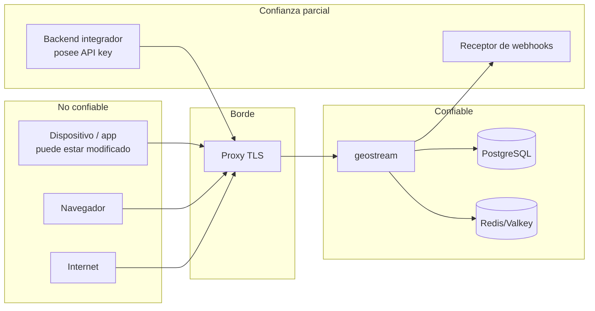

# 10 — Seguridad, privacidad y modelo de amenazas

**ID:** GS-SEC-001 · **Versión:** 0.2.0 · **Rango:** máxima precedencia (`00_INDEX.md` §3)

## 1. Objetivos

- **S-1** Solo principales autorizados leen ubicaciones, y solo mientras lo están.
- **S-2** Nadie publica ubicación en nombre de otro.
- **S-3** La revocación tiene efecto en un plazo acotado y probado (NFR-SEC-002).
- **S-4** Ningún dato cruza tenants.
- **S-5** Las coordenadas se retienen lo mínimo y nunca aparecen en registros.
- **S-6** El servicio resiste abuso de recursos sin degradar a otros tenants.
- **S-7** Las credenciales comprometidas pueden invalidarse sin redesplegar.

## 2. Activos

| Activo | Sensibilidad | Dónde vive |
|---|---|---|
| Coordenadas actuales (snapshots, mensajes en vuelo) | Muy alta | Almacén efímero (TTL), memoria |
| Relación persona–sesión–personas (grafo social) | Alta | PostgreSQL (`memberships`) |
| `external_subject_id` | Alta (puede vincularse a una persona) | PostgreSQL |
| Tokens, tickets, API keys, secretos de webhook, códigos de invitación | Crítica | Solo hashes o cifrado en reposo |
| Claves de firma JWT | Crítica | Sistema de archivos del servidor / gestor de secretos |
| `GS_DATA_ENCRYPTION_KEY` | Crítica | Gestor de secretos |
| Auditoría | Media | PostgreSQL |
| Disponibilidad del stream | Alta | — |

## 3. Límites de confianza

- Todo lo que llega del dispositivo es no confiable (incluidos `captured_at`, `is_mock`, `sequence`).
- El backend del integrador es confiable **solo dentro de su tenant** y de los scopes de su key.
- PostgreSQL y Redis/Valkey están en red privada, con credenciales separadas y TLS cuando atraviesan redes no controladas.

## 4. Modelo de amenazas (STRIDE)

| ID | Categoría | Amenaza | Controles obligatorios | Verificación |
|---|---|---|---|---|
| T-01 | Spoofing | Adivinar o filtrar un `session_id` para leer ubicaciones | El ID no es credencial; membresía + capacidad en cada operación; 404 sin relación | SCN-004 |
| T-02 | Spoofing | Robo de token de dispositivo | TTL corto (≤ `GS_TOKEN_MAX_TTL_S`), sin refresh tokens, `token_epoch`, desactivación de dispositivo | FR-AUTH-005 |
| T-03 | Spoofing | Robo de API key | Solo server-to-server; hash SHA-256; revocación por CLI con efecto en vivo; scopes mínimos; `locations:read` no por defecto | FR-AUTH-001, matriz |
| T-04 | Spoofing | Reutilizar un ticket de stream | Un solo uso (get-and-delete), TTL 30 s, redacción en logs | FR-AUTH-006 |
| T-05 | Tampering | Publicar como otro dispositivo o miembro | Identidad desde el token; `publisher_device_id`; ignorar IDs del payload | FR-SHR-004 |
| T-06 | Tampering | Replay/duplicados de muestras | Secuencia monotónica con CAS; antigüedad máxima | FR-LOC-003/004 |
| T-07 | Tampering | Ubicación falsa (mock, emulador) | Fuera de alcance garantizarlo; se transporta `is_mock` si la plataforma lo da; el integrador decide | Documentado |
| T-08 | Repudiation | Negar haber activado compartir o revocado a alguien | Auditoría de acciones sensibles (§8.3) | FR-PRV-005 |
| T-09 | Information disclosure | Lectura entre tenants | `tenant_id` del principal en toda consulta; pruebas negativas 100 % | NFR-SEC-004 |
| T-10 | Information disclosure | Miembro expulsado sigue recibiendo | Caché de autorización acotada + invalidación por bus + revalidación por TTL | SCN-002, NFR-SEC-002 |
| T-11 | Information disclosure | Fuga de coordenadas por logs, métricas, trazas, crash reports | Tipos redactados; prohibición de labels; prueba de captura de logs | FR-PRV-004 |
| T-12 | Information disclosure | Revelar presencia de quien no comparte | Minimización de `MemberStatus` | FR-PRS-004 |
| T-13 | Information disclosure | Retención indebida | Sin historial; TTL de snapshot; borrado inmediato; Redis/Valkey sin persistencia | NFR-PRIV-001/002 |
| T-14 | Information disclosure | Enumeración de invitaciones | 80 bits, hash, rate limit por dispositivo, error genérico | FR-INV-002 |
| T-15 | Information disclosure | SSRF vía URL de webhook | Validación de destino en registro y en cada entrega (DNS rebinding), sin redirecciones | FR-WHK-004 |
| T-16 | DoS | Inundación de conexiones o mensajes | Límites por IP, por conexión, por instancia; tickets; backpressure; cierre 4429/4005 | FR-STR-006, FR-LOC-007 |
| T-17 | DoS | Fan-out amplificado (sesiones enormes) | `max_members_cap`; coalescencia; métricas de fan-out | NFR-PERF-003 |
| T-18 | DoS | Tormenta de reconexión | Backoff exponencial con jitter completo en el SDK; drenaje con dispersión | NFR-SCALE-002 |
| T-19 | Elevation of privilege | Escalar capacidades vía invitaciones o PATCH | grants ⊆ capacidades del emisor; INV-MEM-1..3 | FR-INV-001, FR-MEM-003 |
| T-20 | Elevation of privilege | Aplicación activando la compartición de un usuario | INV-SHR-2: solo el propio subject | FR-SHR-002 |
| T-21 | Elevation of privilege | Compromiso de infraestructura | Mínimo privilegio en BD, secretos externos, imagen no-root, parches, segmentación | Checklist §11 |
| T-22 | Information disclosure | El servidor puede leer coordenadas | Aceptado en v1 y documentado: **no hay E2EE**. TLS + cifrado de disco no equivalen a E2EE. Pista F16 | Documentado |

## 5. Controles transversales

### 5.1 Transporte
- TLS 1.2+ (preferente 1.3) terminado en el proxy; HSTS en despliegues públicos; `wss://` obligatorio fuera de `GS_ENV=dev`.
- Conexiones a PostgreSQL/Redis con TLS cuando salen de una red privada controlada.

### 5.2 Validación de entrada
Toda entrada se valida según `09`. Límites de tamaño antes de deserializar. Deserializadores sin recursión ilimitada (Protobuf con límite de tamaño de mensaje; JSON con límite de profundidad 32).

### 5.3 SSRF (webhooks)
- Solo `https` (salvo `GS_ENV=dev`), puerto 443 u otro explícito permitido por `GS_WEBHOOK_ALLOWED_PORTS`.
- Resolver DNS y rechazar si **alguna** IP resultante pertenece a: loopback, privadas (RFC 1918), CGNAT (100.64.0.0/10), link-local (169.254.0.0/16, fe80::/10), ULA (fc00::/7), multicast, `0.0.0.0/8`, `::`, metadatos de nube, salvo `GS_WEBHOOK_ALLOW_PRIVATE_NETWORKS=true`.
- Conectar a la IP validada (no volver a resolver) para evitar DNS rebinding. No seguir redirecciones.

### 5.4 Límites anti-abuso
Todos en `17_CONFIGURATION.md`: tamaño de cuerpo y trama, conexiones por instancia, upgrades por IP, fallos de auth por IP, peticiones por principal, mensajes entrantes por conexión, suscripciones por conexión, miembros por sesión, sesiones activas por subject, dispositivos por subject, invitaciones (usos y TTL), webhooks por tenant (`max_webhooks_per_tenant`), geocercas por tenant.

### 5.5 Secretos
- Solo por variables de entorno o archivos montados desde un gestor de secretos. Nunca en el repositorio ni en imágenes.
- `.env` versionado solo con valores de desarrollo no secretos (`deploy/.env.example`).
- El arranque falla si en `GS_ENV=prod` falta un secreto o tiene un valor de ejemplo conocido.

### 5.6 Criptografía (sin primitivas propias)

| Uso | Algoritmo | Crate de referencia |
|---|---|---|
| Firma de tokens | Ed25519 (EdDSA) | `jsonwebtoken` (verificación/firma), `ed25519-dalek` (generación de claves) |
| Hash de API keys, códigos, tickets | SHA-256 | `sha2` |
| Firma de webhooks | HMAC-SHA256 | `hmac` + `sha2` |
| Comparaciones de secretos | Tiempo constante | `subtle` |
| Cifrado en reposo (secretos de webhook, respuestas idempotentes con secretos) | AES-256-GCM, nonce aleatorio de 96 bits, formato `v1:<key_id>:<nonce>:<ciphertext>` | `aes-gcm` |
| Aleatoriedad | CSPRNG del sistema operativo | `rand` (`OsRng`) / `getrandom` |

`GS_DATA_ENCRYPTION_KEY` = 32 bytes en base64; admite rotación con `GS_DATA_ENCRYPTION_KEYS_OLD` (lista) para descifrar valores antiguos.

## 6. Privacidad

### 6.1 Principios aplicados
1. **Consentimiento explícito por sesión**: `sharing=false` por defecto; solo el propio subject lo activa (INV-SHR-2). El integrador es responsable de obtener y registrar el consentimiento en su UX.
2. **Minimización**: no se guarda historial; el snapshot es efímero; `MemberStatus` no revela presencia de quien no comparte; los webhooks no contienen coordenadas.
3. **Limitación de finalidad**: GeoStream no usa las ubicaciones para nada distinto de distribuirlas a los autorizados.
4. **Transparencia**: estado de compartición observable en el SDK y en la API.
5. **Control y revocación**: detener compartición, abandonar, borrar subject.
6. **Límite físico de la revocación**: lo ya entregado a otros participantes no puede "desrecibirse"; el SDK lo descarta de la UI al recibir `sharing=false`, pero una app modificada podría conservarlo. Debe comunicarse al usuario final.

### 6.2 Inventario de datos

| Dato | Almacén | Retención | Notas |
|---|---|---|---|
| Snapshot (última ubicación) | Efímero | `snapshot_ttl_seconds` o hasta detener/revocar/cerrar | Puede desactivarse (`0`) |
| Secuencia por dispositivo/sesión | Efímero | 7 días desde la última escritura | Sin coordenadas |
| Presencia | Efímero | `GS_PRESENCE_TTL_S` | Sin coordenadas |
| Tenants, aplicaciones, keys (hash) | PostgreSQL | Mientras existan | |
| Subjects (`external_subject_id`) | PostgreSQL | Hasta borrado | Anonimizado al borrar |
| Dispositivos | PostgreSQL | Hasta borrado del subject | |
| Sesiones y membresías | PostgreSQL | `GS_RETENTION_CLOSED_SESSIONS_D` tras cerrar/expirar | Sin coordenadas |
| Invitaciones (hash) | PostgreSQL | `GS_RETENTION_INVITATIONS_D` tras expirar | |
| Auditoría | PostgreSQL | `GS_RETENTION_AUDIT_D` | Sin coordenadas |
| Claves de idempotencia | PostgreSQL | `GS_RETENTION_IDEMPOTENCY_H` | Respuestas con secretos cifradas |
| Entregas de webhook | PostgreSQL | `GS_RETENTION_WEBHOOK_DELIVERIES_D` | Sin coordenadas |
| Geocercas (F11) | PostgreSQL | Hasta borrado | Lugares, no personas |

### 6.3 Qué ve cada parte

| Parte | Ve |
|---|---|
| Miembro con `read` | Ubicaciones de miembros que comparten en esa sesión, mientras sea miembro con `read` |
| Backend con `locations:read` | Ubicaciones de cualquier sesión del tenant (auditado) |
| Backend sin `locations:read` | Sesiones, miembros, estados, eventos; nunca coordenadas |
| Operador | Métricas agregadas y logs sin coordenadas; con acceso a la infraestructura podría leer snapshots en memoria/Redis (riesgo aceptado y documentado, T-22) |
| Proveedor de mapas | Lo que el SDK de mapas del cliente le envíe (tiles del área visible); fuera del control de GeoStream; documentado en `13` |

## 7. Retención y borrado

### 7.1 Jobs de retención (rol worker, F10)
Purga diaria por lotes (`FOR UPDATE SKIP LOCKED`) según los parámetros `GS_RETENTION_*`. Cada job registra cuántas filas borró (métrica), nunca qué.

### 7.2 Borrado de subject (`DELETE /v1/subjects/{id}`)
En una transacción, más efectos efímeros antes de responder:
1. `token_epoch++`; `status=ERASED`; `external_subject_id=NULL`; `erased_at=now()`.
2. Todos sus dispositivos → `INACTIVE`.
3. Todas sus membresías `ACTIVE` → `REVOKED` con efectos de `05` §5.2 (snapshots borrados, eventos, transferencia de propiedad).
4. Auditoría: `subject_id` se conserva como UUID sin enlace a identidad externa; `details` se purga de cualquier `external_subject_id`.
5. Outbox: `member.revoked` por cada membresía afectada (con `external_subject_id` ya nulo → se envía el valor `"erased"`).
6. Bus: `SubjectTokensRevoked`.

### 7.3 Exportación
`GET /v1/subjects/{id}/export` devuelve subject, dispositivos, membresías y auditoría asociada. No incluye coordenadas porque no se conservan (salvo historial F13, que tendrá su propia exportación).

## 8. Registro seguro

### 8.1 Permitido por defecto
IDs opacos (`req_`, `con_`, `ses_`, `mem_`, `dev_`, `sub_`), códigos de error, duraciones, contadores, nombres de operación, estado HTTP, versión de SDK/plataforma.

### 8.2 Prohibido siempre
Latitud/longitud (o cualquier campo de `Position`), direcciones derivadas, tokens, tickets, API keys (ni siquiera parciales, salvo el `key_id`), secretos de webhook, códigos de invitación, cuerpos completos de petición o mensaje, `metadata` de sesión, `external_subject_id` (se registra `sub_…` en su lugar).

Mecanismo obligatorio:
- Los tipos con coordenadas implementan `Debug`/`Display` redactados y **no** implementan `Serialize` hacia logs (la serialización existe solo en el codec de protocolo).
- Los tipos de secretos (`ApiKeySecret`, `AccessToken`, `Ticket`, `InvitationCode`, `WebhookSecret`) son newtypes con `Debug` redactado y `Zeroize` al soltarse.
- El middleware de logs de acceso redacta `ticket` y nunca registra cabeceras `Authorization`.
- `GS_LOG_UNSAFE_LOCATIONS=true` solo se acepta con `GS_ENV=dev`; en otro entorno el arranque falla.

### 8.3 Acciones auditadas
`tenant.created|disabled|enabled`, `application.created|disabled`, `api_key.created|revoked`, `token.minted` (agregado: se registra como contador por aplicación, no por token), `subject.tokens_revoked`, `subject.erased`, `subject.exported`, `device.deactivated`, `session.created|updated|closed|expired`, `member.added|updated|revoked|left`, `invitation.created|revoked|redeemed`, `sharing.started|stopped`, `locations.read_by_application` (snapshot REST o suscripción de aplicación; una entrada por suscripción, no por mensaje), `webhook.created|deleted|disabled`, `geofence.created|deleted`.

## 9. Marco legal (orientativo, no es asesoría legal)

- La ubicación de una persona identificable es **dato personal**. En Panamá aplica la Ley 81 de 2019 sobre Protección de Datos Personales y su reglamento (Decreto Ejecutivo 285 de 2021); con usuarios en la UE, el RGPD; otras jurisdicciones según los usuarios del integrador.
- Roles habituales: el **integrador** es responsable del tratamiento (decide finalidad, obtiene consentimiento, informa al usuario). Quien **opere GeoStream como servicio** para terceros actúa como encargado y necesita un contrato de encargo. En autoalojamiento, el integrador es ambos.
- El integrador DEBE: obtener consentimiento informado antes de llamar `sharing=true`; explicar la finalidad, quién verá la ubicación y cuánto tiempo; declarar el uso de ubicación en segundo plano ante Google Play y App Store; ofrecer forma de dejar de compartir; atender derechos de acceso/supresión (endpoints de F10).
- Se recomienda una evaluación de impacto (DPIA) antes de producción para casos de seguimiento continuo (familia, empleados, flota).
- Verificar el marco vigente con asesoría legal: este documento no reemplaza esa revisión.

## 10. Vulnerabilidades e incidentes
- Política de divulgación en `SECURITY.md` (raíz).
- Dependencias: `cargo deny` y `cargo audit` en CI; dependencias Dart revisadas en cada release.
- Incidente que exponga coordenadas o credenciales: rotar claves afectadas (`06` §4.4 / API keys / `GS_DATA_ENCRYPTION_KEY`), revocar tokens de subjects afectados, preservar auditoría, notificar según el marco legal aplicable.

## 11. Checklist de liberación (cada release pública)

- [ ] Modelo de amenazas revisado frente a los cambios del release.
- [ ] Matriz de autorización REST y stream: 100 % verde.
- [ ] Escenarios SCN-002, SCN-004, SCN-010 verdes; plazo NFR-SEC-002 medido.
- [ ] Prueba de captura de logs sin coordenadas ni secretos.
- [ ] `/metrics` sin labels prohibidos.
- [ ] Rate limits y límites de tamaño probados.
- [ ] `cargo deny` / `cargo audit` sin advisories altas abiertas.
- [ ] Licencias de dependencias compatibles con la licencia del proyecto (ADR-0019).
- [ ] Fuzzing nocturno sin fallos durante la última semana (desde F10).
- [ ] Retención y borrado probados (desde F10).
- [ ] Imagen de contenedor no-root, sin secretos, con SBOM.
- [ ] Runbook de rotación de claves ensayado (desde F12).

## 12. Pruebas de seguridad requeridas
Ver `18_TESTING_STRATEGY.md` §7: matriz de autorización, aislamiento de tenants, revocación con medición, captura de logs, SSRF, fuzzing, límites de abuso.
