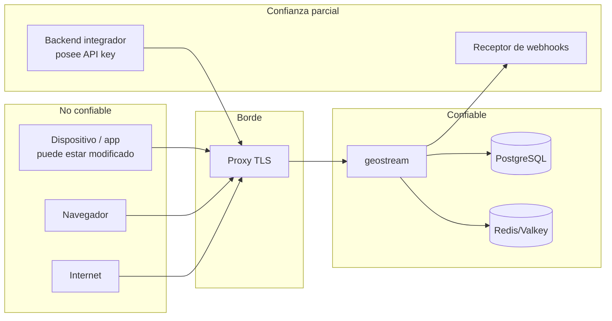

# 10 — Seguridad, privacidad y modelo de amenazas

**ID:** GS-SEC-001 · **Versión:** 0.2.0 · **Rango:** máxima precedencia (`00_INDEX.md` §3)

## 1. Objetivos

- **S-1** Solo principales autorizados leen ubicaciones, y solo mientras lo están.
- **S-2** Nadie publica ubicación en nombre de otro.
- **S-3** La revocación tiene efecto en un plazo acotado y probado (NFR-SEC-002).
- **S-4** Ningún dato cruza tenants.
- **S-5** Las coordenadas se retienen lo mínimo y nunca aparecen en registros.
- **S-6** El servicio resiste abuso de recursos sin degradar a otros tenants.
- **S-7** Las credenciales comprometidas pueden invalidarse sin redesplegar.

## 2. Activos

| Activo | Sensibilidad | Dónde vive |
|---|---|---|
| Coordenadas actuales (snapshots, mensajes en vuelo) | Muy alta | Almacén efímero (TTL), memoria |
| **Historial de puntos y viajes** (opt-in, E6) | Muy alta | PostgreSQL (`location_points` particionado, `trips`, `trip_tracks`, `stops`) |
| **Estimaciones de trayectoria** (`LocationEstimate`) | Muy alta | En vuelo (stream) y efímero |
| **Agregados analíticos** (mapas de calor, OD, velocidad, lugares) | Media-alta, k-anónimo | PostgreSQL |
| **Reportes Beacon cifrados** (E8) | Muy alta (cifrados E2E) | PostgreSQL (blobs opacos con TTL) |
| **Credenciales BYOK de proveedores** (E5) | Crítica | Cifradas en reposo (`10` §5.6) |
| **Clave `EIK` de tags** (E8) | Crítica | **Solo** en el tag y en el dispositivo dueño; nunca en el servidor |
| Relación persona–sesión–personas (grafo social) | Alta | PostgreSQL (`memberships`) |
| `external_subject_id` | Alta (puede vincularse a una persona) | PostgreSQL |
| Tokens, tickets, API keys, secretos de webhook, códigos de invitación | Crítica | Solo hashes o cifrado en reposo |
| Claves de firma JWT | Crítica | Sistema de archivos del servidor / gestor de secretos |
| `GS_DATA_ENCRYPTION_KEY` | Crítica | Gestor de secretos |
| Auditoría | Media | PostgreSQL |
| Disponibilidad del stream | Alta | — |

## 3. Límites de confianza

- Todo lo que llega del dispositivo es no confiable (incluidos `captured_at`, `is_mock`, `sequence`).
- El backend del integrador es confiable **solo dentro de su tenant** y de los scopes de su key.
- PostgreSQL y Redis/Valkey están en red privada, con credenciales separadas y TLS cuando atraviesan redes no controladas.

## 4. Modelo de amenazas (STRIDE)

| ID | Categoría | Amenaza | Controles obligatorios | Verificación |
|---|---|---|---|---|
| T-01 | Spoofing | Adivinar o filtrar un `session_id` para leer ubicaciones | El ID no es credencial; membresía + capacidad en cada operación; 404 sin relación | SCN-004 |
| T-02 | Spoofing | Robo de token de dispositivo | TTL corto (≤ `GS_TOKEN_MAX_TTL_S`), sin refresh tokens, `token_epoch`, desactivación de dispositivo | FR-AUTH-005 |
| T-03 | Spoofing | Robo de API key | Solo server-to-server; hash SHA-256; revocación por CLI con efecto en vivo; scopes mínimos; `locations:read` no por defecto | FR-AUTH-001, matriz |
| T-04 | Spoofing | Reutilizar un ticket de stream | Un solo uso (get-and-delete), TTL 30 s, redacción en logs | FR-AUTH-006 |
| T-05 | Tampering | Publicar como otro dispositivo o miembro | Identidad desde el token; `publisher_device_id`; ignorar IDs del payload | FR-SHR-004 |
| T-06 | Tampering | Replay/duplicados de muestras | Secuencia monotónica con CAS; antigüedad máxima | FR-LOC-003/004 |
| T-07 | Tampering | Ubicación falsa (mock, emulador) | GeoStream **no** puntúa fraude, no lista ni sanciona (D-10). Calcula señales de plausibilidad de bajo nivel (`PlausibilityFlag` + puntuación) porque el filtro las necesita; viajan como metadato etiquetado en `LocationEstimate` y la decisión de negocio es del integrador. Se sigue transportando `is_mock` si la plataforma lo da. **Enmienda DR-20261031-02:** el tenant puede activar el rechazo en la aceptación de `is_mock = true` (`reject_mock_samples`) y de `source = NETWORK` (`reject_network_only`), apagados por defecto; sigue sin haber puntuación de fraude, listas ni sanciones dentro de GeoStream. Atestación del dispositivo: pendiente de ADR | FR-TRK-002, vectores TRK-PLAUS |
| T-08 | Repudiation | Negar haber activado compartir o revocado a alguien | Auditoría de acciones sensibles (§8.3) | FR-PRV-005 |
| T-09 | Information disclosure | Lectura entre tenants | `tenant_id` del principal en toda consulta; pruebas negativas 100 % | NFR-SEC-004 |
| T-10 | Information disclosure | Miembro expulsado sigue recibiendo | Caché de autorización acotada + invalidación por bus + revalidación por TTL | SCN-002, NFR-SEC-002 |
| T-11 | Information disclosure | Fuga de coordenadas por logs, métricas, trazas, crash reports | Tipos redactados; prohibición de labels; prueba de captura de logs | FR-PRV-004 |
| T-12 | Information disclosure | Revelar presencia de quien no comparte | Minimización de `MemberStatus` | FR-PRS-004 |
| T-13 | Information disclosure | Retención indebida | **Línea base (historial inactivo):** sin historial, TTL de snapshot, borrado inmediato, Redis/Valkey sin persistencia. **Con historial opt-in (E6):** el historial solo existe con `tenant.history_allowed ∧ session.history_mode ≠ OFF ∧ HISTORY ∈ consent_purposes`; retirar el consentimiento detiene las escrituras de inmediato; retención por eliminación de particiones (`history_raw_retention_days`) y purga de viajes (`history_trip_retention_days`); Valkey sigue sin persistencia | NFR-PRIV-001/002, FR-HIS-001, FR-HIS-005 |
| T-14 | Information disclosure | Enumeración de invitaciones | 80 bits, hash, rate limit por dispositivo, error genérico | FR-INV-002 |
| T-15 | Information disclosure | SSRF vía URL de webhook | Validación de destino en registro y en cada entrega (DNS rebinding), sin redirecciones | FR-WHK-004 |
| T-16 | DoS | Inundación de conexiones o mensajes | Límites por IP, por conexión, por instancia; tickets; backpressure; cierre 4429/4005 | FR-STR-006, FR-LOC-007 |
| T-17 | DoS | Fan-out amplificado (sesiones enormes) | `max_members_cap`; coalescencia; métricas de fan-out | NFR-PERF-003 |
| T-18 | DoS | Tormenta de reconexión | Backoff exponencial con jitter completo en el SDK; drenaje con dispersión | NFR-SCALE-002 |
| T-19 | Elevation of privilege | Escalar capacidades vía invitaciones o PATCH | grants ⊆ capacidades del emisor; INV-MEM-1..3 | FR-INV-001, FR-MEM-003 |
| T-20 | Elevation of privilege | Aplicación activando la compartición de un usuario | INV-SHR-2: solo el propio subject | FR-SHR-002 |
| T-21 | Elevation of privilege | Compromiso de infraestructura | Mínimo privilegio en BD, secretos externos, imagen no-root, parches, segmentación | Checklist §11 |
| T-22 | Information disclosure | El servidor puede leer coordenadas | **Sesiones y REST:** aceptado y documentado, **no hay E2EE**; TLS + cifrado de disco no equivalen a E2EE (pista F16). **Tags Beacon (E8):** **sí hay E2EE**; el servidor almacena blobs opacos que no puede leer (`FR-EDGE-002`, `NFR-PRIV-004`) | FR-TRK-001, FR-EDGE-002, SCN-025 |
| T-23 | Information disclosure | Reidentificación por agregados (mapas de calor, matrices OD, perfiles de velocidad, lugares aprendidos) | k-anonimato obligatorio (`analytics_k_anonymity`, por defecto 5) sobre subjects **distintos** con consentimiento `ANALYTICS`; supresión completa (no redondeo ni degradación) de celdas, pares y lugares por debajo de *k*; resolución mínima de celda; ninguna serie individual en agregados | FR-ANA-001, NFR-PRIV-003, SCN-023 |
| T-24 | Information disclosure | Inferencia de domicilio o trabajo por paradas, viajes e historial | Scopes solo de aplicación (`history:read`, `analytics:read`); perfil de movilidad solo con consentimiento `ANALYTICS`; retención acotada; auditoría de lecturas de historial; k-anonimato en todo agregado | FR-ANA-002, FR-HIS-005, NFR-PRIV-003 |
| T-25 | Information disclosure | Exposición de conductores de un pool | INV-POOL-1 (los conductores no se ven entre sí); `nearby` y `rings` solo para aplicación (`pools:query`); `density` (`pools:density`) sin identificadores, ajustada al centroide de celda H3 con desplazamiento aleatorio acotado, rumbo cuantizado a 8 sectores y retraso mínimo `pool_density_delay_s`; borrado síncrono del índice al desconectar | FR-POOL-001/004/005/006, SCN-016, SCN-017 |
| T-26 | Information disclosure | Acoso o seguimiento no deseado con tags BLE | Protecciones DULT: estado *separado* en el tag con rotación ralentizada a 24 h, sonido y desactivación por el usuario; detector en el cliente (`dult_min_sightings`, `dult_min_distinct_locations`, `dult_min_distance_m`, `dult_min_duration_min`) que emite `UnwantedTrackerAlert` | FR-EDGE-004, `25` §3 |
| T-27 | Spoofing / DoS | Reportes Beacon falsos o inundación | Token de dispositivo con `edge:report`; límite de tasa por buscador y por `hashed_eid`; coherencia temporal obligatoria; el dueño fusiona ponderando por precisión y descarta atípicos; el servidor no puede verificar la veracidad del reporte (aceptado) | FR-EDGE-002, `25` §2.5 |
| T-28 | Information disclosure | El servidor vincula buscador y tag | El reporte **no** almacena `device_id`, `subject_id` ni IP del buscador junto al blob; marcas temporales en cubetas horarias; contadores de tasa con TTL corto; el servidor solo conoce `hashed_eid` y un timestamp grueso | NFR-PRIV-004, FR-EDGE-002 |
| T-29 | Information disclosure | Fuga hacia proveedores por el gateway del servidor | BYOK (la credencial es del tenant); manifiestos con `terms.checked_on` y `ContentPolicy`; minimización estricta (solo las coordenadas necesarias para el cálculo, nunca IDs de subject, dispositivo o sesión); caché según los términos del proveedor; contador de uso agregado por tenant y hora en PostgreSQL, nunca como etiqueta Prometheus | FR-MOB-003, ADR-0028, `13` §8 |
| T-30 | Tampering / DoS | `SamplingPolicy` abusiva que agota la batería del dispositivo | La política solo llega por el canal autenticado (`ServerHello` sobre TLS); el núcleo del cliente **acota cada valor** a los rangos duros de `17` antes de aplicarlo e ignora valores ausentes o malformados | FR-SMP-003, NFR-MOB-005 |
| T-31 | Elevation of privilege | Superficie FFI con `unsafe` | Un solo crate `gs-ffi` concentra toda la frontera; el resto del workspace mantiene `#![forbid(unsafe_code)]` sin excepción; ningún `panic` cruza la frontera (`catch_unwind` → error tipado); revisión obligatoria y *fuzzing* de esa superficie; validación de longitudes antes de construir tipos de dominio | FR-BND-007, NFR-SEC-005, ADR-0031 |
| T-32 | Spoofing | Token de consola falsificado o de otro emisor (proveedor OIDC suplantado, `alg` débil, confusión de audiencia) | Solo `GS_CONSOLE_OIDC_ISSUER`, solo EdDSA o ES256 desde su JWKS (`none` y HS* rechazados), `iss` exacto, `aud` con `GS_CONSOLE_OIDC_AUDIENCE`, `exp`/`nbf`; recarga del JWKS acotada por `GS_CONSOLE_OIDC_JWKS_MIN_REFRESH_S`; jamás un secreto compartido con Gravital | FR-CON-001, ADR-0033 |
| T-33 | Information disclosure | Robo del token de consola en el navegador (XSS, almacenamiento persistente) | Token solo en memoria, nunca en `localStorage`; PKCE `S256` sin secreto de cliente; CSP estricta sin `unsafe-inline` para scripts, `frame-ancestors 'none'`, HSTS; CORS de `/v1/console/*` limitado a `GS_CONSOLE_PUBLIC_URL` | FR-CON-001, ADR-0033 |
| T-34 | DoS / abuso | Altas masivas de cuentas u organizaciones con el registro público | `GS_CONSOLE_SIGNUP_RPM_PER_IP`, `GS_CONSOLE_MAX_ORGS_PER_ACCOUNT`, capacidades opcionales apagadas al nacer, cuotas gratuitas | FR-CON-005 |
| T-35 | Elevation of privilege | Acceso a una organización ajena o escalada de `VIEWER` a `ADMIN` | Rol comprobado por organización en cada operación; 404 para organizaciones ajenas; la cuenta de consola nunca es subject ni dispositivo y no accede a rutas de datos | FR-CON-002, FR-CON-003 |
| T-36 | Information disclosure | Fuga de API keys desde la consola | La key en claro se devuelve una sola vez al crearla y nunca se guarda (FR-AUTH-001); después solo su prefijo; auditoría de creación, rotación y revocación | FR-CON-004, FR-CON-008 |
| T-37 | DoS | Un proyecto agota recursos compartidos | Cuotas por aplicación de `17` §4 además de los límites de tasa de `5.4`; contadores en el almacén efímero | FR-CON-006 |
| T-38 | Information disclosure | API key de integrador expuesta en el navegador (XSS, extensiones, almacenamiento persistente) | Solo keys de solo lectura (`sessions:read`, `locations:read`) con vida corta; guardada solo en memoria; CSP estricta y `connect-src` acotado; el portal rechaza keys con scopes de escritura; CORS solo para los orígenes de la aplicación y `Allow-Credentials: false` | FR-PRT-004, FR-INT-003, ADR-0034 |
| T-39 | DoS / abuso | Uso de la demo pública para saturar el servicio o scraping | Demo de solo lectura sobre datos simulados con límites propios de conexiones y de tasa por IP; sin ubicaciones reales | FR-PRT-005 |
| T-40 | Information disclosure | Publicar por error documentación interna (modelo de amenazas, operaciones, configuración) | Manifiesto explícito de documentos permitidos y prueba que falla ante cualquier otro; `10`, `16`, `17` y `docs/decisions/` excluidos | FR-PRT-003 |

## 5. Controles transversales

### 5.1 Transporte
- TLS 1.2+ (preferente 1.3) terminado en el proxy; HSTS en despliegues públicos; `wss://` obligatorio fuera de `GS_ENV=dev`.
- Conexiones a PostgreSQL/Redis con TLS cuando salen de una red privada controlada.

### 5.2 Validación de entrada
Toda entrada se valida según `09`. Límites de tamaño antes de deserializar. Deserializadores sin recursión ilimitada (Protobuf con límite de tamaño de mensaje; JSON con límite de profundidad 32).

### 5.3 SSRF (webhooks)
- Solo `https` (salvo `GS_ENV=dev`), puerto 443 u otro explícito permitido por `GS_WEBHOOK_ALLOWED_PORTS`.
- Resolver DNS y rechazar si **alguna** IP resultante pertenece a: loopback, privadas (RFC 1918), CGNAT (100.64.0.0/10), link-local (169.254.0.0/16, fe80::/10), ULA (fc00::/7), multicast, `0.0.0.0/8`, `::`, metadatos de nube, salvo `GS_WEBHOOK_ALLOW_PRIVATE_NETWORKS=true`.
- Conectar a la IP validada (no volver a resolver) para evitar DNS rebinding. No seguir redirecciones.

### 5.4 Límites anti-abuso
Todos en `17_CONFIGURATION.md`: tamaño de cuerpo y trama, conexiones por instancia, upgrades por IP, fallos de auth por IP, peticiones por principal, mensajes entrantes por conexión, suscripciones por conexión, miembros por sesión, sesiones activas por subject, dispositivos por subject, invitaciones (usos y TTL), webhooks por tenant (`max_webhooks_per_tenant`), geocercas por tenant.

### 5.5 Secretos
- Solo por variables de entorno o archivos montados desde un gestor de secretos. Nunca en el repositorio ni en imágenes.
- `.env` versionado solo con valores de desarrollo no secretos (`deploy/.env.example`).
- El arranque falla si en `GS_ENV=prod` falta un secreto o tiene un valor de ejemplo conocido.

### 5.6 Criptografía (sin primitivas propias)

| Uso | Algoritmo | Crate de referencia |
|---|---|---|
| Firma de tokens | Ed25519 (EdDSA) | `jsonwebtoken` (verificación/firma), `ed25519-dalek` (generación de claves) |
| Hash de API keys, códigos, tickets | SHA-256 | `sha2` |
| Firma de webhooks | HMAC-SHA256 | `hmac` + `sha2` |
| Comparaciones de secretos | Tiempo constante | `subtle` |
| Cifrado en reposo (secretos de webhook, respuestas idempotentes con secretos) | AES-256-GCM, nonce aleatorio de 96 bits, formato `v1:<key_id>:<nonce>:<ciphertext>` | `aes-gcm` |
| Aleatoriedad | CSPRNG del sistema operativo | `rand` (`OsRng`) / `getrandom` |

`GS_DATA_ENCRYPTION_KEY` = 32 bytes en base64; admite rotación con `GS_DATA_ENCRYPTION_KEYS_OLD` (lista) para descifrar valores antiguos.

## 6. Privacidad

### 6.1 Principios aplicados
1. **Consentimiento explícito por sesión**: `sharing=false` por defecto; solo el propio subject lo activa (INV-SHR-2). El integrador es responsable de obtener y registrar el consentimiento en su UX.
2. **Minimización**: no se guarda historial; el snapshot es efímero; `MemberStatus` no revela presencia de quien no comparte; los webhooks no contienen coordenadas.
3. **Limitación de finalidad**: GeoStream no usa las ubicaciones para nada distinto de distribuirlas a los autorizados.
4. **Transparencia**: estado de compartición observable en el SDK y en la API.
5. **Control y revocación**: detener compartición, abandonar, borrar subject.
6. **Límite físico de la revocación**: lo ya entregado a otros participantes no puede "desrecibirse"; el SDK lo descarta de la UI al recibir `sharing=false`, pero una app modificada podría conservarlo. Debe comunicarse al usuario final.

### 6.2 Inventario de datos

| Dato | Almacén | Retención | Notas |
|---|---|---|---|
| Snapshot (última ubicación) | Efímero | `snapshot_ttl_seconds` o hasta detener/revocar/cerrar | Puede desactivarse (`0`) |
| Secuencia por dispositivo/sesión | Efímero | 7 días desde la última escritura | Sin coordenadas |
| Presencia | Efímero | `GS_PRESENCE_TTL_S` | Sin coordenadas |
| Tenants, aplicaciones, keys (hash) | PostgreSQL | Mientras existan | |
| Subjects (`external_subject_id`) | PostgreSQL | Hasta borrado | Anonimizado al borrar |
| Dispositivos | PostgreSQL | Hasta borrado del subject | |
| Sesiones y membresías | PostgreSQL | `GS_RETENTION_CLOSED_SESSIONS_D` tras cerrar/expirar | Sin coordenadas |
| Invitaciones (hash) | PostgreSQL | `GS_RETENTION_INVITATIONS_D` tras expirar | |
| Auditoría | PostgreSQL | `GS_RETENTION_AUDIT_D` | Sin coordenadas |
| Claves de idempotencia | PostgreSQL | `GS_RETENTION_IDEMPOTENCY_H` | Respuestas con secretos cifradas |
| Entregas de webhook | PostgreSQL | `GS_RETENTION_WEBHOOK_DELIVERIES_D` | Sin coordenadas |
| Geocercas (F11) | PostgreSQL | Hasta borrado | Lugares, no personas |
| Historial de puntos (E6, opt-in) | PostgreSQL | `history_raw_retention_days`; borrado inmediato al retirar consentimiento y al borrar el subject | Solo con triple llave de `24` §1; particionado por día |
| Viajes y paradas (E6, opt-in) | PostgreSQL | `history_trip_retention_days` | Polilínea `gsp1` simplificada; sin más precisión que `trip_simplify_tolerance_m` |
| Agregados H3, lugares aprendidos, perfiles de velocidad (E6/E7) | PostgreSQL | Derivados; se recalculan | **k-anónimos**; sin series por subject |
| Estado del filtro, odómetro y paradas (E2) | Efímero | `GS_TRACK_STATE_TTL_S`; borrado junto al snapshot | Coordenadas derivadas; mismo borrado inmediato |
| Reportes Beacon (E8) | PostgreSQL (blob opaco) | `edge_report_ttl_hours` | Cifrados E2E; **el servidor no puede leerlos** |
| Credenciales BYOK de proveedor (E5) | PostgreSQL | While exista la configuración | Cifradas en reposo; nunca en respuestas ni logs |

### 6.3 Qué ve cada parte

| Parte | Ve |
|---|---|
| Miembro con `read` | Ubicaciones de miembros que comparten en esa sesión, mientras sea miembro con `read` |
| Backend con `locations:read` | Ubicaciones de cualquier sesión del tenant (auditado) |
| Backend sin `locations:read` | Sesiones, miembros, estados, eventos; nunca coordenadas |
| Backend con `pools:query` | Posiciones de los miembros de un `POOL` de su tenant; nunca las de otro pool |
| **Pasajero con `pools:density` (E4)** | **Solo marcadores aproximados y anónimos de densidad**, sin identificadores, cuantizados a celda H3, con desplazamiento y retraso |
| **Backend con `history:read` (E6)** | Trazas, viajes y exportaciones del tenant, subjects con consentimiento `HISTORY` |
| **Backend con `analytics:read` (E6)** | Agregados k-anónimos; el perfil de movilidad exige consentimiento `ANALYTICS` del subject |
| Operador | Métricas agregadas y logs sin coordenadas; con acceso a la infraestructura podría leer snapshots en memoria/Redis y el historial en PostgreSQL (riesgo aceptado y documentado, T-22) |
| Proveedor de mapas | Lo que el SDK de mapas del cliente le envíe (tiles del área visible); fuera del control de GeoStream; documentado en `13` |
| **Proveedor de rutas/matrices (E5)** | **Solo las coordenadas estrictamente necesarias** para el cálculo delegado por el tenant, mediante BYOK; nunca IDs de subject, dispositivo o sesión |
| **Buscador Beacon (E8)** | **Solo el `EID` que escucha** y su propia posición; nunca la ubicación del tag ni de otros usuarios |
| **Servidor (tags Beacon, E8)** | **Nada de las ubicaciones de tags** (solo blobs opacos), salvo que el dueño use el puente explícito de `25` §2.8 |

## 7. Retención y borrado

### 7.1 Jobs de retención (rol worker, F10)
Purga diaria por lotes (`FOR UPDATE SKIP LOCKED`) según los parámetros `GS_RETENTION_*`. Cada job registra cuántas filas borró (métrica), nunca qué.

**Historial opt-in (E6):** el rol `worker` (o `analytics`) crea las particiones de `location_points` con `GS_HISTORY_PARTITION_LOOKAHEAD_DAYS` de antelación y **elimina particiones completas** al vencer `history_raw_retention_days`; purga `trips`, `trip_tracks` y `stops` según `history_trip_retention_days`. Eliminar una partición completa es barato y no deja huecos; no requiere `pg_partman` ni PostGIS.

### 7.2 Borrado de subject (`DELETE /v1/subjects/{id}`)
En una transacción, más efectos efímeros antes de responder:
1. `token_epoch++`; `status=ERASED`; `external_subject_id=NULL`; `erased_at=now()`.
2. Todos sus dispositivos → `INACTIVE`.
3. Todas sus membresías `ACTIVE` → `REVOKED` con efectos de `05` §5.2 (snapshots borrados, eventos, transferencia de propiedad).
4. Auditoría: `subject_id` se conserva como UUID sin enlace a identidad externa; `details` se purga de cualquier `external_subject_id`.
5. Outbox: `member.revoked` por cada membresía afectada (con `external_subject_id` ya nulo → se envía el valor `"erased"`).
6. Bus: `SubjectTokensRevoked`.
7. **Historial del subject (E6):** se eliminan sus filas de `location_points`, `trips`, `trip_tracks` y `stops`, y sus claves efímeras `{p}:odo:*` y `{p}:stop:*`. Los agregados k-anónimos **no** contienen datos personales y se documentan como tales en §6.2; no se recalculan para «borrar» al subject porque no lo identifican.

### 7.3 Exportación
`GET /v1/subjects/{id}/export` devuelve subject, dispositivos, membresías y auditoría asociada. **Con historial activo (E6) incluye además su historial de puntos, sus viajes y sus paradas.** La exportación masiva de un tenant se hace con `POST /v1/exports` (NDJSON o CSV) con URL de descarga de TTL corto.

## 8. Registro seguro

### 8.1 Permitido por defecto
IDs opacos (`req_`, `con_`, `ses_`, `mem_`, `dev_`, `sub_`), códigos de error, duraciones, contadores, nombres de operación, estado HTTP, versión de SDK/plataforma.

### 8.2 Prohibido siempre
Latitud/longitud (o cualquier campo de `Position`), direcciones derivadas, tokens, tickets, API keys (ni siquiera parciales, salvo el `key_id`), secretos de webhook, códigos de invitación, cuerpos completos de petición o mensaje, `metadata` de sesión, `external_subject_id` (se registra `sub_…` en su lugar).

**Regla reforzada con el historial y la capa aprendida (E6/E7).** Una **celda H3**, una **estimación** (`LocationEstimate`), una **polilínea** (`trip_tracks`, `gsp1`), un **centroide de parada**, una **posición de densidad** o un **perfil de velocidad** **de un individuo** son coordenadas a efectos de redacción. Están **prohibidos** en logs, métricas, trazas y errores, con la misma fuerza que un par de latitud/longitud:

- Ninguna etiqueta de métrica Prometheus puede contener `h3_cell`, `member_id`, `session_id`, `device_id`, `subject_id` ni `tenant_id` (NFR-OBS-002, ADR-0017).
- El contador de uso del Provider Gateway se agrega por tenant y hora **en PostgreSQL**, nunca como etiqueta de métrica.
- Los agregados se registran solo como **totales de filas suprimidas o publicadas**, nunca con sus valores.
- El verificador de captura de logs (`18` §7) se amplía con los valores sintéticos de los vectores GEO-*, TRK-*, SMP-*, PRD, POOL-Q, ETA-EST, ASG, EDGE-EID y EDGE-RPT.

Mecanismo obligatorio:
- Los tipos con coordenadas implementan `Debug`/`Display` redactados y **no** implementan `Serialize` hacia logs (la serialización existe solo en el codec de protocolo).
- Los tipos de secretos (`ApiKeySecret`, `AccessToken`, `Ticket`, `InvitationCode`, `WebhookSecret`) son newtypes con `Debug` redactado y `Zeroize` al soltarse.
- El middleware de logs de acceso redacta `ticket` y nunca registra cabeceras `Authorization`.
- `GS_LOG_UNSAFE_LOCATIONS=true` solo se acepta con `GS_ENV=dev`; en otro entorno el arranque falla.

### 8.3 Acciones auditadas
`tenant.created|disabled|enabled`, `application.created|disabled`, `api_key.created|revoked`, `token.minted` (agregado: se registra como contador por aplicación, no por token), `subject.tokens_revoked`, `subject.erased`, `subject.exported`, `device.deactivated`, `session.created|updated|closed|expired`, `member.added|updated|revoked|left`, `invitation.created|revoked|redeemed`, `sharing.started|stopped`, `locations.read_by_application` (snapshot REST o suscripción de aplicación; una entrada por suscripción, no por mensaje), `webhook.created|deleted|disabled`, `geofence.created|deleted`.

**Acciones añadidas por la pista E** (mismo criterio: sin coordenadas, con `actor_kind`, `actor_id`, `subject_id`, `target_kind`, `target_id`, `outcome`, `request_id` y detalles estructurados):
`membership.consent_updated` (INV-SHR-5, con los propósitos antes y después), `pool.member_availability_changed`, `provider.configured|rotated|deleted` (alta y rotación de credenciales BYOK), `tag.registered|removed`, `history.read_by_application` (consulta de trazas y viajes; una entrada por consulta, nunca por punto), `analytics.read_by_application` (una entrada por consulta agregada), `export.requested|completed`.

## 9. Marco legal (orientativo, no es asesoría legal)

- La ubicación de una persona identificable es **dato personal**. En Panamá aplica la Ley 81 de 2019 sobre Protección de Datos Personales y su reglamento (Decreto Ejecutivo 285 de 2021); con usuarios en la UE, el RGPD; otras jurisdicciones según los usuarios del integrador.
- Roles habituales: el **integrador** es responsable del tratamiento (decide finalidad, obtiene consentimiento, informa al usuario). Quien **opere GeoStream como servicio** para terceros actúa como encargado y necesita un contrato de encargo. En autoalojamiento, el integrador es ambos.
- El integrador DEBE: obtener consentimiento informado antes de llamar `sharing=true`; explicar la finalidad, quién verá la ubicación y cuánto tiempo; declarar el uso de ubicación en segundo plano ante Google Play y App Store; ofrecer forma de dejar de compartir; atender derechos de acceso/supresión (endpoints de F10).
- **Con historial y analítica de comportamiento (E6), el riesgo legal aumenta de forma cualitativa.** Antes del release de E6 el propietario debe completar la tarea **T-E6-11**: revisión de DPIA, textos de consentimiento **con propósitos** (`HISTORY`, `ANALYTICS` aprobados por separado) y contratos de tratamiento con los integradores. Mientras esa revisión no esté cerrada, `history_allowed` y `analytics_allowed` permanecen en `false` por defecto y ningún tenant puede activarlos.
- **Tags Beacon (E8):** el tag emite identificadores rotatorios y el buscador solo ve el `EID` que escucha; aun así, un integrador que registre tags debe informar del despliegue de la red de búsqueda y ofrecer la desactivación del anuncio (T-26).
- Se recomienda una evaluación de impacto (DPIA) antes de producción para casos de seguimiento continuo (familia, empleados, flota).
- Verificar el marco vigente con asesoría legal: este documento no reemplaza esa revisión.

## 10. Vulnerabilidades e incidentes
- Política de divulgación en `SECURITY.md` (raíz).
- Dependencias: `cargo deny` y `cargo audit` en CI; dependencias Dart revisadas en cada release.
- Incidente que exponga coordenadas o credenciales: rotar claves afectadas (`06` §4.4 / API keys / `GS_DATA_ENCRYPTION_KEY`), revocar tokens de subjects afectados, preservar auditoría, notificar según el marco legal aplicable.

## 11. Checklist de liberación (cada release pública)

- [ ] Modelo de amenazas revisado frente a los cambios del release.
- [ ] Matriz de autorización REST y stream: 100 % verde.
- [ ] Escenarios SCN-002, SCN-004, SCN-010 verdes; plazo NFR-SEC-002 medido.
- [ ] Prueba de captura de logs sin coordenadas ni secretos.
- [ ] `/metrics` sin labels prohibidos.
- [ ] Rate limits y límites de tamaño probados.
- [ ] `cargo deny` / `cargo audit` sin advisories altas abiertas.
- [ ] Licencias de dependencias compatibles con la licencia del proyecto (ADR-0019).
- [ ] Fuzzing nocturno sin fallos durante la última semana (desde F10).
- [ ] Retención y borrado probados (desde F10).
- [ ] Imagen de contenedor no-root, sin secretos, con SBOM.
- [ ] Runbook de rotación de claves ensayado (desde F12).

## 12. Pruebas de seguridad requeridas
Ver `18_TESTING_STRATEGY.md` §7: matriz de autorización, aislamiento de tenants, revocación con medición, captura de logs, SSRF, fuzzing, límites de abuso.
