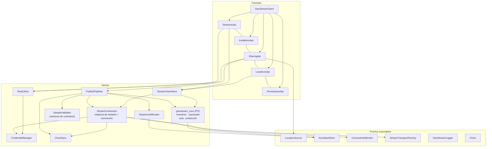

# 12 — SDK Flutter

**ID:** GS-SDK-001 · **Versión:** 0.3.0 · **Decisiones:** ADR-0012, ADR-0014 (ampliada), ADR-0022, ADR-0025, ADR-0030, ADR-0031
**Requisitos:** FR-SDK-001..016, FR-MAP-*, FR-SMP-*, FR-CORE-*, FR-BND-*, NFR-MOB-*, NFR-COMPAT-001/003

## 1. Objetivo
Que un integrador comparta y muestre ubicación en tiempo real con pocas líneas, sin acoplarse a un proveedor de mapas, con estados y errores explícitos y con comportamiento correcto ante permisos, segundo plano, pérdida de red y relojes desfasados.

**Ampliación de la pista E.** Además de compartir y mostrar, el SDK **decide cuándo publicar** (§11.1), **sobrevive a la desconexión** con cola cifrada (§13.2), **suaviza el dibujo** localmente (§13.3) y expone la **estimación del servidor** como dato derivado (`estimate`). El objetivo es que la lógica que decide sea **la misma en todos los SDK** y no una reimplementación por lenguaje (`26` §1).

## 2. Paquetes

| Paquete | Fase | Contenido | Dependencias de mapas |
|---|---|---|---|
| `geostream` | F5 | Núcleo: cliente REST, stream, credenciales, ubicación, compartición, vistas de sesión | Ninguna (FR-SDK-016) |
| `geostream_core` | E3 | Bindings FFI de `gs-client-core` + `gs-client-runtime` (ADR-0031) | Ninguna |
| `geostream_maps` | F9 | Interfaces de renderer, geocodificación, rutas y `ProviderStack` | Ninguna |
| `geostream_maps_maplibre` | F9 | Adaptador MapLibre | `maplibre_gl` |
| `geostream_maps_google` | F9 | Adaptador Google Maps | `google_maps_flutter` |
| `example/` | F5 | App de ejemplo (lista en F5, mapa en F9) | Las de los adaptadores |

Ubicación: `sdks/flutter/`. Los nombres de paquete en pub.dev se verifican en F5 (T-F5-01) antes de publicar.

## 3. Arquitectura interna



Reglas: la fachada no expone tipos de transporte ni Protobuf; los modelos públicos son clases Dart inmutables propias. Todos los puertos de plataforma son inyectables (FR-SDK-015).

**El núcleo es opcional en tiempo de ejecución.** Si `geostream_core` no está disponible (build web, plataforma sin FFI), el SDK cae a una implementación Dart equivalente con la **misma** semántica y los mismos vectores `SMP-*`/`PRED-*`. La equivalencia se verifica en CI (`26` §4); no es una degradación silenciosa de la calidad, es una segunda implementación probada.

## 4. API pública (normativa)

```dart
class GeoStreamClient {
  GeoStreamClient(GeoStreamConfig config);

  /// Carga installation_id y secuencia, prepara puertos. Idempotente.
  Future<void> initialize();

  Stream<ClientState> get states;
  ClientState get state;

  SessionsApi get sessions;
  InvitationsApi get invitations;
  SharingApi get sharing;
  LocationsApi get locations;
  PermissionsApi get permissions;

  /// installation_id persistido (no secreto). Lo usa el CredentialProvider.
  String get installationId;

  /// Detiene compartición local, cierra conexión y libera recursos. Idempotente.
  Future<void> dispose();
}

class GeoStreamConfig {
  const GeoStreamConfig({
    required this.baseUrl,
    required this.credentialProvider,
    this.locationSource,             // por defecto: GeolocatorLocationSource
    this.store,                      // por defecto: SharedPreferencesStore
    this.logger,                     // por defecto: sin logs
    this.httpClient,                 // por defecto: http.Client()
    this.transportFactory,           // por defecto: WebSocketChannel
    this.connectivity,               // por defecto: ConnectivityPlusMonitor
    this.clock,                      // por defecto: SystemClock
    this.subprotocols = const [StreamSubprotocol.proto],
    this.reconnectPolicy = const ReconnectPolicy(),
    this.appVersion = '',
    this.backgroundDisconnectDelay = const Duration(seconds: 30),
    this.pauseAutoStopAfter = const Duration(minutes: 10),
  });
  // campos finales homónimos…
}

/// Implementado por el integrador: llama a SU backend, que llama a POST /v1/tokens.
abstract interface class CredentialProvider {
  Future<AccessToken> getAccessToken({
    required String installationId,
    required bool forceRefresh,
  });
}

final class AccessToken {
  const AccessToken({required this.value, required this.expiresAt});
  final String value;
  final DateTime expiresAt; // UTC
}

abstract interface class SessionsApi {
  Future<Session> create(CreateSessionOptions options);
  Future<Session> get(String sessionId);
  Future<Page<Session>> list({int limit = 50, String? cursor});
  Future<Session> update(String sessionId, UpdateSessionOptions options, {int? ifMatchVersion});
  Future<Session> close(String sessionId);
  Future<void> leave(String sessionId);
  Future<Page<Member>> members(String sessionId, {int limit = 50, String? cursor});
  Future<Member> me(String sessionId);
  /// Suscribe al stream mientras haya oyentes; reconstruye el estado tras reconexión.
  Stream<SessionView> watch(String sessionId);
}

abstract interface class InvitationsApi {
  Future<CreatedInvitation> create(String sessionId, {Capabilities? grants, int maxUses = 1, Duration? expiresIn});
  Future<RedeemedInvitation> redeem(String code);
  Future<void> revoke(String sessionId, String invitationId);
}

abstract interface class SharingApi {
  Future<void> start(
    String sessionId, {
    SamplingProfile profile = SamplingProfile.balanced,
    BackgroundMode background = BackgroundMode.foregroundOnly,
  });
  Future<void> stop(String sessionId);
  Stream<SharingState> states(String sessionId);
  SharingState state(String sessionId);
}

abstract interface class LocationsApi {
  /// LocationUpdate crudas (ya filtradas por secuencia por miembro).
  Stream<LocationUpdate> watch(String sessionId);
  Future<SessionSnapshot> snapshot(String sessionId);
}

abstract interface class PermissionsApi {
  Future<LocationPermissionStatus> check();
  /// Muestra el diálogo del sistema. El SDK NUNCA lo muestra por iniciativa propia.
  Future<LocationPermissionStatus> request(LocationPermissionLevel level);
  Future<bool> openAppSettings();
  Future<bool> openLocationSettings();
}

enum SamplingProfile { navigation, balanced, fleet, lowPower }
enum BackgroundMode { foregroundOnly, continueInBackground, always }
enum LocationPermissionLevel { whileInUse, always }
enum LocationPermissionStatus { granted, grantedWhileInUseOnly, approximateOnly, denied, deniedForever, restricted, servicesDisabled }
enum StreamSubprotocol { proto, json }
```

Modelos públicos (inmutables, con `==`/`hashCode`, sin dependencias de Protobuf): `Session`, `Member`, `Capabilities`, `SessionMode`, `SessionStatus`, `MemberRole`, `Connectivity`, `Position`, `LocationQuality`, `LocationSample`, `LocationUpdate { sessionId, memberId, sample, receivedAt, delivery }`, `SessionView`, `MemberView`, `SessionSnapshot`, `CreatedInvitation`, `RedeemedInvitation`, `Page<T> { items, nextCursor }`, `CreateSessionOptions`, `UpdateSessionOptions`, `ReconnectPolicy`.

```dart
final class SessionView {
  final Session session;
  final Map<String, MemberView> members;   // por memberId, solo miembros ACTIVE
  final bool live;                         // false mientras se reconecta
}

final class MemberView {
  final Member member;                     // incluye sharing, connectivity, role, capabilities
  final LocationUpdate? lastLocation;      // null si no comparte o sin datos
  final LocationFreshness freshness;       // live | stale | none (calculado con hora del servidor)
}
enum LocationFreshness { live, stale, none }
```

Ejemplo de uso (ILUSTRATIVO):

```dart
final geo = GeoStreamClient(GeoStreamConfig(
  baseUrl: Uri.parse('https://geo.example.com'),
  credentialProvider: MyBackendCredentialProvider(),
));
await geo.initialize();

final perm = await geo.permissions.request(LocationPermissionLevel.whileInUse);
if (perm != LocationPermissionStatus.granted) { /* UX del integrador */ }

final invite = await geo.invitations.redeem('ABCD-EFGH-JKMN-PQRS');
await geo.sharing.start(invite.session.id, background: BackgroundMode.continueInBackground);

final sub = geo.sessions.watch(invite.session.id).listen((view) {
  for (final m in view.members.values) { /* pintar m.lastLocation */ }
});
// …
await geo.sharing.stop(invite.session.id);   // dejar de compartir sin salir
await sub.cancel();
await geo.dispose();
```

## 5. Estados

```dart
sealed class ClientState {}
final class Uninitialized extends ClientState {}
final class Idle extends ClientState {}                       // inicializado, sin conexión necesaria
final class Connecting extends ClientState { final int attempt; }
final class Connected extends ClientState { final String connectionId; }
final class Reconnecting extends ClientState { final int attempt; final DateTime retryAt; final GeoStreamException? lastError; }
final class Offline extends ClientState {}                    // sin red según ConnectivityMonitor
final class Superseded extends ClientState {}                 // cierre 4409
final class AuthFailed extends ClientState { final GeoStreamException error; }
final class Disposed extends ClientState {}

sealed class SharingState {}
final class NotSharing extends SharingState {}
final class SharingStarting extends SharingState {}
final class Sharing extends SharingState { final SamplingProfile profile; final bool approximate; final DateTime? lastPublishedAt; }
final class SharingPaused extends SharingState { final PauseReason reason; }
final class SharingStopping extends SharingState {}
final class SharingFailed extends SharingState { final GeoStreamException error; }

enum PauseReason { permissionRevoked, locationServicesDisabled, backgroundRestricted, offline, serverUnavailable }
```

Transiciones de compartición:
- `start` → `SharingStarting` → (`Sharing` | `SharingFailed`).
- Pérdida de permiso/servicio/red durante `Sharing` → `SharingPaused(reason)`; al recuperarse → `Sharing` automáticamente.
- `stop` → `SharingStopping` → `NotSharing`. Si el servidor emite `MemberStatus{sharing=false}` o el miembro es revocado/sale/la sesión termina → `NotSharing` (o `SharingFailed` con la excepción correspondiente).

## 6. Errores

```dart
sealed class GeoStreamException implements Exception {
  String get message;
  ErrorCode? get code;      // del catálogo (09 §6), si vino del servidor
  String? get requestId;
}
```

| Excepción | Códigos del servidor / causa local |
|---|---|
| `PermissionException(status)` | Permiso de ubicación insuficiente (local) |
| `LocationServiceDisabledException` | Servicio de ubicación apagado (local) |
| `ConfigurationException` | Configuración inválida, `ProviderStack` prohibido (local) |
| `AuthenticationException` | `UNAUTHENTICATED`, `TOKEN_EXPIRED`; fallo del `CredentialProvider` |
| `AuthorizationException` | `PERMISSION_DENIED`, `INSUFFICIENT_SCOPE`, `ACCOUNT_DISABLED`, `MEMBER_REVOKED`, `NOT_PUBLISHER` |
| `NotFoundException` | `NOT_FOUND`, `INVITATION_INVALID` |
| `SessionStateException` | `SESSION_CLOSED`, `SESSION_EXPIRED`, `SESSION_FULL`, `NOT_SHARING` |
| `ConflictException` | `CONFLICT`, `PRECONDITION_FAILED`, `IDEMPOTENCY_KEY_REUSED` |
| `ValidationException` | `VALIDATION_FAILED`, `INVALID_LOCATION`, `PAYLOAD_TOO_LARGE` |
| `RateLimitException(retryAfter)` | `RATE_LIMITED` |
| `ProtocolException` | `PROTOCOL_ERROR`, `PROTOCOL_VERSION_UNSUPPORTED`, `TOO_MANY_SUBSCRIPTIONS`; cierres 4000/4001 |
| `ServerException` | `INTERNAL`, `TEMPORARILY_UNAVAILABLE` |
| `NetworkException` | Errores de transporte, timeouts (local) |
| `StorageException` | Fallo del `KeyValueStore` (local) |
| `ProviderException` | Fallo de un adaptador de mapas/geocodificación/rutas (F9) |

Una prueba recorre todos los valores de `ErrorCode` y verifica que cada uno mapea a exactamente una excepción (FR-SDK-009). Un código desconocido (servidor más nuevo) mapea a `ServerException`.

## 7. Permisos y servicios de ubicación
- El SDK **no** solicita permisos por su cuenta: `sharing.start` comprueba y, si falta, lanza `PermissionException` con el estado actual. La app decide cuándo y cómo pedirlo con `permissions.request` (FR-SDK-003).
- Nivel requerido por modo de segundo plano:

| `BackgroundMode` | Android | iOS |
|---|---|---|
| `foregroundOnly` | `ACCESS_FINE_LOCATION` o `ACCESS_COARSE_LOCATION` | When In Use |
| `continueInBackground` | Igual + foreground service de tipo `location` **iniciado con la app visible** | When In Use + `allowsBackgroundLocationUpdates` (indicador azul) iniciado en primer plano |
| `always` | + `ACCESS_BACKGROUND_LOCATION` (necesario solo para empezar a compartir estando en segundo plano) | Always |

- Precisión reducida (Android coarse / iOS approximate): se permite compartir; `Sharing.approximate = true`; la precisión real viaja en `horizontal_accuracy_m`.
- Servicio apagado → `LocationServiceDisabledException` en `start`; durante la compartición → `SharingPaused(locationServicesDisabled)`.
- Permiso revocado mientras se comparte → `SharingPaused(permissionRevoked)`; el SDK **no** detiene la compartición en el servidor automáticamente: notifica a la app, que decide (`stop` o pedir permiso). Si el permiso no vuelve en `GeoStreamConfig.pauseAutoStopAfter` (default 10 min), el SDK llama `stop` para no dejar a otros viendo una ubicación congelada como si fuera actual.

## 8. Conexión y reconexión
- **Perezosa**: se conecta cuando hay al menos un `watch` activo o una sesión compartiendo; se desconecta `backgroundDisconnectDelay` después de pasar a segundo plano si no comparte, y 30 s después de quedarse sin necesidades en primer plano.
- Secuencia de conexión: token (`CredentialManager`, renovación cuando falta < 20 % de vida) → `POST /v1/stream/tickets` → upgrade → `ClientHello` → `ServerHello` → aplicar `sequence_floor`, límites y desfase → re-suscribir todas las sesiones observadas → reanudar publicación.
- Backoff (`ReconnectPolicy`): `delay = random(0, min(maxDelay, base · 2^attempt))` (jitter completo), `base = 500 ms`, `maxDelay = 30 s`; el contador se reinicia tras 60 s conectado. Cambio de red detectado → reintento inmediato una vez.
- Por código de cierre: tabla de `08` §8. Resumen: 4401 → `forceRefresh` y reconectar (si el proveedor falla → `AuthFailed`); 4403 y 4001 → no reconectar; 4409 → `Superseded`, no reconectar; 4408 → reconectar sin espera; 4503 con `ServerNotice` → esperar `reconnect_after_ms`; resto → backoff.
- `AuthExpiring` → obtener token con `forceRefresh: true` y enviar `AuthRefresh`; si falla, dejar que el servidor cierre con 4401 y reconectar.
- `Heartbeat` cada `limits.heartbeat_interval_ms`; si no llega ninguna trama del servidor en `idle_timeout_ms`, el cliente cierra y reconecta.

## 9. Installation ID y secuencia (ADR-0008)
- Claves en el `KeyValueStore` (el mismo almacén para ambas): `gs.v1.installation_id` (UUID v4) y `gs.v1.seq_reserved` (entero).
- Asignación por bloques: al inicializar, `next = seq_reserved` (o 1 si no existe) y se persiste `seq_reserved = next + 100` **antes** de usar `next`. Al alcanzar el valor reservado, se reserva otro bloque. Un cierre abrupto deja huecos (permitidos), nunca repeticiones.
- Tras `ServerHello`: `next = max(next, sequence_floor + 1)`; si supera la reserva, reservar de nuevo.
- Si el almacén está corrupto o falta una de las dos claves: generar `installation_id` nuevo y empezar en 1 (el servidor lo verá como dispositivo nuevo al emitirse su token).
- La secuencia es por instalación, compartida entre sesiones: una muestra publicada a dos sesiones lleva la misma `sequence` en ambas.

## 10. Desfase de reloj
- Muestras: en el hello (`t0` envío local, `t1` recepción local, `ts = server_time`) y en cada `HeartbeatAck` (eco de `client_time`): `offset = ts − (t0 + t1)/2`, `rtt = t1 − t0`.
- Mantener las últimas 8; usar el `offset` de la muestra de menor `rtt`.
- `captured_at` enviado = instante de la medición según el reloj del dispositivo + `offset`.
- La frescura en `SessionView` usa `ahora_local + offset` frente a `captured_at`.

## 11. Muestreo y conversión

Perfiles (valores iniciales, a validar en campo — NFR-MOB-002):

| Perfil | Precisión solicitada | Filtro de distancia | Intervalo deseado | Intervalo mínimo de publicación | Fix de mantenimiento |
|---|---|---|---|---|---|
| `navigation` | máxima | 5 m | 1 s | máx(1 s, `min_publish_interval_ms`) | 15 s |
| `balanced` | alta | 10 m | 3 s | máx(3 s, servidor) | 60 s |
| `fleet` | media | 25 m | 10 s | máx(10 s, servidor) | 120 s |
| `lowPower` | baja (ahorro) | 100 m | 60 s | máx(60 s, servidor) | 300 s |

- Una sola fuente de ubicación activa aunque se comparta en varias sesiones; el perfil efectivo es el más exigente de las sesiones activas.
- **Fix de mantenimiento**: si no llega ninguna medición en ese intervalo (dispositivo quieto con filtro de distancia), se solicita una posición actual real y se publica. Nunca se republica una medición antigua con otro `captured_at`.
- Conversión desde la plataforma (antes de validar con `SampleValidator`):
  - velocidad < 0 o NaN → ausente; rumbo < 0 o NaN → ausente; rumbo == 360 → 0;
  - precisión horizontal ≤ 0 o NaN → **descartar** la medición (registrar contador local);
  - altitud con precisión vertical desconocida (0 o negativa en Android) → altitud ausente;
  - `is_mock` si la plataforma lo expone;
  - `kind = MEASURED`; `source` = `FUSED` si la plataforma indica proveedor fusionado, `GNSS` si indica GPS, si no `UNSPECIFIED`.
- `SampleValidator` aplica las reglas de `09` §3 con los vectores de `contracts/test-vectors/location_samples.json`; una muestra inválida no se envía (contador `invalid_samples_dropped`).

## 11.1 Muestreo adaptativo y publicación por cambio (E3)

Los perfiles de §11 son el **punto de partida**. En la pista E la decisión de cuándo publicar pasa a ser adaptativa, y la lógica vive en `gs-client-core` (Rust), no en Dart, para que sea la misma en todos los SDK (`26` §1, ADR-0022).

- **Regla de publicación por cambio significativo** (`22` §3.3): se publica cuando se cumple **cualquiera** de estas condiciones, lo que ocurra antes:
  - la distancia al último punto publicado supera `publish_min_distance_m`;
  - la precisión empeora por un factor > `publish_accuracy_factor` sobre la mejor conocida;
  - el rumbo cambia más de `publish_min_course_change_deg` con velocidad ≥ `publish_turn_min_speed_mps`;
  - la velocidad cambia más de `publish_min_speed_change_mps`;
  - han pasado `publish_max_silence_s` sin publicar (garantiza el heartbeat de datos).
- **Reglas de muestreo** (`22` §3.2): la `SamplingPolicy` que llega en `ServerHello.sampling` agrupa por velocidad, precisión y zona (urbana / carretera / rural / desconocido) en cuatro grupos; cada grupo tiene su intervalo. El cliente **acota cada valor** a los rangos de `17` §4.1 antes de aplicarlo e ignora valores ausentes o malformados (T-30).
- La degradación por confianza de actividad sube un escalón el intervalo del grupo tras `sampling_downgrade_confirm_s` con confianza ≥ `sampling_activity_confidence`. Nunca se acelera sin la condición de movimiento que lo justifique.
- El perfil `NavigationProfile` sigue siendo un límite superior: el adaptativo nunca publica más rápido que el mínimo del perfil.

## 12. Segundo plano

### 12.1 Android
- Declaraciones necesarias (la lista exacta depende del plugin elegido en F5; verificar contra su documentación):

```xml
<uses-permission android:name="android.permission.INTERNET"/>
<uses-permission android:name="android.permission.ACCESS_COARSE_LOCATION"/>
<uses-permission android:name="android.permission.ACCESS_FINE_LOCATION"/>
<uses-permission android:name="android.permission.FOREGROUND_SERVICE"/>
<uses-permission android:name="android.permission.FOREGROUND_SERVICE_LOCATION"/>
<uses-permission android:name="android.permission.POST_NOTIFICATIONS"/>
<!-- Solo con BackgroundMode.always -->
<uses-permission android:name="android.permission.ACCESS_BACKGROUND_LOCATION"/>
```

- `continueInBackground` arranca un foreground service de tipo `location` con notificación persistente configurable (título, texto, icono) **mientras la app está visible**; Android restringe iniciar foreground services desde segundo plano.
- Fabricantes con gestión agresiva de batería pueden matar el proceso: documentar en la guía cómo pedir exclusión de optimización de batería (decisión del integrador) y probar en un dispositivo así (NFR-MOB-001).
- Publicar en Google Play con ubicación en segundo plano exige la declaración de uso correspondiente: responsabilidad del integrador.

### 12.2 iOS (F7)
- `Info.plist`: `NSLocationWhenInUseUsageDescription`; `NSLocationAlwaysAndWhenInUseUsageDescription` (solo con `always`); `UIBackgroundModes` con `location`.
- `continueInBackground`: actualizaciones iniciadas en primer plano con `allowsBackgroundLocationUpdates = true` y `showsBackgroundLocationIndicator = true`.
- `pausesLocationUpdatesAutomatically = false` mientras se comparte con `navigation`/`balanced`; `true` permitido con `lowPower`.
- El sistema puede suspender la app; no se promete ejecución indefinida (NG-3).

### 12.3 Cuando Flutter no basta
Si el plugin elegido no expone una capacidad necesaria de forma fiable, se implementa un plugin propio mínimo en Kotlin/Swift dentro de `sdks/flutter/geostream/` mediante platform channels, con ADR que lo justifique.

## 13. Política offline (ADR-0014, ampliada por ADR-0025)

### 13.1 `latestOnly` — política de la línea base
- Sin conexión se conserva en memoria solo la última muestra válida por sesión; al reconectar se envía si su antigüedad ≤ `limits.max_event_age_ms` (de `ServerHello`; antes de la primera conexión, 120 000 ms); si no, se descarta.
- `stop` sin conexión: la compartición se detiene localmente al instante (no se publica nada más, se descarta la muestra pendiente) y la llamada REST se reintenta hasta tener éxito; la intención se persiste (`gs.v1.pending_stops`) para sobrevivir a un reinicio.

### 13.2 `encryptedQueue` — política de la pista E (E3)

ADR-0025 sustituye a ADR-0014 **solo** para el caso en que el integrador lo elija explícitamente; `latestOnly` sigue siendo el valor por defecto y no se elimina (`NFR-COMPAT-003`).

- La cola se cifra en reposo con una clave derivada por instalación (`gs.v1.queue_key`), protegida por el almacén de credenciales del sistema (Keychain / Android Keystore). El contenido nunca se escribe en claro en disco.
- Límites duros (`17` §5): `offline_buffer_max_samples` (20 000) y `offline_buffer_max_age_s` (86 400). Al superarlos se descarta **la muestra más antigua**, nunca la más reciente: perder el presente para no perder el pasado sería lo contrario de lo que el usuario espera.
- Al reconectar se entrega por lotes: `max_samples_per_publish_http` por petición, con simplificación Douglas-Peucker en línea previa de tolerancia `offline_simplify_tolerance_m` (reduce el tráfico sin perder la forma de la trayectoria).
- La subida del historial, si el tenant tiene historial activo, es independiente de la cola de publicación y usa su propio ritmo (`history_upload_interval_s`).
- **Al detener la compartición, al salir, al ser revocado o al cerrar la sesión, la cola se borra de forma síncrona y completa** (`10` §7.3, NFR-PRIV-002). No queda nada pendiente en disco.

### 13.3 Predicción visual
`MemberView` puede dibujar una posición interpolada o `dead reckoning` (`22` §3.6) para suavizar el movimiento. Esa posición es **local, efímera y no persistente**: nunca se publica, nunca entra en la cola, nunca se registra (`08` §7.6, ADR-0030).

## 14. Semántica de `SessionView`
- Se construye con `SubscribeAck` y se actualiza con `LocationUpdate`, `MemberStatus`, `MemberEvent`, `SessionEvent`, `SessionInfo` y `TrackEvent` (E2).
- Descarta `LocationUpdate` con `sequence` ≤ la última aplicada por miembro.
- Retira `lastLocation` al recibir `sharing=false`, `LEFT`, `REVOKED`; termina el stream con error al recibir `SubscriptionEnded`/`SESSION_*`.
- Tras reconectar, reemplaza el estado completo con el nuevo `SubscribeAck` (`live=false` mientras tanto).
- Emisiones agrupadas como máximo cada 100 ms para no saturar la UI.
- **La muestra es la verdad** (P-E3): `lastLocation.position` es siempre la muestra del dispositivo, nunca la estimación. `estimate` —cuando venga— es un campo **derivado y opcional** que la app puede dibujar aparte (por ejemplo, como posición suavizada o corregida a la vía). Un SDK que no lo entiende sigue funcionando igual.

## 15. Privacidad en el SDK
- El `GeoStreamLogger` nunca recibe coordenadas ni tokens; los modelos con posición implementan `toString()` redactado.
- El token vive solo en memoria.
- **Línea base:** ningún dato de ubicación se persiste en disco.
- **Con `encryptedQueue` (E3):** la cola sí se persiste, **cifrada en reposo** (§13.2). Es el único caso del SDK en el que hay coordenadas en disco, y por eso exige: cifrado con clave por instalación, límites duros, borrado síncrono al detener y nunca en logs ni en `toString()`.
- La estimación (`LocationEstimate`) se trata como coordenada: los mismos redactores la aplican.
- El cliente **no** puntúa fraude ni lista: expone `PlausibilityFlag` al integrador como dato, y la decisión es suya (D-10).

## 16. Pruebas
- Unitarias con `FakeTransport` (simulador del protocolo), `FakeLocationSource`, `FakeKeyValueStore`, `fake_async`.
- Contrato: vectores de `contracts/test-vectors/` para validación, IDs y códigos de invitación; mapeo exhaustivo de errores; serialización Protobuf ↔ modelos.
- **Vectores del motor (E3):** los casos `SMP-*` de `contracts/test-vectors/` fijan la decisión de muestreo y publicación; `PRED-*` fijan la predicción visual. Los ejecuta el núcleo Rust a través de los bindings Dart, de modo que lo que se prueba es el mismo binario que usan los demás SDK.
- **Conformidad entre lenguajes (E9, `NFR-COMPAT-003`):** una suite de vectores se ejecuta en Dart, Kotlin, Swift, TypeScript, Go y Ruby contra el mismo núcleo. Las salidas deben coincidir **bit a bit** en posición, rumbo y velocidad; las diferencias permitidas se declaran explícitamente por lenguaje (p. ej. redondeo de coma flotante de la FFI) y se documentan en la matriz de `26` §4.
- Integración: el núcleo (sin plataforma) contra un servidor real en CI, ejecutando un subconjunto de escenarios.
- Dispositivos reales: checklist manual de `18` §9 por release (NFR-MOB-001).
- Cobertura ≥ 70 % (NFR-MAINT-002).

## 17. Compatibilidad y publicación
- SemVer; `CHANGELOG.md` del paquete; guía de migración en cambios mayores.
- Versiones mínimas de Dart/Flutter, `minSdk`/`targetSdk` de Android e iOS mínimo: se fijan en T-F5-01 a partir de las restricciones reales de las dependencias aprobadas y se publican en la matriz de compatibilidad (NFR-COMPAT-001). No fijar mínimos sin comprobarlos.
- El código Protobuf generado se versiona en `lib/src/gen/` y CI verifica que coincide con los `.proto`.
- **Los paquetes FFI del núcleo se versionan con la API pública del paquete**: cambiar la firma de un método de `geostream_core` es un cambio mayor del SDK, aunque el Protobuf no cambie.
- **Capacidades opcionales.** `ServerHello.sampling`, `LocationUpdate.estimate` y `Subscribe.replay_trace` son aditivos. Un SDK antiguo contra un servidor nuevo funciona sin cambios; un SDK nuevo contra un servidor viejo simplemente no recibe esos campos y usa sus defaults locales (`22` §3.4). Ninguna capacidad de la pista E es obligatoria para usar la línea base.
