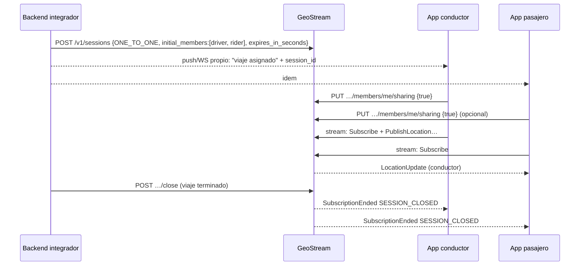

# 15 — Guía de integración para sistemas terceros

**ID:** GS-INT-001 · **Versión:** 0.2.0 · **Requisitos:** FR-INT-001..004, NFR-DX-001

Esta guía es normativa en los **flujos** y en las **reglas para integradores**; los fragmentos de código son ILUSTRATIVOS y sus versiones ejecutables viven en `examples/` (F8), probadas en CI.

## 1. Qué hace cada parte

| Parte | Responsabilidades |
|---|---|
| **Backend del integrador** | Autenticar a sus usuarios; guardar la API key; emitir tokens de dispositivo (`POST /v1/tokens`); opcionalmente crear sesiones y miembros; recibir webhooks; opcionalmente consumir el stream con `locations:read` |
| **App del integrador** | Integrar el SDK; implementar `CredentialProvider` contra su backend; obtener consentimiento del usuario antes de `sharing.start`; pedir permisos de ubicación con buena UX; mostrar el estado de compartición |
| **GeoStream** | Autorizar, distribuir, revocar, notificar; no guardar historial por defecto |

## 2. Integración paso a paso

1. **Credenciales**: el operador ejecuta `geostream admin tenant create`, `app create` y `key create` (`16` §3). Guarda la key en el gestor de secretos del backend.
2. **Endpoint de tokens en tu backend** (§6.1): recibe el `installation_id` desde tu app autenticada, llama `POST /v1/tokens` con el `external_subject_id` de tu usuario y devuelve `{access_token, expires_at}`.
3. **`CredentialProvider` en la app**: llama a ese endpoint con la sesión de tu usuario.
4. **Sesiones**: créalas desde tu backend (recomendado para flujos de negocio: viajes, pedidos) o desde la app (flujos sociales: familia, eventos).
5. **Compartir y mostrar**: `sharing.start` / `sessions.watch` en la app.
6. **Webhooks** (opcional): registra un endpoint y verifica firmas (§6.2).
7. **Stream del lado servidor** (opcional): para despacho o monitoreo, con una key que tenga `stream:connect` y `locations:read` (§5).

## 3. Patrones de integración

### 3.1 Ride-hailing (UC-01)



Reglas: usar `Idempotency-Key` derivada del ID del viaje; cerrar siempre la sesión al terminar (no depender solo de la expiración); `expires_in_seconds` = duración máxima razonable del viaje.

### 3.2 Delivery con seguimiento para el cliente (UC-02)
- Sesión `ONE_TO_MANY` creada por el backend con el repartidor como miembro con `publish` (+ `read` si debe ver al cliente, normalmente no).
- El cliente puede ser:
  - usuario de la app del integrador → alta directa con capacidades `{read}`;
  - visitante web sin cuenta → el backend crea un subject invitado (`external_subject_id = "guest:<id aleatorio del pedido>"`), lo agrega con `{read}` y le emite un token `platform=WEB` con scopes mínimos (`stream:connect`). Nunca exponer el `session_id` como único secreto de un enlace público: el enlace debe llevar a una página del integrador que obtenga el token.
- El backend puede leer la ubicación con `locations:read` (snapshot) para calcular ETA con su proveedor de rutas.
- Geocerca de destino (F11) para notificar "llegó" por webhook.

### 3.3 Familia o equipo (UC-03)
- Sesión `MANY_TO_MANY` creada desde la app (dispositivo con `sessions:create`), con expiración larga dentro de la política del tenant (`max_session_ttl_seconds`), extendida periódicamente con `PATCH`.
- Invitaciones por código (`max_uses` = tamaño del grupo, expiración corta).
- Cada persona decide si comparte; la UI debe mostrar claramente quién está compartiendo y permitir dejar de compartir en un toque.
- Recomendado: teselas propias por privacidad (`13` §7).

### 3.4 Flota (UC-04)
- Sesión **propiedad de la aplicación** (`owner_external_subject_id` ausente) `MANY_TO_MANY` o `ONE_TO_MANY` con `max_members` alto (dentro de `max_members_cap`).
- Conductores con capacidades `{publish}` (sin `read`: no se ven entre sí).
- El backend consume por stream con un principal de aplicación (§5).
- Si la flota supera `max_members_cap`, particionar en varias sesiones (por zona o turno).

### 3.5 Evento temporal (UC-05)
Sesión con expiración de horas, invitación multiuso, `snapshot_ttl_seconds` corto. La expiración automática limpia todo.

### 3.6 IoT / gateways (UC-08, F8)
- Cada equipo es un subject (o un subject por vehículo) con dispositivo `platform=OTHER`.
- Token con scope `ingest:write`; publica por `POST /v1/ingest/locations` en lotes ≤ `max_samples_per_publish_http`, respetando `min_publish_interval_ms`.
- Debe activar `sharing=true` con su propio token antes de publicar (es su consentimiento técnico; el integrador es responsable de la base legal).

## 4. Manejo de errores recomendado
- Respetar `Retry-After` y `retry_after_ms`.
- Reintentar solo errores marcados como reintentables en `09` §6, con backoff exponencial y jitter.
- Usar `Idempotency-Key` en todo `POST` que el backend pueda repetir.
- Tratar `404` como "no existe o no tienes relación": nunca deducir existencia.
- Ante `401` en llamadas de dispositivo: pedir token nuevo al backend una vez; si vuelve a fallar, cerrar sesión de usuario en la app.

## 5. Consumidor de stream del lado servidor
- Key con `stream:connect` + `locations:read`.
- `POST /v1/stream/tickets` con la API key → conectar → `ClientHello` (`platform = PLATFORM_SERVER`) → `Subscribe` a las sesiones de interés.
- Reconectar antes de `auth_expires_at` (`GS_STREAM_APP_MAX_CONNECTION_AGE_S`) abriendo una conexión nueva **antes** de cerrar la anterior (las conexiones de aplicación no se desplazan entre sí).
- Las suscripciones de aplicación quedan auditadas (`locations.read_by_application`).
- Ejemplo ejecutable en `examples/stream-consumer/` (F8): cliente WebSocket + código generado desde `contracts/proto`.

## 6. Ejemplos (ILUSTRATIVOS)

### 6.1 Endpoint de tokens (Node.js / Express)

```ts
// ILUSTRATIVO — versión ejecutable en examples/token-backend-node (F8)
app.post("/geostream/token", requireUserSession, async (req, res) => {
  const { installation_id, platform } = req.body;          // del SDK
  const r = await fetch(`${GS_BASE_URL}/v1/tokens`, {
    method: "POST",
    headers: {
      "Authorization": `Bearer ${process.env.GS_API_KEY}`,  // nunca en la app
      "Content-Type": "application/json",
    },
    body: JSON.stringify({
      external_subject_id: req.user.opaqueId,               // ID opaco, nunca email
      installation_id,
      platform,
      ttl_seconds: 900,
    }),
  });
  if (!r.ok) return res.status(502).json({ error: "token_unavailable" });
  const t = await r.json();
  res.json({ access_token: t.access_token, expires_at: t.expires_at });
});
```

### 6.2 Verificación de webhooks (Node.js)

```ts
// ILUSTRATIVO — versión ejecutable en examples/webhook-receiver-node (F8)
import { createHmac, timingSafeEqual } from "node:crypto";

function verify(rawBody: Buffer, headers: Record<string, string>, secret: string): boolean {
  const id = headers["gs-webhook-id"];
  const ts = headers["gs-webhook-timestamp"];
  const sigHeader = headers["gs-webhook-signature"] ?? "";
  if (!id || !ts || Math.abs(Date.now() / 1000 - Number(ts)) > 300) return false;
  const expected = createHmac("sha256", Buffer.from(secret, "utf8"))
    .update(`${id}.${ts}.`).update(rawBody).digest("hex");
  return sigHeader.split(" ").some((part) => {
    const [v, sig] = part.split("=");
    return v === "v1" && sig?.length === expected.length &&
      timingSafeEqual(Buffer.from(sig), Buffer.from(expected));
  });
}
```

El receptor DEBE deduplicar por `GS-Webhook-Id` y responder 2xx rápido (procesar en segundo plano).

## 6.1 Integración de la pista E

Los cuatro patrones que cambian con la pista E, con su requisito previo.

### 6.1.1 Flota con ETA y asignación (E4 + E5)
1. El backend crea un `POOL` con `pools:manage`.
2. Cada dispositivo entra solo, activa `sharing` y marca `availability = BUSY` al aceptar un encargo.
3. El backend llama a `GET /v1/pools/{id}/nearby?rank=eta` con origen y destino, y a `POST /v1/tools/assignments` para repartir las tareas.
4. El cliente recibe las herramientas por el mismo stream (`SessionView`), no por una llamada extra.

### 6.1.2 Historial y analítica (E6)
1. El tenant activa `history_allowed` y la DPIA (tarea T-E6-11) está cerrada.
2. El backend crea sesiones con `history_mode = TRACE_AND_ANALYTICS`.
3. **El usuario concede el consentimiento** por separado para `HISTORY` y para `ANALYTICS`, desde su dispositivo. El backend no puede concederlo (INV-SHR-5).
4. Se consulta con `history:read` / `analytics:read`, que son scopes distintos y se conceden uno a uno.

### 6.1.3 BYOK de proveedor (E5)
1. `PUT /v1/providers/route_matrix` con la credencial **del tenant** y `terms.checked_on`.
2. Se revisa `GET /v1/analytics/provider-usage` para controlar coste y volumen.
3. Si el contrato con el proveedor no es aceptable, se usa el grafo vial propio (`GS_GRAPH_PATHS`) y **ninguna coordenada sale de la infraestructura del tenant**.

### 6.1.4 Tags BLE (E8)
1. El usuario escanea el tag (la `EIK` se queda en el tag).
2. Se registra con `tags:manage`: modelo, nombre, nada más.
3. Buscadores autorizados envían reportes cifrados; el servidor los almacena sin poder leerlos.
4. El dueño consulta sus sightings con `edge:lookup` y los descifra en su cliente.

## 7. Checklist de producción del integrador
- [ ] La API key solo existe en el backend (gestor de secretos), con los scopes mínimos.
- [ ] `external_subject_id` opaco (sin emails ni teléfonos).
- [ ] TTL de tokens ≤ 15 min salvo justificación.
- [ ] Consentimiento explícito antes de `sharing.start`, con texto que explique quién verá la ubicación y durante cuánto tiempo.
- [ ] Botón visible para dejar de compartir.
- [ ] Declaraciones de ubicación en segundo plano en Google Play / App Store si aplica.
- [ ] Política de privacidad actualizada (incluye proveedor de mapas, `13` §7).
- [ ] Webhooks verificados y deduplicados.
- [ ] Sesiones cerradas explícitamente al terminar el flujo de negocio.
- [ ] Manejo de `Superseded` en la app (otra instancia del mismo dispositivo).
- [ ] **Si usa historial:** DPIA cerrada, textos de consentimiento **por propósito** aprobados, retención declarada y endpoint de borrado funcionando.
- [ ] **Si usa `POOL`:** la app de conductor nunca recibe `nearby`/`rings`; solo `density` sin identificadores, y el conductor no puede ver a los demás.
- [ ] **Si usa BYOK:** términos del proveedor revisados y aceptados; coste monitorizado en `provider-usage`.
- [ ] **Si usa tags:** el texto de privacidad informa del despliegue de la red de búsqueda y ofrece desactivación.

## 8. Antipatrones
- Incluir la API key en la app o en el frontend web.
- Usar el `session_id` como credencial de un enlace público.
- Consultar el snapshot REST en bucle en lugar de usar el stream.
- Tokens de larga duración "para no molestar".
- Activar `sharing` automáticamente al unirse sin acción del usuario.
- Mezclar geocodificación de Google con mapas MapLibre.
- Guardar por su cuenta el historial de ubicaciones recibidas sin base legal ni política de retención.

## 9. Antipatrones de la pista E

Los cinco anteriores siguen siendo antipatrones. Estos se añaden:

- **Conceder `HISTORY` o `ANALYTICS` desde el backend.** Es imposible por diseño (INV-SHR-5) y, si se intenta, falla. El consentimiento es del sujeto, no del tenant.
- **Gravar una celda H3, una ETA o un perfil como etiqueta de Prometheus.** Enruta el comportamiento de un usuario concreto a un sistema de métricas al que muchos tienen acceso. Los agregados se guardan en PostgreSQL (`13` §8.3).
- **Degradar en silencio a la estimación propia cuando el proveedor falla.** Devuelve `503 PROVIDER_UNAVAILABLE`: un integrador que eligió proveedor por cobertura necesita distinguir "no hay ruta" de "no supe".
- **Enviar la predicción visual como si fuera una medición.** Se rechaza con `INVALID_LOCATION`. La predicción es para dibujar; el dato persistente es la medición.
- **Tratar `density` como `nearby`.** `density` está deliberadamente empobrecido (sin identificadores, con desplazamiento y retraso). Pedir `nearby` para un pasajero es pedir una surveillance de la ubicación de los conductores; por eso exige `pools:query`, que es de aplicación.
