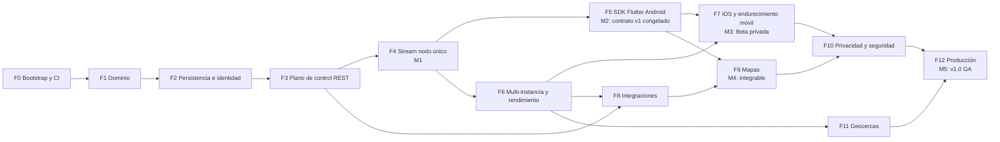

# 21 — Hoja de ruta de implementación

**ID:** GS-RMP-001 · **Versión:** 0.2.0
De repositorio vacío a **GeoStream v1.0 GA** (F0–F12) y pistas posteriores (F13–F16).

## 1. Reglas
- El roadmap define **secuencia**, no comportamiento: el comportamiento está en los documentos citados.
- Cada tarea `T-Fx-NN` es una unidad de PR. Columnas: requisitos que cubre, documentos que hay que leer, dependencias.
- Una fase se cierra cuando se cumplen **todos** sus criterios de salida y queda registrado en `PROGRESS.md` con evidencia (enlaces a CI, informes).
- Estimaciones orientativas para un desarrollador con agentes de código; no son compromisos.
- "Adelantable" = puede empezar antes de cerrar la fase anterior si sus dependencias están cerradas.

## 2. Mapa de fases e hitos

| Hito | Al cerrar | Significado | Release |
|---|---|---|---|
| M0 | F0 | Repositorio con CI y contratos verificados | — |
| M1 | F4 | Backend funcional en nodo único con todos los escenarios | `server-v0.1.0-alpha.1` |
| M2 | F5 | Dos teléfonos Android comparten; **contrato v1 congelado** | `sdk-flutter-v0.1.0-alpha.1` |
| M3 | F7 | Beta privada: Android + iOS, multi-nodo, benchmarks | `server-v0.5.0-beta.1`, `sdk-flutter-v0.5.0-beta.1` |
| M4 | F9 | Integrable: webhooks, consumidores de servidor, ingesta, mapas | `-rc.1` |
| M5 | F12 | **v1.0 GA** | `server-v1.0.0`, `sdk-flutter-v1.0.0` |

Estimación total F0–F12: 32–45 semanas.

---

## F0 — Bootstrap del repositorio y CI (1 semana) → M0

**Objetivo:** estructura, toolchain, CI y verificación de contratos antes de escribir lógica.

| ID | Tarea y entregable | Requisitos | Leer | Depende |
|---|---|---|---|---|
| T-F0-01 | Workspace Cargo con la estructura de `04` §4 (crates vacíos con `#![forbid(unsafe_code)]`), `rust-toolchain.toml` (stable vigente), edición 2024; revisar `.editorconfig` y `.gitignore` existentes | FR-OPS-001 | 04 §4, 19 §3 | — |
| T-F0-02 | Fijar dependencias aprobadas en `Cargo.lock`; `deny.toml` con licencias de `19` §6.1; `cargo deny` y `cargo audit` en CI | NFR-SEC-006 | 19 §6 | T-F0-01 |
| T-F0-03 | Binario `geostream` con `version` (versión + commit), `serve` (listener mínimo con `/health/live`), `migrate` y `admin` como stubs que devuelven "no implementado" | FR-OPS-001 | 04 §5 | T-F0-01 |
| T-F0-04 | `gs-protocol`: `build.rs` con `prost-build` + `pbjson-build` + `protoc-bin-vendored`; prueba de ida y vuelta JSON → binario → JSON con todos los mensajes de `contracts/test-vectors/stream_messages.json` | — | 08, contracts/README §2 | T-F0-01 |
| T-F0-05 | CI etapas 1, 2, 3 y 5 (`18` §10.1): formato, lint, `buf lint`, Redocly lint, JSON válido, checks de consistencia documental en `tools/` (catálogo de errores, claves de configuración, IDs de requisitos, matriz `06` §8.2 vs `x-gs-auth`, enlaces, reglas de crates) | NFR-DOC-001, NFR-SEC-006 | 18 §10, 00 | T-F0-02 |
| T-F0-06 | Proceso de release y changelog (plantilla de release, verificación de `CHANGELOG.md` en PR) | NFR-MAINT-001 | 19 §8 | T-F0-05 |
| T-F0-07 | `deploy/docker-compose.dev.yml` (PostgreSQL + Valkey) y `deploy/.env.example` | — | 16 §10, 17 | T-F0-01 |
| T-F0-08 | Verificar disponibilidad de nombres (crates.io, pub.dev) y registrar en `PROGRESS.md`; recordar ADR-0019 (licencia) pendiente | — | ADR-0019 | — |

**Criterios de salida:** CI verde en `main` con todas las etapas aplicables; `geostream version` funciona; `gs-protocol` compila los contratos; los checks de consistencia pasan sobre la documentación actual.

---

## F1 — Núcleo de dominio (1–2 semanas)

**Objetivo:** reglas de negocio puras y probadas, sin I/O.

| ID | Tarea y entregable | Requisitos | Leer | Depende |
|---|---|---|---|---|
| T-F1-01 | IDs tipados con prefijo y codec; vectores `ids.json` | FR-API-006 (base) | 05 §2 | F0 |
| T-F1-02 | Tipos de ubicación redactados y `validate_sample` puro; vectores `location_samples.json` (`cases`) | FR-LOC-001, FR-LOC-002, FR-LOC-004, FR-LOC-006 | 09 §3, 05 §9 | T-F1-01 |
| T-F1-03 | Modelo de ordenación de secuencias (`batches` de los vectores, sobre un almacén simulado) | FR-LOC-003 | 09 §4 | T-F1-02 |
| T-F1-04 | Sesión, membresía, capacidades, compartición, invitación: estados, transiciones e invariantes `INV-*` | FR-SES-006, FR-SES-007, FR-MEM-003, FR-MEM-007, FR-SHR-001, FR-SHR-002, FR-SHR-004 | 05 | T-F1-01 |
| T-F1-05 | Generación y normalización de códigos de invitación; vectores `invitation_codes.json` | FR-INV-001 (base) | 05 §6 | T-F1-01 |
| T-F1-06 | `gs-config`: carga y validación de configuración y restricciones por entorno; política de tenant con defaults y validación cruzada | FR-OPS-003, FR-ADM-002 | 17 | F0 |
| T-F1-07 | Errores de dominio y mapeo único a `ErrorCode` | FR-API-001 (base) | 09 §6 | T-F1-04 |
| T-F1-08 | Pruebas de propiedades (secuencias, capacidades) y cobertura ≥ 85 % de `gs-domain` | NFR-MAINT-002 | 18 §3 | T-F1-03, T-F1-04 |

**Criterios de salida:** vectores de dominio verdes; invariantes con pruebas nombradas; `gs-domain` sin dependencias de I/O; cobertura cumplida.

---

## F2 — Persistencia, identidad y base operativa (2–3 semanas)

| ID | Tarea y entregable | Requisitos | Leer | Depende |
|---|---|---|---|---|
| T-F2-01 | `migrations/0001_init.sql` exacto a `11` §2; `geostream migrate`; pruebas de restricciones; verificación de versión al arrancar | FR-OPS-004 | 11 | F1 |
| T-F2-02 | `gs-store`: repositorios de tenants, aplicaciones, keys, subjects, dispositivos y auditoría con filtro por tenant | FR-AUTH-001 (persistencia) | 11, 05 §3 | T-F2-01 |
| T-F2-03 | CLI `geostream admin` (tenant, app, key, policy, signing-key) | FR-ADM-001, FR-ADM-002 | 16 §3, 06 §3–§4 | T-F2-02 |
| T-F2-04 | `gs-auth`: API keys (formato, hash, tiempo constante), JWT EdDSA (emisión, verificación en el orden de `06` §4.3, rotación), scopes; vector `token_claims.json` | FR-AUTH-001, FR-AUTH-003, FR-AUTH-004, FR-AUTH-008 | 06 | T-F2-02 |
| T-F2-05 | `gs-ephemeral` y `gs-bus`: traits e implementación en memoria; suite parametrizada preparada para Redis/Valkey | — | 04 §6, 11 §3 | F1 |
| T-F2-06 | `gs-observability`: tipos redactados, métricas base, logs JSON, verificador de captura de logs | FR-PRV-004 (base), NFR-OBS-001, NFR-OBS-002, NFR-SEC-003 | 10 §8, 16 §4 | F1 |
| T-F2-07 | `gs-api` esqueleto: router, `X-Request-Id`, Problem Details, extracción de principal, límites de cuerpo, logs de acceso redactados, `/health/*`, `/metrics` en admin | FR-OPS-002, FR-API-001 (base) | 07 §1–§5, 16 §4 | T-F2-04, T-F2-06 |
| T-F2-08 | `POST /v1/tokens` con upsert de subject/dispositivo e INV-DEV-2 | FR-AUTH-002 | 06 §4, OpenAPI `mintToken` | T-F2-07 |
| T-F2-09 | Configuración de TLS de referencia documentada en `deploy/` (proxy) | NFR-SEC-001 | 16 §2.3 | T-F0-07 |

**Criterios de salida:** tokens emitidos y verificados con todos los casos negativos de `06` §4.3; migraciones idempotentes; salud y métricas operativas; verificador de logs activo.

---

## F3 — Plano de control REST (3–4 semanas)

| ID | Tarea y entregable | Requisitos | Leer | Depende |
|---|---|---|---|---|
| T-F3-01 | Idempotencia con almacenamiento cifrado de respuestas (AES-256-GCM) | FR-API-002 | 07 §6, 10 §5.6 | F2 |
| T-F3-02 | Paginación por cursor | FR-API-003 | 07 §7 | F2 |
| T-F3-03 | Sesiones: crear (dispositivo/aplicación, propietario, miembros iniciales), listar, obtener, actualizar con `If-Match`, cerrar; job de expiración + verificación perezosa | FR-SES-001, FR-SES-002, FR-SES-003, FR-SES-004, FR-SES-005, FR-SES-006 | 05 §4, 07 §9.2, 11 §2.1, §5 | T-F3-01, T-F3-02 |
| T-F3-04 | Miembros: alta, listado, consulta (`me`), cambio de capacidades/rol, revocación, salida, transferencia de propiedad, readmisión, límite de miembros con bloqueo | FR-MEM-001, FR-MEM-002, FR-MEM-003, FR-MEM-004, FR-MEM-005, FR-MEM-006, FR-MEM-007, FR-SES-007 | 05 §5, 07 §9.3 | T-F3-03 |
| T-F3-05 | Compartición: `PUT …/sharing` con efectos (borrado de snapshot, `mver++`, evento de control) | FR-SHR-001, FR-SHR-002, FR-SHR-003, FR-SHR-004 | 05 §7, 04 §7.4 | T-F3-04 |
| T-F3-06 | Invitaciones: crear, listar, revocar, canjear con concurrencia y rate limit | FR-INV-001, FR-INV-002, FR-INV-003 | 05 §6, 07 §9.4 | T-F3-04 |
| T-F3-07 | Subjects y dispositivos: búsqueda, consulta, revocación de tokens, desactivación de dispositivo | FR-AUTH-005 | 06 §7, 07 §9.5 | T-F3-03 |
| T-F3-08 | Deshabilitar/habilitar tenant y aplicación por CLI con invalidación de cachés | FR-ADM-003 | 06 §7 | T-F3-07 |
| T-F3-09 | Auditoría de acciones sensibles | FR-PRV-005, FR-SHR-005 | 10 §8.3 | T-F3-04 |
| T-F3-10 | Rate limits REST e invitaciones | FR-API-004 | 07 §8 | F2 |
| T-F3-11 | Conformidad OpenAPI, matriz de autorización REST completa, aislamiento de tenants | FR-API-001, FR-API-005, FR-API-006, NFR-SEC-004 | 18 §5, 06 §8 | T-F3-03..T-F3-08 |

**Criterios de salida:** todas las operaciones con `x-gs-phase` ≤ F3 implementadas y conformes; matriz de autorización 100 % verde; requisitos de F3 trazados.

---

## F4 — Stream en nodo único (3–4 semanas) → M1

| ID | Tarea y entregable | Requisitos | Leer | Depende |
|---|---|---|---|---|
| T-F4-01 | Tickets: `POST /v1/stream/tickets` y canje atómico en el upgrade | FR-AUTH-006 | 06 §5, 08 §3 | F3 |
| T-F4-02 | Conexión: upgrade, subprotocolos, hello, máquina de estados, heartbeat, inactividad, límites de trama y mensajes, códigos de cierre | FR-STR-001, FR-STR-005 | 08 §2–§6.5, §8 | T-F4-01 |
| T-F4-03 | `AuthzCache` con `mver`, invalidación por bus, revalidación por TTL, revalidación del principal | NFR-SEC-002 | 04 §6.2, ADR-0009 | T-F4-02 |
| T-F4-04 | Suscripción sin huecos, snapshot y `MemberStatus` con minimización | FR-STR-002, FR-PRS-001, FR-PRS-004 | 08 §6.3, 05 §8 | T-F4-03 |
| T-F4-05 | Publicación: precondiciones, validación, CAS de secuencia, `sequence_floor`, snapshot, rate limit, acks; vectores por stream | FR-LOC-001..FR-LOC-008, FR-STR-004 | 08 §6.4, §7, 09 §3–§4, ADR-0008 | T-F4-03 |
| T-F4-06 | Fan-out por bus (ruta única), coalescencia y backpressure | FR-STR-003, FR-STR-006 | 04 §8, 08 §10 | T-F4-05 |
| T-F4-07 | Eventos de control y revocación en vivo (`SubscriptionEnded`, cierres 4401/4403) | FR-STR-008, FR-STR-011, FR-AUTH-005 | 08 §9, 05 §10 | T-F4-04 |
| T-F4-08 | Presencia, gracia de desconexión y conexión única | FR-PRS-002, FR-STR-007 | 04 §6.3, 08 §6.7 | T-F4-04 |
| T-F4-09 | `AuthExpiring` / `AuthRefresh` | FR-AUTH-007 | 08 §6.6 | T-F4-02 |
| T-F4-10 | `GET /v1/sessions/{id}/snapshot` | FR-INT-002 | 07 §9.6 | T-F4-05 |
| T-F4-11 | `gs-testkit`: cliente de prueba y runner de escenarios (DSL completo); SCN-001..010 verdes con ambos subprotocolos (SCN-009 nocturno) | FR-PRV-001 | 18 §6, contracts/README §5 | T-F4-04..T-F4-09 |
| T-F4-12 | `gs-devclient`: conectar, suscribir y publicar trayectorias sintéticas | — | 04 §4 | T-F4-05 |
| T-F4-13 | Pruebas de privacidad: captura de logs sobre escenarios, inspección de PG y almacén efímero, borrado inmediato de snapshot | FR-PRV-004, NFR-PRIV-001, NFR-PRIV-002, NFR-SEC-003 | 10 §8, 18 §7 | T-F4-11 |

**Criterios de salida (M1):** SCN-001..010 verdes; plazo de revocación medido y dentro de NFR-SEC-002; demo con `gs-devclient` (dos publicadores y un lector); release `server-v0.1.0-alpha.1`.

---

## F5 — SDK Flutter núcleo, Android (4–6 semanas) → M2

Adelantable: T-F5-01..T-F5-05 pueden empezar cuando T-F4-02 esté cerrada.

| ID | Tarea y entregable | Requisitos | Leer | Depende |
|---|---|---|---|---|
| T-F5-01 | Estructura `sdks/flutter/geostream` + `example`; verificar nombres en pub.dev; fijar versiones mínimas tras revisar dependencias; matriz de compatibilidad | NFR-COMPAT-001 | 12 §2, §17 | F4 |
| T-F5-02 | Generación Dart de los `.proto` y check de sincronía en CI | — | contracts/README §2 | T-F5-01 |
| T-F5-03 | Modelos públicos, jerarquía de excepciones y mapeo exhaustivo de `ErrorCode` | FR-SDK-001, FR-SDK-009 | 12 §4–§6 | T-F5-02 |
| T-F5-04 | `RestClient` y `CredentialManager` | FR-SDK-002 | 12 §8, 06 §2 | T-F5-03 |
| T-F5-05 | `SequenceAllocator` y `KeyValueStore` | FR-SDK-005 | 12 §9 | T-F5-03 |
| T-F5-06 | `StreamConnection`: estados, reconexión, tabla de cierres, `AuthRefresh`, `ClockSync` | FR-SDK-004, FR-SDK-006 | 12 §8, §10, 08 §8 | T-F5-04 |
| T-F5-07 | `LocationSource` (geolocator), permisos, conversión de plataforma, `SampleValidator` con vectores | FR-SDK-003, FR-SDK-007 | 12 §7, §11 | T-F5-03 |
| T-F5-08 | `PublishPipeline`: perfiles, intervalo mínimo, fix de mantenimiento, `latestOnly`, detenciones pendientes | FR-SDK-007, FR-SDK-008 | 12 §11, §13 | T-F5-06, T-F5-07 |
| T-F5-09 | `SessionView` y `sessions.watch` | FR-SDK-012 | 12 §14 | T-F5-06 |
| T-F5-10 | Android en segundo plano (foreground service) | FR-SDK-010 | 12 §12.1 | T-F5-08 |
| T-F5-11 | App de ejemplo (backend de tokens mínimo, crear/unirse, compartir, lista de miembros) | FR-SDK-013 | 12 §4 | T-F5-09 |
| T-F5-12 | Pruebas con *fakes*, integración contra servidor real, checklist de dispositivos Android | FR-SDK-015, FR-SDK-016 | 12 §16, 18 §9 | T-F5-11 |
| T-F5-13 | **Congelar contrato v1**: OpenAPI `info.version: 1.0.0`, activar `buf breaking` y `oasdiff` obligatorios | NFR-COMPAT-002 | 08 §11, 07 §11 | T-F5-12 |

**Criterios de salida (M2):** dos teléfonos Android comparten en tiempo real con la app de ejemplo contra un servidor desplegado; checklist de dispositivos Android completo; contrato v1 congelado; `sdk-flutter-v0.1.0-alpha.1`.

---

## F6 — Multi-instancia, rendimiento y despliegue (3–4 semanas)

Adelantable: puede empezar al cerrar F4, en paralelo con F5 (crates distintos).

| ID | Tarea y entregable | Requisitos | Leer | Depende |
|---|---|---|---|---|
| T-F6-01 | `gs-ephemeral` y `gs-bus` sobre Redis/Valkey (scripts Lua, Pub/Sub con refcount); suite parametrizada verde | FR-STR-009, FR-PRS-003 | 11 §3, 04 §6, ADR-0010 | F4 |
| T-F6-02 | Desplazamiento de conexión y presencia entre instancias | FR-STR-007 | 04 §6.3 | T-F6-01 |
| T-F6-03 | Degradación y recuperación ante caída del almacén efímero | NFR-RES-002 | 04 §7.6 | T-F6-01 |
| T-F6-04 | Drenaje en SIGTERM | FR-STR-010, NFR-RES-003 | 08 §6.8 | T-F6-01 |
| T-F6-05 | Dockerfile, compose de referencia, Caddyfile | FR-OPS-005, NFR-COST-001 | 16 §10 | T-F6-01 |
| T-F6-06 | Escenarios multi-nodo en CI | FR-STR-009 | 18 §6 | T-F6-02 |
| T-F6-07 | `gs-loadgen` con perfiles P-S, P-M, P-L, P-FLEET, P-STORM | — | 18 §8 | T-F6-01 |
| T-F6-08 | Benchmarks y optimización hasta cumplir NFR de rendimiento y escala (o ADR con desviación medida y plan) | NFR-PERF-001, NFR-PERF-002, NFR-PERF-003, NFR-PERF-004, NFR-SCALE-001, NFR-SCALE-002 | 03 §3, 18 §8 | T-F6-07 |
| T-F6-09 | Pruebas de caos nocturnas | NFR-RES-002 | 18 §2 | T-F6-03 |
| T-F6-10 | Catálogo completo de métricas y alertas de ejemplo | NFR-OBS-001 | 16 §4–§5 | T-F6-01 |

**Criterios de salida:** benchmarks publicados en `docs/benchmarks/` con resultados medidos; escenarios multi-nodo y caos verdes.

---

## F7 — iOS y endurecimiento móvil (3–4 semanas) → M3

| ID | Tarea y entregable | Requisitos | Leer | Depende |
|---|---|---|---|---|
| T-F7-01 | iOS: permisos, actualizaciones en segundo plano, `Info.plist` del ejemplo | FR-SDK-011 | 12 §12.2 | F5 |
| T-F7-02 | Build iOS en CI (runner macOS) y app de ejemplo iOS | FR-SDK-013 | 18 §10 | T-F7-01 |
| T-F7-03 | Matriz completa de dispositivos y medición de batería | NFR-MOB-001, NFR-MOB-002 | 18 §9 | T-F7-02 |
| T-F7-04 | Endurecimiento: pausa/reanudación por permisos, auto-stop, desconexión en segundo plano, UX de `Superseded`, detenciones pendientes tras reinicio | FR-SDK-003, FR-SDK-008 | 12 §7, §8, §13 | T-F7-01 |
| T-F7-05 | Guía de plataforma para integradores (declaraciones de tiendas, batería de fabricantes) | FR-INT-004 (parcial) | 12 §12, 15 | T-F7-03 |

**Criterios de salida (M3):** Android e iOS probados en dispositivos reales con informe; servidor multi-nodo desplegado; versiones beta publicadas.

---

## F8 — Integraciones (3–4 semanas)

Adelantable: T-F8-01 puede empezar al cerrar F3.

| ID | Tarea y entregable | Requisitos | Leer | Depende |
|---|---|---|---|---|
| T-F8-01 | Webhooks: CRUD, outbox transaccional, worker de entrega, firma, SSRF, deshabilitación | FR-WHK-001, FR-WHK-002, FR-WHK-003, FR-WHK-004, FR-WHK-005 | 07 §10, 10 §5.3, ADR-0015 | F3 |
| T-F8-02 | Consumidor del lado servidor: tickets de aplicación, suscripción con `locations:read`, auditoría, vida máxima de conexión | FR-INT-001 | 15 §5, 06 §5 | F6 |
| T-F8-03 | Ingesta HTTP por lotes | FR-LOC-009 | 07 §9.8 | F4 |
| T-F8-04 | CORS por aplicación | FR-INT-003 | 07 §12 | F3 |
| T-F8-05 | Flutter Web (sin segundo plano) | FR-SDK-014 | 12 | F5 |
| T-F8-06 | `examples/`: backend de tokens, receptor de webhooks y consumidor de stream, ejecutados en CI; escenarios SCN-011 (webhooks) y SCN-012 (flota con consumidor) | FR-INT-004 | 15 | T-F8-01, T-F8-02 |
| T-F8-07 | Quickstart verificado en < 30 min | NFR-DX-001 | 15 §2 | T-F8-06 |

**Criterios de salida:** webhooks y consumidores verificados por escenarios; ejemplos en CI; quickstart validado.

---

## F9 — Mapas (2–3 semanas) → M4

| ID | Tarea y entregable | Requisitos | Leer | Depende |
|---|---|---|---|---|
| T-F9-01 | `geostream_maps`: interfaces y `ProviderStack` con reglas de compatibilidad | FR-MAP-001, FR-MAP-002 | 13 §3–§4 | F5 |
| T-F9-02 | Adaptador MapLibre con atribución | FR-MAP-003 | 13 §5.1 | T-F9-01 |
| T-F9-03 | Interpolación visual etiquetada | FR-MAP-005 | 13 §6 | T-F9-02 |
| T-F9-04 | Adaptador Google Maps | FR-MAP-004 | 13 §5.2 | T-F9-01 |
| T-F9-05 | Revalidar términos, cuotas, costos y atribución; actualizar `13` §4 con fecha | FR-MAP-006 | 13 §2 | T-F9-02 |
| T-F9-06 | App de ejemplo con mapa; prueba con adaptador que falla | NFR-RES-001 | 13 §1 | T-F9-02 |

**Criterios de salida (M4):** un integrador puede construir un producto completo (sesiones, compartición, mapa, webhooks, backend consumidor) siguiendo la documentación; release candidate.

---

## F10 — Privacidad completa y seguridad (2–3 semanas)

| ID | Tarea y entregable | Requisitos | Leer | Depende |
|---|---|---|---|---|
| T-F10-01 | Borrado y exportación de subject | FR-PRV-002 | 10 §7, 07 §9.5 | F8 |
| T-F10-02 | Jobs de retención | FR-PRV-003 | 10 §7.1, 11 §5 | F8 |
| T-F10-03 | Fuzzing en CI nocturno | NFR-SEC-005 | 18 §7 | F4 |
| T-F10-04 | Revisión del modelo de amenazas, checklist de liberación completa, prueba de penetración interna (externa si hay presupuesto) | NFR-SEC-004 | 10 §4, §11 | T-F10-01 |
| T-F10-05 | Rotación de `GS_DATA_ENCRYPTION_KEY` con re-cifrado | — | 10 §5.6, 16 §8 | F8 |
| T-F10-06 | Pruebas ampliadas de SSRF y de todos los límites de abuso | FR-WHK-004 | 10 §5.3–§5.4 | F8 |

**Criterios de salida:** checklist de seguridad verde; fuzzing 7 noches sin fallos; borrado verificado en todas las tablas.

---

## F11 — Geocercas (2–3 semanas)

Adelantable: puede empezar al cerrar F6.

| ID | Tarea y entregable | Requisitos | Leer | Depende |
|---|---|---|---|---|
| T-F11-01 | Migración `0003_geofences.sql`, CRUD y validación de geometría | FR-GEO-001 | 14 §2–§3, 11 §2 | F6 |
| T-F11-02 | Motor de evaluación con histéresis y estado efímero | FR-GEO-002 | 14 §4 | T-F11-01 |
| T-F11-03 | Índice R-tree por tenant con invalidación por bus | FR-GEO-004 | 14 §6 | T-F11-02 |
| T-F11-04 | `GeofenceEvent` por stream y webhooks | FR-GEO-003 | 14 §5 | T-F11-02, T-F8-01 |
| T-F11-05 | Trayectorias sintéticas con ruido; escenario SCN-013 | FR-GEO-002 | 14 §7 | T-F11-04 |
| T-F11-06 | Benchmark con `max_geofences_per_tenant` | NFR-PERF-001 | 18 §8 | T-F11-03 |

**Criterios de salida:** transiciones exactas en trazas ruidosas; NFR-PERF-001 mantenido con el máximo de geocercas.

---

## F12 — Preparación de producción (3–4 semanas) → M5 v1.0 GA

| ID | Tarea y entregable | Requisitos | Leer | Depende |
|---|---|---|---|---|
| T-F12-01 | Runbooks completos y ensayo de rotaciones (JWT, API keys, cifrado) | FR-OPS-006 | 16 §8 | F10 |
| T-F12-02 | Backups y ejercicio de restauración documentado | FR-OPS-006 | 16 §9 | F10 |
| T-F12-03 | Tablero de SLO y alertas; ≥ 30 días de medición en beta | NFR-AVAIL-001 | 16 §5 | F7 |
| T-F12-04 | Benchmarks finales P-M y P-L con la versión candidata | NFR-PERF-001..004 | 18 §8 | F11 |
| T-F12-05 | Documentación pública (sitio a partir de `docs/` y OpenAPI renderizado), guía de migración, matriz de compatibilidad final | NFR-DOC-001, NFR-COMPAT-001 | 00, 15 | F9 |
| T-F12-06 | Auditoría de trazabilidad: todo requisito MUST ≤ F12 con pruebas verdes | — | TRACEABILITY | F11 |
| T-F12-07 | Publicación: `server-v1.0.0`, contratos 1.0.0, `sdk-flutter-v1.0.0`, imagen de contenedor con SBOM, changelog | NFR-MAINT-001 | 19 §8 | T-F12-06 |

**Criterios de salida (M5):** los de `01` §9.

---

## Pistas posteriores a GA

Cada pista requiere, antes de empezar: un caso de uso real de al menos un integrador, un ADR aprobado y, cuando aplique, una revisión legal o de seguridad.

| Fase | Pista | Requisitos | Criterio de entrada específico |
|---|---|---|---|
| F13 | Historial opt-in, cola offline acumulada cifrada, consulta de historial, calidad de trayectoria y map-matching (Valhalla) | FR-HIS-001, FR-HIS-002, FR-HIS-003, FR-HIS-004 | ADR de base legal, retención y costo; tabla particionada por día |
| F14 | Puente MQTT para IoT | FR-IOT-001 | ADR de broker y autenticación de dispositivos |
| F15 | SDKs nativos Kotlin/Swift (reevaluar núcleo Rust compartido), geocercas en dispositivo, API de administración, tokens firmados por el integrador, aprobación de solicitudes de unión | FR-NAT-001, FR-AUTH-009, FR-ADM-004, FR-INV-004 | Demanda medida; ADR por cada elemento |
| F16 | Modo E2EE y transporte P2P WebRTC | FR-E2E-001, FR-P2P-001 | Revisión criptográfica externa; aceptación explícita de perder snapshots en claro y geocercas del servidor |
