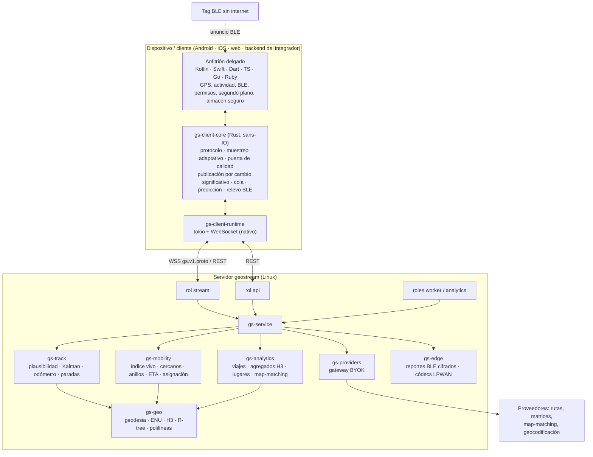

# GeoStream — Addendum A-02: Motor de ubicación y movilidad

**ID propuesto:** GS-ENG-A02 · **Estado:** Propuesta aprobada por el propietario para adopción (decisiones en §3) · **Fecha:** 2026-10-15
**Base verificada:** commit `c7b8f65` (`feat(testkit): runner de escenarios y suite e2e SCN-001..010 (T-F4-11)`), paquete documental v0.2.0
**Relación con otras propuestas:** adopta y concreta `GeoStream_Addendum_A01_Integracion_Proveedores_Externos.md` (puertos con manifiesto y Provider Gateway) y las brechas G-15, G-20, G-21 y G-22 de `GeoStream_Brechas_y_Plan_de_Completitud.md`.

> **Este documento no es normativo por sí solo.** Se adopta convirtiéndolo en documentos, contratos, requisitos, tareas y ADR mediante la fase **E0** (§18). Hasta entonces, `docs/` y `contracts/` siguen mandando.

---

## 0. Instrucciones para el agente de código

1. Antes de nada, lee `AGENTS.md`, `docs/00_INDEX.md`, `docs/20_AGENT_PROTOCOL.md`, `docs/PROGRESS.md` y este documento completo.
2. Las decisiones **D-01..D-12** de §3 son **decisiones del propietario** fechadas el 2026-10-15. Autorizan a crear los ADR y a cambiar los documentos y contratos listados en §17 sin abrir solicitudes de decisión **para esos puntos concretos**. Cualquier cosa no cubierta aquí, o cualquier contradicción nueva que aparezca al adoptar, sigue la condición de parada de `20` §6.
3. **Orden obligatorio.** Primero la fase E0 (solo documentación, contratos y ADR; sin código de producción). Después, las tareas E en el orden y con las dependencias de §18. No mezcles adopción documental e implementación en el mismo PR. Solo puede haber un PR abierto que toque `contracts/` a la vez (`20` §11).
4. Los valores numéricos de este documento son **valores iniciales**. En E0 se trasladan a `17_CONFIGURATION.md`. Desde ese momento viven solo allí (`00` §1, corolario 4) y el resto de documentos los citan por nombre.
5. **Dependencias nuevas** (§13.3, §17.3): cada una necesita su ADR. Además, antes de usarlas hay que verificar API, licencia, versión y mantenimiento en el registro (`19` §6.1, `20` §9). Si una no existe o no cumple, se para.
6. **Ninguna cifra de rendimiento, precisión o batería se afirma sin medirla** (principio P-6). Los objetivos de §16 son objetivos a medir, no promesas.
7. **Prerrequisitos que decide el propietario, no el agente:**
   - DR-20261013-01 (montar `/v1` y `/v1/stream` en `geostream serve`) y DR-20261012-04 (`gs-observability` en el binario) deben estar resueltas **antes de E2**. Las pruebas de extremo a extremo del motor de trayectoria necesitan el binario sirviendo.
   - ADR-0019 (licencia) bloquea publicar los SDK de E9, no la implementación.
8. Las tareas pendientes de F4 (T-F4-12, T-F4-13) se cierran normalmente. La pista E no las sustituye.

---

## 1. Resumen ejecutivo

GeoStream deja de ser solo la capa de transporte y autorización de ubicación. Pasa a ser **el motor de ubicación y movilidad** sobre el que se construyen apps de reparto, ride-hailing tipo Uber/InDrive, flotas, rastreo de activos y localización de dispositivos sin internet.

El motor vive en **dos lugares que se hablan entre sí**, y en ambos es el mismo código Rust:

- **En el servidor (Linux):** acepta y distribuye, estima trayectorias, indexa en vivo lo que se mueve, responde consultas de movilidad, guarda historial y calcula analítica.
- **En el dispositivo (Android, iOS y, por bindings, cualquier lenguaje):** decide cuándo y cómo medir para ahorrar batería, limpia la señal antes de enviarla, predice visualmente entre muestras, guarda en cola sin conexión y hace de relevo para tags BLE sin internet.

Capacidades nuevas, agrupadas:

| Grupo | Capacidades |
|---|---|
| Calidad de señal | Puerta de plausibilidad, filtro de Kalman, anti-deriva en reposo, odómetro en vivo, detección de paradas |
| Eficiencia en el dispositivo | Muestreo adaptativo por actividad, publicación por cambio significativo, despertar por región del sistema operativo, política de muestreo configurable desde el servidor |
| Movilidad | Pools de disponibilidad, búsqueda de cercanos, anillos de expansión para ofertas, densidad aproximada para la app del cliente, ETA, asignación por lotes, geocercas de permanencia y de proximidad dinámica |
| Historial y analítica | Trazas, viajes, mapas de calor, perfiles de movilidad, lugares aprendidos, perfiles de velocidad |
| Mapas | Teselas, rutas, matrices, geocodificación y map-matching mediante proveedores conectados; capa de mapa aprendida con datos propios; grafo vial propio opcional |
| Edge | Red BLE propia cifrada de extremo a extremo para tags sin internet; ingesta desde LPWAN y rastreadores celulares |
| Plataformas | Núcleo Rust con bindings para Kotlin, Swift, Dart, TypeScript (web y Node), Go y Ruby |

**Lo que GeoStream sigue sin ser:** una plataforma de negocio. Pedidos, tarifas, pagos, reglas de despacho, incentivos y sanciones antifraude pertenecen al integrador. GeoStream le da las herramientas y los datos para decidir.

**Tesis técnica:**
- Algoritmos *en streaming* con estado acotado por entidad.
- El mismo código en servidor y dispositivo, verificado con los mismos vectores dorados.
- Lo pesado (historial, analítica, map-matching completo) siempre fuera del camino caliente.

---

## 2. Punto de partida verificado

Estado del repositorio en `c7b8f65` (2026-10-15):

- **Fases:** F0–F3 completas. En F4 están completas T-F4-01..11 y pendientes T-F4-12 y T-F4-13. Hay 451 pruebas en verde.
- **`crates/gs-geo` existe pero está vacío** (`lib.rs` de 2 líneas). `geo` (0.33.1) y `rstar` (0.13.0) ya están aprobados y declarados en el workspace. No hay ningún cálculo geográfico en el código, ni siquiera haversine.
- **`crates/gs-worker` está vacío.**
- **El contrato ya anticipa datos derivados:**
  - `LocationKind` define `FILTERED`, `INTERPOLATED`, `PREDICTED` y `MAP_MATCHED`.
  - `DeliveryKind.REPLAY` está reservado.
  - `GeofenceEvent` ya está definido (F11).
- **Números de campo libres en Protobuf:**
  - `ServerMessage.body` ≥ 28 (27 = `geofence_event`, 30 = `error`).
  - `ClientMessage.body` ≥ 16.
  - `LocationUpdate` ≥ 6, `SessionInfo` ≥ 8, `MemberStatus` ≥ 9, `ServerHello` ≥ 11, `ClientHello` ≥ 8.
  - `SessionMode` ≥ 4.
- **Congelación del contrato:** el contrato v1 se congela en **T-F5-13 (M2)**. Los cambios de §14 deben entrar antes. Después solo se admiten cambios compatibles (`buf breaking`, `oasdiff`).
- **SDK Flutter (F5):** no iniciado. Es el momento ideal para sustituir ADR-0012 sin tirar código.
- **Bloqueos abiertos:** DR-20261012-02, -03, -04 y DR-20261013-01. ADR-0019 (licencia) sigue sin decidir.
- **Restricciones vigentes que este addendum cambia:**
  - `01` §5: NG-4, NG-5 y NG-6.
  - ADR-0005, ADR-0012, ADR-0014 y ADR-0016.
  - FR-MAP-005 (prohibición de extrapolar).
  - `13` §8 (el servidor no usa proveedores).
  - Amenazas T-07, T-13 y T-22 de `10` §4.
- **Escenarios:** SCN-001..013 ya tienen ID asignado. Los nuevos empiezan en **SCN-014**.
- **Scopes existentes** (formato `recurso:acción`): `sessions:*`, `members:write`, `invitations:*`, `sharing:write`, `stream:connect`, `locations:read`, `ingest:write`, `geofences:manage`, `webhooks:manage`, `subjects:manage` y `tokens:mint`.

---

## 3. Decisiones del propietario (2026-10-15)

| ID | Tema | Decisión del propietario (resumen fiel) | Interpretación técnica adoptada | Documentos afectados |
|---|---|---|---|---|
| **D-01** | Alcance | GeoStream es la tecnología núcleo para apps tipo Uber y de movilidad. Vive en el servidor y también en la app que instala el usuario final; ambas partes interactúan. | Motor con dos mitades (servidor y dispositivo) que comparten núcleo. No es plataforma de negocio (ver D-10). | `01`, `04`, `12`, ADR-0021, ADR-0022 |
| **D-02** | Universalidad | Debe adaptarse a cualquier app de ubicación. Lo único externo que necesita es un proveedor de mapas (Google Maps u otros), al que se delega esa parte. | Todo lo relativo a ubicación vive en el motor. Teselas, rutas, matrices, geocodificación y map-matching se conectan por puertos con manifiesto (A-01), también en el servidor. | `01`, `13`, ADR-0013 → ADR-0028 |
| **D-03** | Dispositivos sin internet | GeoStream debe llegar incluso a dispositivos tipo AirTag que no requieren conexión. | Fase E8: red BLE propia cifrada E2E (relevo por teléfonos con el SDK), más ingesta desde LPWAN y rastreadores. | `01`, `10`, doc nuevo `25`, ADR-0029 |
| **D-04** | Dónde filtrar | Como sea más óptimo y alineado con GeoStream. | Dispositivo: puerta de calidad, muestreo adaptativo y filtro local solo para la UI. Servidor: estimación canónica, sin modificar nunca la muestra medida. | `22` (nuevo), ADR-0023 |
| **D-05** | Rust en el móvil | Rust donde sea conveniente. Optimizado para servidores Linux, Android y Apple; iOS hay que validarlo. | Núcleo Rust compartido sans-IO con bindings; sustituye ADR-0012. iOS se valida en el spike T-E3-01. | `12`, `26` (nuevo), ADR-0022, ADR-0031 |
| **D-06** | Predicción visual | Como sea más conveniente; puede agradar al usuario final. | Se permite en el cliente, etiquetada `PREDICTED`, acotada en tiempo y nunca publicada ni guardada. Enmienda FR-MAP-005. | `13` §6, ADR-0030 |
| **D-07** | Historial | Sí: guardar historial, trazas y mapas de calor, y usar esos datos para evaluar el comportamiento de movilidad. GeoStream es el medio para capturar esa data. | Historial y analítica son capacidad central, opt-in por política del tenant y por consentimiento con propósito. Sustituye ADR-0005 y ADR-0014. F13 entra en la pista E. | `01`, `10`, `11`, `24` (nuevo), ADR-0024, ADR-0025 |
| **D-08** | Red vial | Delegar en el proveedor, sin perder la capacidad de optimizar los mapas que el sistema usa con frecuencia. | Map-matching y rutas por proveedor. Además, una capa de mapa aprendida con datos propios y un grafo OSM propio opcional por región. | `13`, `23`, `24`, ADR-0032 |
| **D-09** | Pool de disponibles | A criterio del arquitecto, siguiendo la práctica de plataformas como Uber o InDrive. | Pools como modo de sesión, índice H3 vivo, ranking por ETA, anillos de expansión y asignación por lotes como herramienta. | `05`, `23` (nuevo), ADR-0027 |
| **D-10** | Antifraude | Fuera de alcance: GeoStream no busca ser plataforma de movilidad, sino un motor robusto con muchas herramientas. | No hay puntuación de fraude, listas ni sanciones. Sí se calculan señales de plausibilidad de bajo nivel, porque el filtro las necesita; viajan como metadato y el integrador decide. **Enmendada 2026-10-31 (DR-20261031-02):** el tenant puede activar el rechazo de `is_mock` y de muestras solo de red. | `10` T-07, `22` |
| **D-11** | Dependencias y lenguajes | Lo más óptimo. Motor 100 % Rust con adaptadores o SDK para Go, TypeScript, Dart, Swift, Ruby y Node. | Bindings por lenguaje sobre un único núcleo; Kotlin se incluye por Android. Cada dependencia, con su ADR. | `19` §6, `26`, ADR-0031 |
| **D-12** | Metas | Sin cifras. GeoStream no puede encasillarse: es el motor y la capa de abstracción para apps que necesitan tiempo real y precisión, una dependencia confiable con todas las herramientas necesarias. | Objetivos iniciales a medir (§16); diseño por escalones de escala; todo opcional por política. | `03` NFR, `18` |

---

## 4. Principios del motor

Complementan los principios P-1..P-7 de `01` §8; no los sustituyen.

- **P-E1 · Un núcleo, muchos anfitriones.** Protocolo, algoritmos y validación se escriben una vez en Rust. Cada lenguaje es una capa delgada que aporta lo que solo la plataforma sabe hacer: GPS, BLE, permisos y segundo plano.
- **P-E2 · Estado acotado.** Todo algoritmo del camino caliente es *online*: estado O(1) por entidad y cero asignaciones de memoria por muestra.
- **P-E3 · La medición es sagrada.** El servidor nunca modifica ni descarta una muestra `MEASURED` aceptada (FR-LOC-006 se mantiene). Lo derivado viaja aparte y etiquetado con su `LocationKind`.
- **P-E4 · El camino caliente no espera.** Nada nuevo bloquea la aceptación ni el fan-out. El cómputo inline solo se permite si cumple un presupuesto medido (§16). El resto va por canales acotados con descarte medido, como en `14` §6.
- **P-E5 · Puertos para todo lo externo.** Proveedores, índices, almacenamiento, transporte y plataforma son traits con más de una implementación.
- **P-E6 · Determinismo verificable.** Los mismos vectores dorados de `contracts/test-vectors/` se ejecutan en Rust y en cada binding, con tolerancias explícitas.
- **P-E7 · Opcional por diseño.** Cada capacidad se activa por política del tenant o por *feature*. La instalación mínima sigue siendo «un binario + PostgreSQL» (espíritu de NG-6).
- **P-E8 · Ubicación ≠ mapa.** Se mantiene P-3: el proveedor dibuja y rutea; el motor sabe dónde está cada cosa y qué significa.
- **P-E9 · Privacidad también con historial.** Propósito explícito, consentimiento del subject, retención acotada, k-anonimato en agregados y E2E para tags.
- **P-E10 · Linux primero en servidor, batería primero en dispositivo.**

---

## 5. Arquitectura objetivo

### 5.1 Las dos mitades del motor

### 5.2 Crates nuevos y ampliados

| Crate | Tipo | Depende de (internos) | Contenido | Restricciones |
|---|---|---|---|---|
| `gs-geo` (se amplía) | Librería pura | `gs-domain` | Geodesia, marcos ENU, geometría, simplificación, códecs de polilínea, índices R-tree y H3 (feature `h3`) | Sin `tokio`/`sqlx`/I/O. Los módulos de cálculo compilan en `no_std + alloc` (feature `std` por defecto) |
| `gs-track` | Librería pura | `gs-domain`, `gs-geo` | Motor de trayectoria por entidad (§7) | Sin I/O. Cero asignaciones por muestra |
| `gs-mobility` | Librería pura | `gs-domain`, `gs-geo` | Trait `LiveIndex` e implementación en memoria; ranking; anillos; estimador de ETA; Hungarian; flujo de coste mínimo; A*/CH sobre grafo propio | Sin I/O |
| `gs-analytics` | Librería pura | `gs-domain`, `gs-geo`, `gs-track` | Segmentación de viajes, paradas offline, DBSCAN, agregados H3, perfiles de velocidad, map-matching HMM | Sin I/O. Se ejecuta en lotes |
| `gs-providers` | Librería con I/O de red | `gs-domain` | Puertos y adaptadores del Provider Gateway (A-01 §5) | Solo red saliente. Lo invoca `gs-service` |
| `gs-edge` | Librería pura `no_std` | — | EID rotatorio, tramas BLE, cifrado de reportes, códecs LPWAN y de rastreadores | `no_std` obligatorio, porque lo usa el firmware |
| `gs-client-core` | Librería pura sans-IO | `gs-domain`, `gs-protocol`, `gs-geo`, `gs-track`, `gs-edge` | Máquina de estados de cliente, pipeline de publicación, vista de sesión y predicción (§8) | Sin `tokio`. Sin I/O. Compila a `wasm32` |
| `gs-client-runtime` | Librería | `gs-client-core` | Transporte nativo (WebSocket, HTTP, temporizadores) | No se compila para `wasm32` |
| `gs-ffi` y `bindings/*` | `cdylib`/`staticlib` | `gs-client-runtime` | Superficie FFI única y generación de bindings (§13) | Única excepción a `#![forbid(unsafe_code)]`, documentada en ADR-0031 |

---

## 6..20 y Anexos A–B

El detalle técnico normativo de las secciones 6 a 20 y los Anexos A–B se materializa en los documentos `docs/22_TRACKING_ENGINE.md` a `docs/26_CORE_AND_BINDINGS.md`, en las enmiendas de `docs/00` a `docs/21`, en `docs/adr/ADR-0021..0032` y en `contracts/` mediante la Fase E0.
